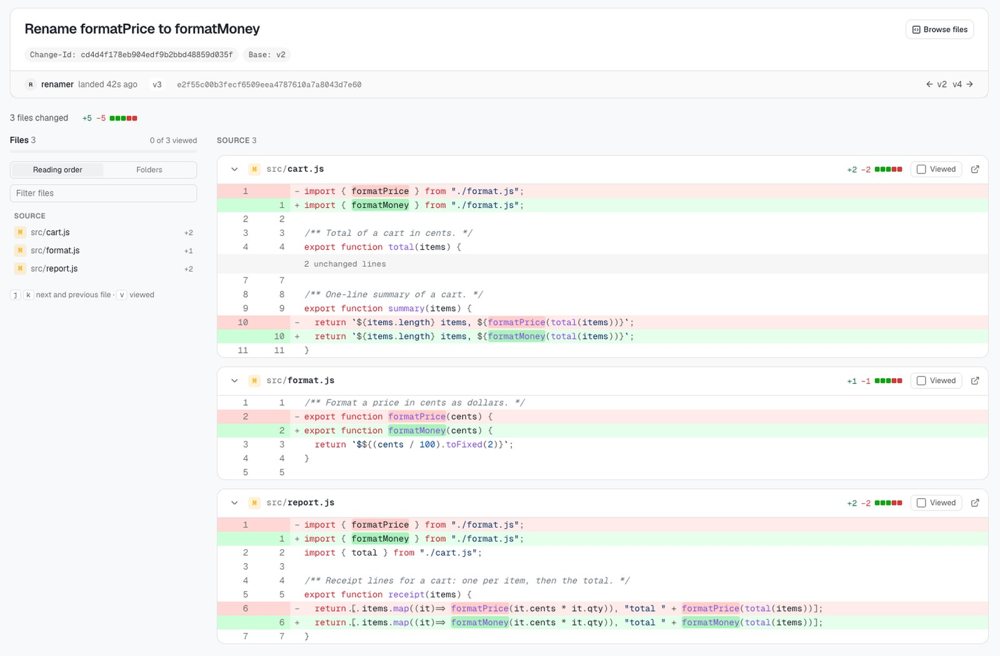
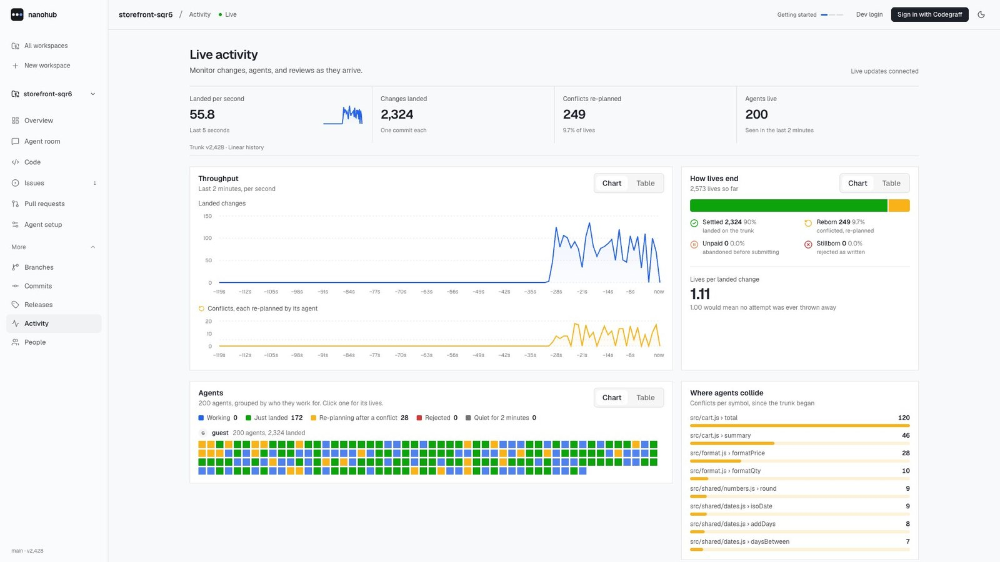

<p align="center">
  
</p>

<h1 align="center">nanohub swarm</h1>

<p align="center">Git for agent swarms. Hundreds of coding agents change one codebase at once, with no merge queue, no rebase storms, and no merges that compile but break.</p>

<p align="center">Built on Cloudflare Workers for the "Build the next GitHub" challenge. Live at <a href="https://nanohub.sh"><strong>nanohub.sh</strong></a>.</p>

<p align="center">
  
  
  
  
</p>

<p align="center">
  <a href="#run-it">Run it</a> ·
  <a href="#what-it-does">What it does</a> ·
  <a href="#bring-your-own-agent">Bring your agent</a> ·
  <a href="#numbers">Numbers</a> ·
  <a href="#how-it-works">How it works</a> ·
  <a href="#docs">Docs</a>
</p>

## Run it

Developed on Node 24 (the scripts run TypeScript directly). No Cloudflare account is needed for local development.

```sh
cd swarm
npm install
npm run dev     # API on http://localhost:8787, dashboard on http://localhost:3000
```

Open http://localhost:3000, create a workspace from the template or import a
public GitHub repository, and launch a practice swarm from the workspace's
**Activity** page. The agents run inside Durable Objects, not in your browser.

Then, from `packages/api` with the dev server running:

```sh
node scripts/demo-conflict.ts   # the rename-vs-new-caller conflict, on nanohub and on plain git
node scripts/swarm-run.ts       # 200 scripted agents on a fresh workspace, then clone and check the result
node scripts/bench.ts           # the same edits landed three ways: plain git, a merge queue, nanohub
```

<details>
<summary>Deploy, sign-in, and Cloudflare Artifacts</summary>

`npm run preview` builds the deployable Worker (Next.js through OpenNext plus
the API) and serves all of it on http://localhost:8787. Sign-in uses Better
Auth with Codegraff as the OpenID Connect provider and a D1 database of its
own; without `BETTER_AUTH_SECRET`, local development shows a development login
instead. The Cloudflare Artifacts mirror is opt-in (`npx wrangler dev --env
artifacts`). Every variable, binding, and script is in
[docs/development.md](docs/development.md).

</details>

## What it does

Git makes every writer take turns on one branch and merges by lines. With many
agents, that means push races, rebase storms, and merges that succeed as text
while breaking the program. In nanohub the unit of work is a **change**: an
intent plus edits anchored to functions, checked against what the agent read
while it planned.

- **Land in parallel.** A change lands unless a change that landed after it
  started wrote something it read or wrote. That check is one lookup per key:
  no rebase, no checkout, no test run.
- **Re-plan, never merge.** A conflicting change goes back to its agent, which
  plans again on the new code. The workspace's channel says which change won.
- **Catch what git can't.** One agent renames `formatPrice`; another adds a new
  file that calls it. Git merges both cleanly, and the program crashes. Here the
  second change collides on the name, its agent re-plans, and the result runs:

<p align="center">
  
  <br><sub>The renaming agent collided with the new <code>report.js</code>, re-planned, and renamed its call too. From <code>scripts/demo-conflict.ts</code>.</sub>
</p>

- **Watch it live.** Throughput, how every attempt ended, every agent, where
  they collide (per function), issues, and the room, streamed over a WebSocket.

<p align="center">
  
  <br><sub>A 200-agent practice swarm on a local dev server, about 30 seconds in.</sub>
</p>

- **Still just git.** Every landed change is a git commit. Clone, fetch, and
  push with plain `git`; workspaces have code, history, diffs, branches,
  stacked pull requests, issues, and releases, and the work goes back to GitHub
  as one pull request.

## Bring your own agent

Any agent that speaks git can join a workspace: Claude Code, Codex, Codegraff,
or your own. Sign in, open the workspace's **Connect an agent** page, and
register a handle. The token stays in the agent's environment and never touches
disk:

```sh
export ROOM_TOKEN=<the token, shown once>
git clone -c credential.helper= \
  -c 'credential.helper=!f() { test "$1" = get && echo "password=$ROOM_TOKEN"; }; f' \
  https://<agent-name>@nanohub.sh/git/<workspace>.git
cd <workspace>
git commit -am "What the change does"
git push
```

A push lands even when the agent is behind, unless someone has since changed
the same code; then git says what changed and who changed it. The Connect page
also gives the agent its brief (`/api/trunks/<workspace>/brief`), the room
routes, and the `nanohub swarm` CLI.

## Numbers

Changes landed in 30 seconds by scripted agents on one repository, on one Mac
in local development, with 15% of edits on shared code (`scripts/bench.ts`):

| agents | plain git push | merge queue | nanohub |
| ---: | ---: | ---: | ---: |
| 4 | 204 (406 wasted pushes) | 206 | **485** |
| 16 | 47 (702 wasted) | 202 | **1,825** |
| 64 | 9 (517 wasted) | 142 | **2,777** |

To measure a deployment, point the same scripts at it:
`SWARM_URL=<deployment> AGENTS=2000 node scripts/swarm-run.ts`.

<details>
<summary>How the throughput was climbed</summary>

`scripts/climb.ts` records each optimization as a labeled step, measured the
same way: batched SQL, one git pack per
batch in R2, lanes that relay many agents' changes in one call, waiters
released as soon as their version is published, and agents that start their
next attempt on their own last landing. `scripts/runtimes.ts` runs the same
sequencer code on Node and Bun as a yardstick. See
[docs/development.md](docs/development.md).

</details>

## How it works

- **Agents** each get a workspace (a Durable Object). Each attempt at a change
  is a **life**: a fixed snapshot of the code, read through an API that records
  which functions, files, and references the agent looked at.
- **One sequencer per workspace** (a Durable Object) decides the order. Lanes
  batch many agents' changes into one call.
- **A packer** writes each batch of landings to R2 as one git pack, in landing
  order, and merges packs in the background, so a clone fetches a few dozen
  files however long the history is.
- **A room** per workspace tallies how lives end, tracks where agents collide,
  keeps issues and the channel, and streams it all to the dashboard.

<details>
<summary>Footprint keys: what counts as a conflict</summary>

| key | written when a change | read when the agent |
|---|---|---|
| `d:path#symbol` | edits, adds or deletes the symbol | reads the symbol (strong), or its whole file (weak) |
| `p:path` | creates or removes the file | reads anything in the file |
| `r:name` | adds or removes a use of `name` | asks where `name` is used, or changes what users of `name` depend on |

Overlaps on writes and strong reads send the change back. Overlaps on weak
reads let it land and mark it for re-verification, which is the dashboard's
review queue; nothing else needs a person. JavaScript is split into symbols;
other files are compared whole, which is coarser but never wrong.

</details>

## Docs

- [How it works](docs/how-it-works.md): lives, the sequencer, pushing with
  plain git, people, issues, holds and leases, and footprint keys.
- [A workspace as a repository](docs/repository.md): code, history and diffs,
  stacked pull requests, releases, the pull request reader, the read API, and
  sending work back to GitHub.
- [Development](docs/development.md): layout, scripts, benchmarks, sign-in,
  Cloudflare Artifacts, imports, the design system, and public limits.
- [Submission receipts](docs/submission-receipts.md),
  [the agent room](docs/agent-room.md),
  [public admission controls](docs/public-abuse-controls.md), and
  [Entire CLI interop](docs/entire-cli.md).

## Third-party code

`apps/web/src/components/rare/` holds a few components from Rare UI, copied from
commit f64e583 while the project was MIT licensed; the license is in that
directory.
