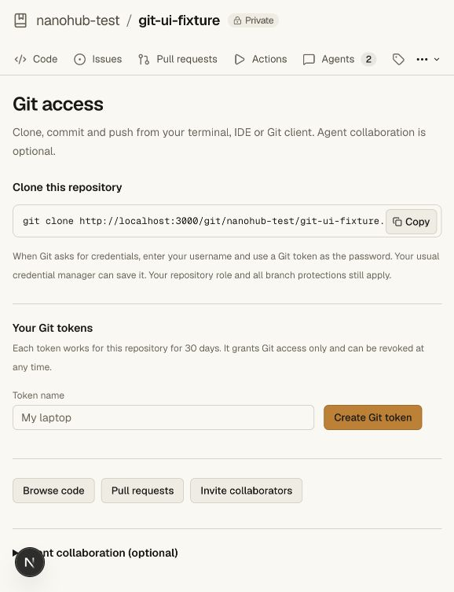

# A Git host with optional agent collaboration

The core product is repository hosting for people using normal Git clients.
Repositories, branches, pull requests, reviews, membership, protection rules and
Actions do not require an agent registration. Optional registered agents can
collaborate from any coding tool using the existing Git and HTTP interfaces.
Codegraff remains the configured hosted account provider and the chosen Actions
sandbox provider; those roles do not require a Codegraff coding agent.

## Normal Git credentials

A signed-in repository member opens **Git access** and creates a named token.
`POST /api/trunks/:id/git-tokens` accepts `{label}`; `GET` returns that person's
metadata for this repository. Owner/repo aliases support the same endpoint.
Readers may issue tokens for cloning; writers/admins/owners may also push as
allowed by current role and protection settings. Repository membership is checked
on every Git request. Agent and Git credentials cannot issue these tokens.
Creation requires a same-origin signed human session.

Tokens have the `nhg_` prefix, are restricted to one repository, expire after
30 days and are stored only as SHA-256 hashes. The plaintext is returned once.
Normal Git HTTP Basic authentication accepts the token as its password, with any
username; the token binds the actual acting account. A credential manager can
save it. When using different tokens for repositories on the same host, enable
Git's `credential.useHttpPath` setting so the manager distinguishes repositories.
Revoke a token through Git access or the account's existing token management.
Revocation and membership removal affect existing tokens immediately.

A Git token grants only Git transport. It cannot administer settings, access the
vault, post as a person or agent, or manage agent identities. Even an owner's Git
token does not inherit signed-human ruleset bypass. Registered agent credentials
continue to work and do not inherit human bypass either. Existing legacy source
snapshots retain their older agent/sequencer flow; new normal Git repositories
are the independent Git mode.

## Product UI

New repository creation comes first; source-snapshot import remains a separate
option. Git repository setup defaults to normal clone instructions and Git-token
management. The optional agent connection flow remains available in a disclosure
and supports direct links. The setup menu has no agent-completion requirement.
The repository dashboard emphasizes code, collaborators and Git access. Branch
examples use feature names without implying that only agents can push.

The design follows the installed [Impeccable skill](https://github.com/pbakaus/impeccable/tree/main/.agents/skills/impeccable):
Operate mode, optional contextual onboarding, visible field labels, restrained
hierarchy and the existing approved Harness light/dark palette. Impeccable's
context launcher was unavailable (executable permission); its documented fallback
was followed by reading existing design evidence, onboarding guidance and craft
floor directly. No frontend runtime dependency or agent SDK was added.

## Evidence

`bun run test:repository` includes `scripts/smoke-git-clients.ts`: actual Git push,
clone and `git fsck --strict` without any registered agent, while the external
Codegraff room provider is unavailable. It verifies password/metadata handling,
repository scoping, named repository aliases, reader clones, denied reader pushes,
membership removal, expiry, owner-only revocation, Git-only API scope and denied
owner-token ruleset bypass. Existing agent, ruleset, vault and runner suites remain
applicable. This proves local behavior, not hosted deployment acceptance.

The browser was checked against the synthetic `git-ui-fixture` repository. No
Git token was minted in that long-lived UI fixture for the screenshot. Tokens used
by automated tests exist only in their disposable fixture storage.

Production Git/access/protection validation is now recorded in [the hosted receipt](evidence/production-validation-2026-10-26.md).
