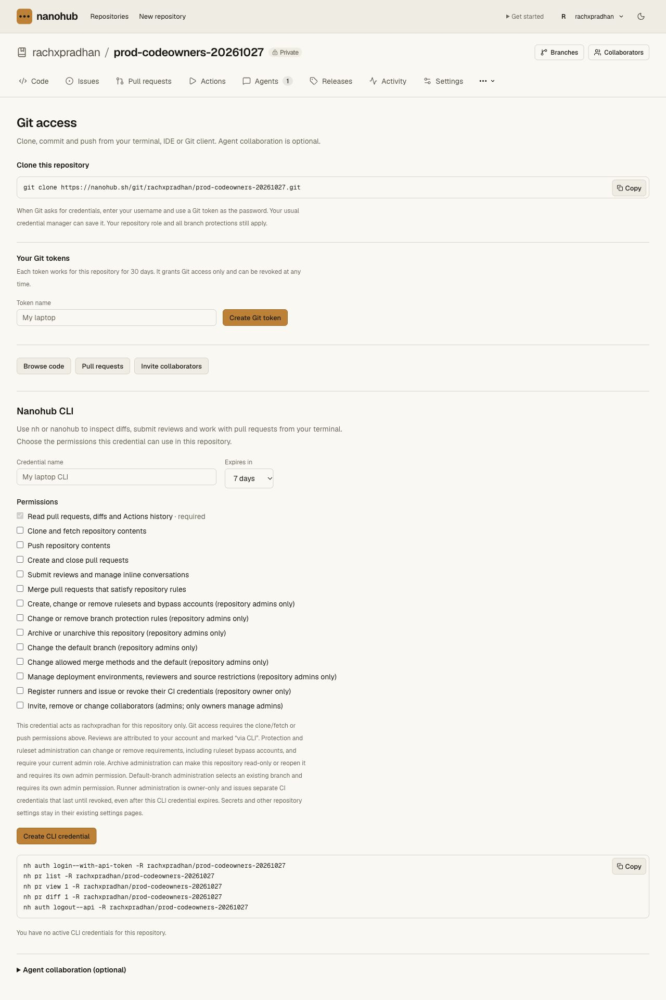

# Collaborator administration, shared capacity and CLI 0.4.16 — 2026-10-29

Worker **`857257c1-18fa-4866-87f8-2e9a9216bf20`** serves 100% of main traffic,
replacing `31d951d3-6a6d-4784-aeaf-34c39995733b`. CLI **0.4.16** is published:
81,369 bytes, SHA-256
`c3f19c95d57ad22e5658c3dc53e837f68bb6af8e24467c9248cb589969f7a9b4`.
The [sanitized receipt](access-capacity-release-receipt.json) pins source,
Linux execution, disposable delivery, staging, promotion and preservation.

The release adds [native collaborator administration](../cli-collaborators.md)
with a separate explicit current-admin permission, private recoverable
invitations, conditional role/removal/cancel operations and final Hub authority
checks. The [shared Actions capacity API](../actions-capacity.md) is also
deployed. Hosted dispatch is not activated; per-job VM isolation is retained.
Account-specific paid tiers, spend budgets and fairness are not added.

## Frozen Linux acceptance

Runtime implementation `610e4c66b9402c91c1b1229e0575c1122ce6ab1b` is frozen in
credential-free acceptance commit `520a91a55548ef9307744ca50398f0931fc908bd`.
All 1,024 copied files match before staging and promotion. The evidence-only
commit `62ea671` records the initially held rollout; release documentation is
updated after promotion and is not a different runtime candidate.

The fresh Codegraff VM passes all eight gates: frozen offline Bun install,
365 API unit cases, the complete real Worker/Git/review/protection/CLI/archive/
cold-recovery chain, 64 CLI cases, access/Vault, hosting/capacity, production Next
build and pinned tsrs/operator checks. Counts overlap. Candidate execution has
no network, control environment or Docker socket. The retained toolchain digest,
commands, source-transfer correction and independently confirmed VM destruction
are in [the exact Linux record](access-capacity-linux-validation.md).
The complete OpenNext build and production-configuration Wrangler dry run pass.

## Disposable routing and full-application delivery

Earlier upload failures and an initial asset 404 remain recorded in the Linux
evidence. No failed probe is treated as a delivery pass. All five earlier owned
Workers have independently confirmed absence. The last failed probe's initial
cleanup was uncertain during connectivity/DNS failures; a later exact provider
observation, deletion and absence read resolve it without repeating creation.

A smaller diagnostic uses the actual web entrypoint and 17 selected built
assets with explicitly synthetic API/Next delegates. It passes normal byte/MIME
checks and all 23 held GET routes plus bodyless HEAD. This is a routing probe,
not full application acceptance. Its first held readiness read still sees the
normal response; the next sees 503. The owned Worker is deleted and an
independent exact-name provider read confirms absence.

A separate full-application probe then uses the actual built OpenNext/API
entrypoint and assets, with only ASSETS and version-metadata bindings. It has
no production state, service bindings or custom domain. Its first manifest GET
returns a Cloudflare-branded HTML “Page not found” response. The next bounded
read returns the exact 0.4.16 JSON manifest. All **17 normal comparisons** then
pass for CLI/installer/checksum, seven checked earlier CLI modules, representative
CSS, JavaScript and fonts. After the hold deployment, all **23 GET routes**
return private/no-store 503 with `Retry-After: 60` and `recovery_hold`; HEAD is
bodyless. The Worker is deleted and a separate pre-staging provider read confirms
absence.

These observations establish delivery convergence for these probes, not a global
propagation bound or the root cause of earlier upload failures. Readiness waits
are bounded, retain observations and do not relax final byte/MIME/hold checks.
Controller creation/promotion is not blindly repeated after an unknown result;
Wrangler can perform its own HTTP retries internally.

## Staging and promotion

Normal version `857257c1-18fa-4866-87f8-2e9a9216bf20` and held version
`2c29f140-66cf-4ba4-9e49-bd0207981e11` are uploaded before changing traffic.
The normal version preserves every one of the 27 binding definitions. The held
version adds only `NANOHUB_RECOVERY_HOLD: "1"`. Both retain Worker-first assets
and the 50,000-subrequest budget. Public version/CLI reads remain on the previous
release during staging.

One controller promotion requests the normal version at 100%, with Durable
Object code update mode `immediate`. Fresh provider deployment records and the
public version endpoint agree. The held version remains inactive and retains
the new access/capacity enforcement for an operator request fence. Request hold
is not an in-flight transaction drain or a complete recovery procedure.

Vault is not redeployed and remains on
**`02dcb88b-5c99-49d9-a4b6-cb95451e6bb5`**. Existing provider secret values,
Meld remotes and original source repositories are not migrated or replaced.

## Live publication, consent and preservation

All **25 public asset comparisons** match built bytes and expected MIME types,
including every built stylesheet, representative JavaScript/fonts, the current
CLI, installer/checksum and seven checked earlier CLI modules. The previous
0.4.15 module retains its independently captured public hash. The public
installer retains its earlier hash and verifies the new module's checksum.
It installs into a temporary path with spaces and an apostrophe; both `nh` and
`nanohub` execute outside the checkout, report 0.4.16 and expose collaborator
commands and prior capabilities. The temporary install is removed; global CLI
installation is unchanged.

Nine fresh authenticated before/after comparisons preserve every field:
branches and their PR/review/CI state, classic protections, rulesets, default
branch, archive, environments, collaborators, secret metadata and runners.
Several browser reads time out. Eight comparisons use ID-addressed endpoints;
the final archive read uses the documented owner/repository address and exactly
matches the ID-addressed baseline. The cause of the ID-page observation failures
is not established. Authentication remains in the browser; no session cookie is
extracted, and no production credential, invitation, ref, review or setting
mutation is requested for this smoke.

CLI discovery adds exactly one scope, `collaborators:write` (13 to 14), with
the credential list still empty. The real production UI displays its optional
checkbox unchecked and enabled. Default read remains required; no new scope is
selected or credential issued. Invitation/role mutations and revocation are
covered by source, bundled and frozen Linux Worker tests; this live check proves
publication, consent discovery and preservation, not a hosted membership edit.

## Remaining launch gates

The configured Nanohub Actions key still lacks sandbox scope. Its read-only
preflight makes one provider GET, no Nanohub requests and no allocations. The
separate trusted CI account proves isolated Linux execution; it does not replace
the Nanohub key or prove hosted dispatch/callbacks. Operator limits must be set
to the intended budget, old controllers drained and provider allocations
reconciled before enabling updated controllers.

Intended-application CI/staging/cutover, complete changing-Git hosted recovery,
load/SLO/security/operations and broader GitHub parity remain open in
[production readiness](../production-readiness.md). This feature release does
not establish unrestricted production-traffic readiness. Source is committed
locally and has not been pushed to GitHub.
