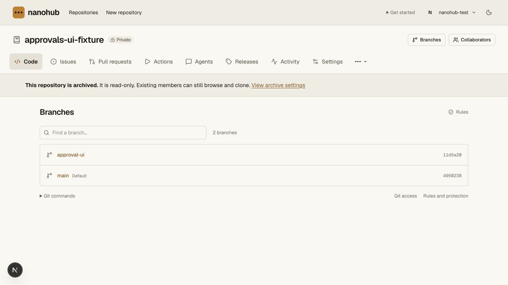
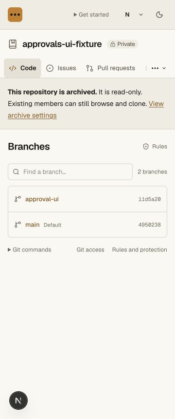
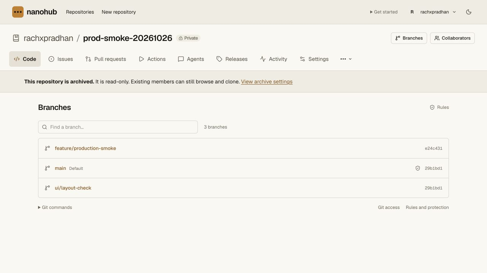

# Repository archive validation — 2026-10-27

Repository-wide archival is distinct from a branch lock. The archive fence
covers all branches/tags, PR/review/suggestion mutations, public and private
comments, issue/channel writes, repository permissions/invitations, releases,
settings and new deployments. Existing authorized readers can still browse,
inspect history/diffs/private drafts and clone. Owners/admins cannot bypass
archival. Current membership and token scope still apply to every read.

This follows [GitHub's read-only archival scope](https://docs.github.com/en/repositories/archiving-a-github-repository/archiving-repositories)
for the corresponding native Nanohub features; it does not implement absent
GitHub features such as forks, stars, wiki or repository projects.

## API and state

`GET /api/trunks/:id/archive` (also through the owner/repo API alias) returns
`archived`, monotonic `revision`, actor/time, an optional in-progress transition,
`readOnly`, `canManage` and the current repository-name confirmation string.
`POST` accepts exactly `{archived:boolean, revision:number, confirmation:string}`.
It requires a same-origin signed-in current owner/admin, the exact current name
and optimistic revision. Agent, Git-only and CI credentials cannot change state.

The Hub stores lifecycle authority and fences metadata/permission writers in
its own synchronous transactions. Room and Sequencer keep monotonic local
mirrors, checked inside their final synchronous writers. Git ref changes,
legacy snapshot landing and review/settings mutations do not rely solely on an
earlier HTTP check. Room also refuses posts on already-open WebSockets and
returns a `repository_archived` error frame.

Archiving first persists a pending Hub fence, then locks Room and Sequencer,
and completes the Hub state after both acknowledge. A lost response leaves a
visible resumable pending operation. New writes remain blocked. The same
request resumes after restart without another revision or duplicate audit.
Late older replica messages cannot overwrite a newer archive epoch. New CI
admission and already-open WebSocket posts also consult the pending Hub fence,
even if the first Room RPC failed before a local mirror was installed. The
smoke test injects that first-Room failure while real queued CI and an open
socket exist. Invalid invitations are validated before the archive check, so
their response does not reveal private archive state.

Unarchiving commits the authorized state at the Hub before activating local
writers. If activation is interrupted, the API explicitly exposes committed
reopening; some paths can remain locked until retry. It never claims the
repository is still archived while a writer has already reopened. A new archive
can supersede an interrupted committed reopening; late activation cannot undo
its newer locks. Branch protections, collaborators and history are preserved.

Pending CI runs become cancelled, their generation advances, and CI/read leases
are removed. An archived queue returns no work. Old callbacks and deployment
authorizations cannot revive after reopening; reruns require an explicit action.
Already completed historical records remain intact. Snapshot changes accepted
before the fence may finish publishing their already committed objects; no new
snapshot change can land after the final writer is locked. Archiving does not undo a
deployment already dispatched to an external service, and external cancellation
may still be needed.

Cloudflare secret values and references remain intact. Workload redemption is
paused through the archive fence, including a recheck after the vault RPC.
Grants retain their expiry and may resume after authorized reopening. No secret
value or vault service deployment is changed. Normal per-repository Git read
tokens and account credential revocation remain available; token creation does
not grant permission to change repository contents. Owner-authorized repository
deletion retains its separate authorization path. External provider membership
revocation still applies; archiving does not control the external organization.

## Verification

- Seven SQLite unit cases exercise pending state, optimistic checks, idempotent
  retries, scope isolation, monotonic replicas, emergency re-archive during
  reopening, final ref/review/settings/deployment guards and CI cancellation.
- Real Worker/Git smoke verifies all native roles, origin/name/revision checks,
  credential scope, final writers through test-only direct RPC routes, an open
  WebSocket, existing private review drafts, invitation acceptance, releases,
  settings, issue/channel writes, native pushes, clone and `git fsck --strict`.
- The same smoke proves legacy snapshot final landing is frozen, remains readable,
  and resumes after explicit unarchive. Existing main lock remains in force.
- Separate fault cases interrupt both archive and unarchive before/after the
  Sequencer commit, restart Workers, and recover without duplicate audit.
- A real Bun CLI process can still authenticate and clone an archived repository;
  native pushes to new branches are refused. OS-helper scope is unchanged.
- All **192 API unit tests**, **151 repository unit tests**, **17 Worker/Git smoke
  scripts** (including six archive checks), **5 CLI tests**, the three tsrs tasks
  and the OpenNext production build pass.

Browser QA at 1280 and 360 CSS pixels verifies typed-name confirmation,
read-only banner, disabled permission/address controls, hidden branch creation,
working branch filtering and source navigation. The disposable local
`approvals-ui-fixture` was archived for this check.

## Production

Final Worker `7ba197aa-201b-4901-aefc-2b5b23e8d6d9` supersedes
`91b8c258-6909-4642-8d30-cd540f7be5b2`. The hosted archive action ran on
intermediate `7be66ef4-8271-45de-b2d0-823ed29b6005`; the final release also
reports archived review/deployment action eligibility accurately, fences CI and
WebSocket admission during pending transitions, and validates private
invitations before exposing archive state. The separate Cloudflare vault is unchanged.
The isolated private `rachxpradhan/prod-smoke-20261026`
(`repo-49463a86f5914dc99fcd6b85f8978aa3`) was archived through the live typed-name
confirmation. All four exact ref records (including their trees/timestamps)
matched before/after; no branch or tag moved. Its three queued runs became
cancelled with zero leases and generation 2. The archived banner, disabled
collaborator/address/secret mutations and absent branch-creation control were
verified. Filtered archive activity persisted one event, #11, revision 1.
No Git/runner credential or member was created for this check. The canary remains
archived as evidence; the active CODEOWNERS canary was not archived. No hosted
unarchive or new credentialed Git push is claimed for this release; the positive
reopen and archived Git push-refusal checks ran locally with real Workers/Git.

The final release was verified through the authenticated repository JSON page:
archive revision 1 remained settled, all four exact ref records still matched,
and deployment-request eligibility was false. Public version health and the
existing install/download routes passed. The private 0600 release receipt
contains before/after refs, cancelled-run metadata and audit event #11.

The final fence/privacy regression run also passes all 192 API unit tests and
the complete 151-test/17-script repository suite. No application sources changed
after that run. Production remains on an archive-aware Worker; rolling back to
a version predating archival would remove its enforcement.
