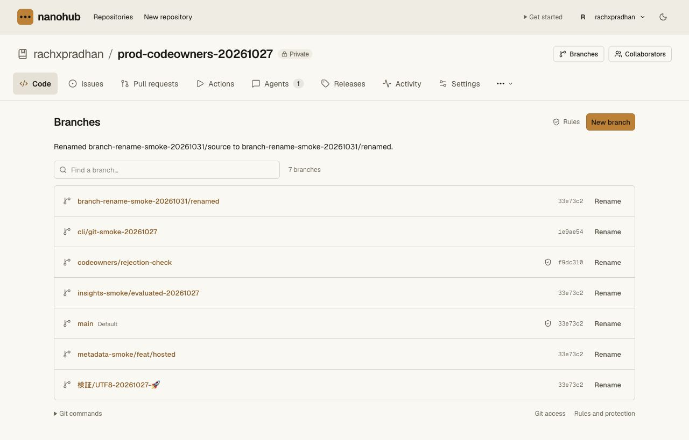
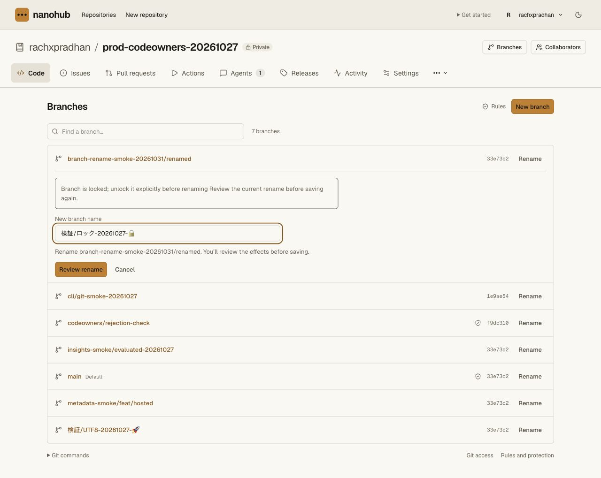

# Protected branch rename — release 0.4.20

Main Worker `16f0ccba-1ecc-421c-a970-b8a62009393e` serves 100% of traffic,
replacing `3f71f23f-a748-4799-b813-b57392714f49`. CLI **0.4.20** is public:
100,963 bytes, SHA-256
`378a7d9ef090fc88146dc6198d3ce15330a27e711506c9da311f8e399065eeb3`.
Vault `0dbd5e74-5c41-428f-bc6a-2e8d3ecaef48` remains unchanged. The
[receipt](branch-rename-release-receipt.json) records the checks and boundaries.

The release adds [branch rename](../branch-rename.md) in the UI and native CLI,
with explicit `branches:write` delegation, current protected/default admin
checks, lock enforcement and revision-checked atomic ref, PR, policy, CI and
alias effects. The documented stricter restrictions remain; this is not complete
GitHub parity or production-traffic acceptance.

## Frozen acceptance and delivery

Implementation `238ccb50c861561a1546a66b741196666663d396` plus validation
correction `37b41c3105b822da0651d6c87632b33dedc50e87` passes all nine frozen
Linux gates, with 436 API cases, 100 CLI cases and three fresh typed workspace
checks. Linux module/checksum/installer bytes match macOS exactly. The VM is
independently confirmed destroyed. The earlier failed and deliberately stopped
runs remain separate in [source acceptance](branch-rename-validation.md).

All 1,134 frozen source files and 1,478 built files match through staging and
promotion. The exact two configured Codegraff keys are absent from those files;
this is not a general secret scan. Incremental redacted Gitleaks scans report
zero findings. Source is published on the feature branch; main remains unchanged.

A disposable Worker with only assets and version metadata passes 48 exact normal
asset checks and 54 held GET checks, private/no-store 503 responses,
`Retry-After: 60` and bodyless HEAD. It has no production resource bindings or
custom domain. Provider deletion is confirmed and independently rechecked before
staging. All 27 normal production bindings, Worker-first routing and the
50,000-subrequest budget are retained. The inactive held version
`9e10182f-db86-447f-ac87-89d8128c8844` adds only the recovery flag.

One promotion uses immediate Durable Object code updates. Provider assignment
and the public version endpoint agree. No Vault deployment occurs. The hold
version remains an operator request fence, not a completed drain/recovery drill.

All 56 public asset comparisons pass, including every built stylesheet, selected
JavaScript/fonts, the current CLI/installer/checksum and all 19 older CLI modules
and checksums. A public installer run uses a temporary path containing spaces and
an apostrophe. Both `nh` and `nanohub` run outside the checkout as 0.4.20; the
temporary installation is removed and the global installation is unchanged.
The observed 0.4.20 module hash is then appended to the immutable release catalog.

## Live production behavior

Before fixture writes, nine authenticated resources match the pre-release
snapshot exactly. Authentication stays in the existing browser session.

In the existing private synthetic repository
`rachxpradhan/prod-codeowners-20261027`, a new
`branch-rename-smoke-20261031/source` branch is created from the current main.
The deployed UI previews and confirms one rename to
`branch-rename-smoke-20261031/renamed`. Its exact commit/tree match main, the
success notice receives focus, and the old browser link becomes the canonical
new URL with the original tree available. One attributed rename audit is present.
The source run is superseded and a distinct destination run is queued.

A second actual rename request targets the existing locked name
`検証/ロック-20261027-🔒`. The final writer rejects it for the owner. The entered
name is retained; the entire rename configuration, including its storage
revision, matches the pre-attempt value. No lock or protection is changed.

All original six refs, PRs, reviews, CI runs, policies, rulesets, default branch
and revision, archive, environments, membership, secrets metadata and runner
registrations are preserved. The deliberately named branch and its two CI
records remain as inspection evidence. No Git object is uploaded or rewritten,
and no Git/CLI credential is created. Secrets and grants remain empty, with no
unused Vault alarm; no saved provider value is read or changed.

The production permission form exposes 20 controls: required read is checked;
all 19 optional permissions, including rename, are enabled and unchecked for the
owner. Anonymous CLI rename GET and POST requests return 401/invalid_token.
Delegated branch-write lifecycle, multiple-user PR effects and protected/default
renames are covered by frozen Worker/Git fixtures, not claimed as new production
mutations in this release.

The deployed branch/tree view also passes a 390px viewport check with the long
synthetic branch name: document width stays 390px, with no horizontal page
overflow. The viewport is reset afterward. [Mobile capture](branch-rename-production-mobile.png).

## Known help omission and remaining gates

The first public/installer verifier expected general help to mention the new
`branches:write` scope. It lists the branch commands but omits that explanation.
The grant is implemented, documented and exposed by the production permission
form; exact CLI behavior is covered in Linux. Those original verifier failures
are retained. Corrected delivery checks assert the command help and permission
in the exact release bytes, without claiming the missing help text exists. The
help description is corrected in the [0.4.21 source candidate](cli-branch-help-validation.md),
with 101 local CLI cases and focused Worker/Git acceptance. It still needs release
acceptance; 0.4.20 is not rewritten.

A fresh intended Nanohub Actions account probe still returns
403/`sandbox_scope_required`, with zero claims or allocations. Isolated acceptance
uses the separate trusted CI account and does not activate hosted dispatch.
Actual application CI/staging and cutover, full production recovery, sustained
load, operations and the remaining GitHub compatibility requirements stay open.
The recommendation remains a controlled private beta with backup mirrors.
