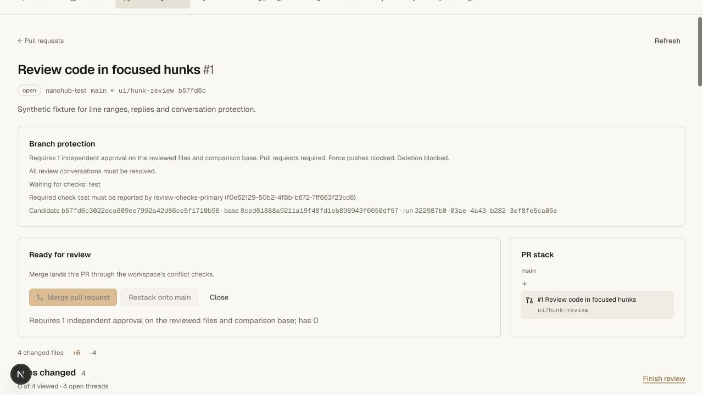
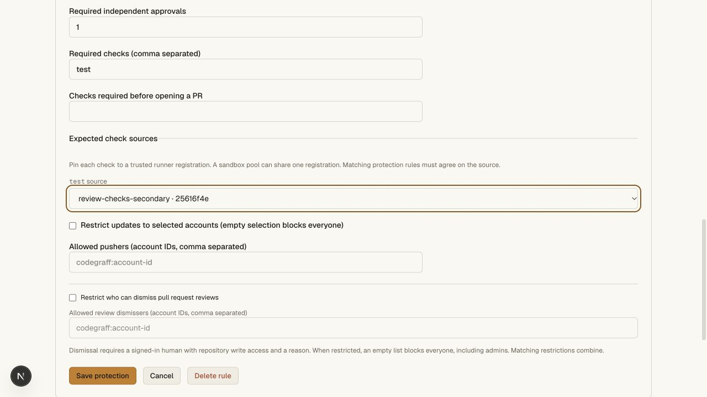
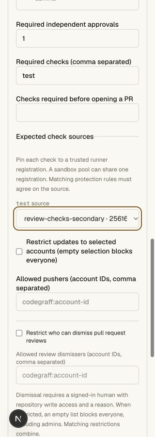
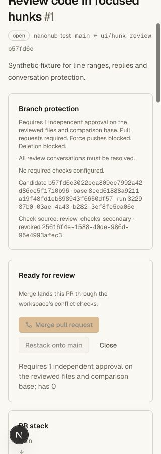
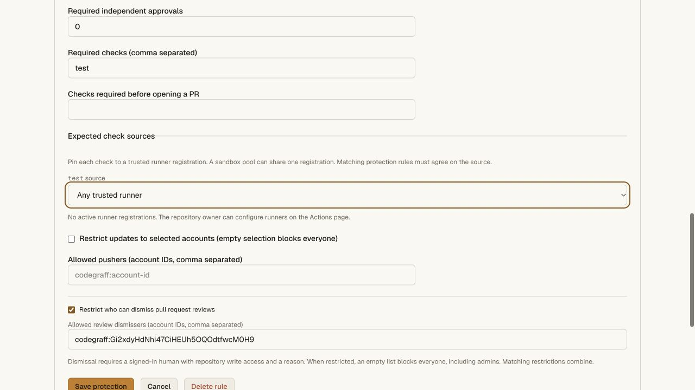

# Required check source validation

Branch protections can pin each required check to a stable, repository-local CI
runner registration. One registration may serve multiple dispatcher processes
and concurrent Codegraff sandboxes. No sandbox-count limit is imposed by a pin.

The source is taken from the authenticated run lease. Result JSON, display names
and sandbox execution metadata cannot assert that identity. Only a completed
successful check for the exact branch/head/base can count. Pins apply to both
pre-open checks and final PR merge. Matching protections retain all pins; an
any-source rule cannot erase one, and conflicting exact sources block.

The final serialized writer reads current policy, candidate results and source
revocation from the same repository SQL state. A revoked pin invalidates even a
previous success. Reusing its display name does not restore it. The owner must
configure a replacement registration, an admin explicitly select it and a fresh
run report successfully. Unpinned historical results retain their prior
name-based behavior. Source metadata exposes only ID, name and revoked state.

## Automated evidence

Five new SQLite cases cover validation and bounds, required-name membership,
unknown and cross-repository registrations, duplicate/unknown pin fields,
successful results from a different registration with the same display name,
spoofed result sources, wrong candidate/base, overlapping any-source rules,
conflicting pins, revocation, same-name replacements, pre-open rejection and
current-policy enforcement at final merge. The positive merge keeps the exact
Git candidate; rejected merges leave main and PR state unchanged.

The real Worker/Git/HTTP suite creates owner, admin, writer and reader identities
and an ordinary private Git repository. It checks:

- Only owner/admin protection updates; same-origin required. A repository admin
  cannot create CI credentials, which remain owner-only.
- Cross-repository source rejection; source metadata contains no credential
  token or hash.
- A successful check from the wrong same-named registration blocks PR opening.
  Retry from the expected registration allows opening.
- Caller-supplied runner/source fields cannot impersonate another registration.
- Changing the expected source immediately blocks final merge, including for a
  previously loaded PR. Rejected attempts leave refs/PR state unchanged.
- Revoking the expected source blocks its completed result. Same-name recreation
  does not revive the old pin. Explicit pin replacement requires a fresh run.
- An overlapping different pin blocks; removing that fixture rule restores the
  expected constraint. The exact candidate merges and a fresh clone passes
  `git fsck --strict`. Policy audit includes the source configuration.

The suite runs real Git operations and fsck; it reports those checks through
trusted fixture runner credentials. It does not claim live Codegraff provider
execution. Fixture CI/Git credentials are revoked in cleanup.

The full repository gate passes **99 unit tests and eleven Git/HTTP suites**.
API, web and vault tsrs checks and the OpenNext hosted build pass. Commands:
`bun run test:repository`, `bun run check`, and
`bun x opennextjs-cloudflare build --config wrangler.deploy.jsonc` in `apps/web`.

## Browser evidence

The existing private local `hunk-review-ui` fixture received a successful
synthetic `test` result from `review-checks-secondary`. Its main protection
expected `review-checks-primary`. The PR showed **Waiting for checks: test** and
the expected registration name/ID, with Merge disabled.

The settings form listed both registrations. Selecting the secondary source and
saving persisted the exact registration ID. The PR changed to **Required checks
have passed**, while its independent-approval requirement still blocked Merge.
Head and main stayed unchanged. The original local policy was restored and both
synthetic registrations revoked afterward. The PR attributes the stored check
to the secondary registration and visibly identifies its revoked status.

Desktop and emulated 320 CSS-pixel checks cover the source selector, attribution
and long candidate/base/run IDs. A discovered candidate-hash overflow was fixed;
final viewport and document widths are both 320. Viewport overrides were reset
and temporary local browser tabs closed.

## Hosted validation

Main Worker `44998612-4744-46da-bd55-56b2a7e409cc` was deployed at 100% for this validation.
The prior feature release was `1b3900d1-838e-4e25-8a59-9ff06bc2e3da`; source
pinning first deployed as `4463c108-f48b-4880-bd6c-f6024f7b1815`, then received
the candidate-ID wrapping correction. At validation, public `/api/agent-help`
identified that final version and legacy `/install.sh` and `/download` returned
HTTP 200. Vault bindings and version were unchanged. The latest deployment is
recorded in the [production index](production-validation-2026-10-26.md).

The hosted editor was opened on existing private canary
`rachxpradhan/prod-codeowners-20261027`. A temporary form entry for `test` exposed
the expected-source selector and **No active runner registrations** explanation.
The edit was cancelled. Existing main protection retained zero check names and
its independent CODEOWNERS requirements. No production policy, Git ref, member,
vault value or credential was changed by this validation.

Two-source positive/negative enforcement is proven by the local real Worker/Git
suite, not by a production runner delivery. The canary has no runner registration
and no production credential was created. The previously supplied Codegraff key
lacks sandbox scope; live provider jobs remain an activation requirement.

## Semantics and remaining gaps

This follows [GitHub's expected-source check principle](https://docs.github.com/en/pull-requests/how-tos/merge-and-close-pull-requests/troubleshooting-required-status-checks#required-status-checks-from-unexpected-sources)
using native runner registrations rather than GitHub Apps. It is a trusted
reporter identity, not remote sandbox attestation. Only success counts; GitHub's
neutral/skipped conclusions, loose-check mode, merge queue, full Actions dialect
and source-compatible GitHub API remain separate work. The private Cloudflare
vault service and its idle/retained-value behavior are unchanged.
