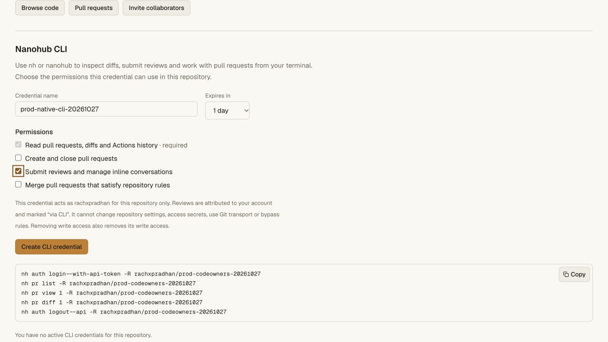
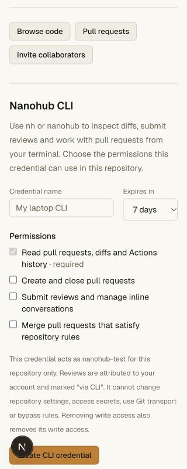
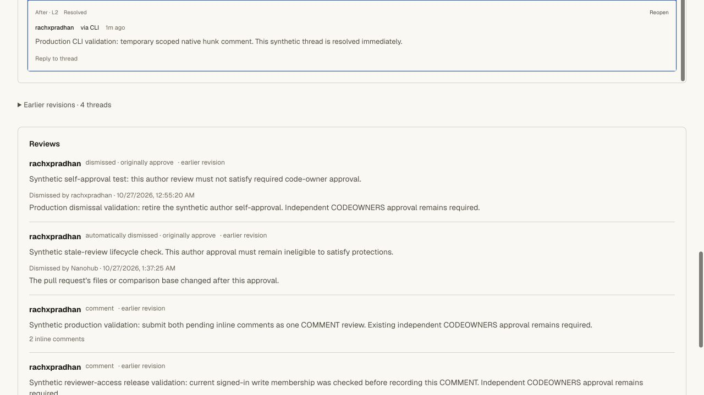
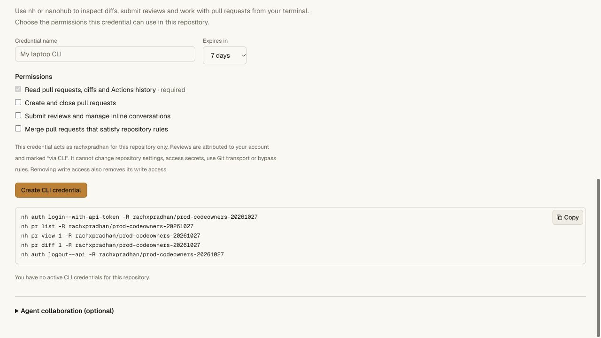

# Native hosting CLI API validation — 2026-10-27

## Release and scope

Production Worker `96b34dfc-f1aa-470f-8af2-86324664022a` was deployed at 100%.
It follows `7ba197aa-201b-4901-aefc-2b5b23e8d6d9`; the vault deployment and
bindings were not changed. Public `/api/agent-help` identifies the new version;
legacy `/install.sh` and `/download` still return 200. Those downloads remain the
older swarm CLI, not a new distribution of this Bun hosting CLI.

The source package exposes `nh` and `nanohub` v0.2.0. From the checkout, use
`bun run nh -- ...`; no global command was installed or replaced. Native commands
cover PR creation, list/view/diff, close, account reviews, bounded inline
comments/replies, resolve/reopen, protected merge and stored Actions history.
`--web` retains the hunk UI and `--print` returns list/view URLs. `--json` now
returns native data by default and emits structured command errors with a
nonzero exit. [Usage](../hosting-cli.md) documents that behavior change.

CLI API credentials are distinct from Git and agent credentials. Creation
requires a signed-in same-origin current member, explicit repository permissions
and 1–30 day expiry; read is required. Readers and archived repositories cannot
issue write scopes. D1 stores only the digest and minimal account identity. The
OS credential helper uses a distinct API path/username, and the client sends
the value only as an Authorization header to the selected host. It omits cookies
and refuses redirects. Logout revokes server-side before local removal.

The gateway allowlist checks origin, immutable repository ID, current membership
and scope, then delegates to the native protection writers. CLI reviews are
explicit account delegation and retain `via: {kind: "cli", credentialId}`.
They can count only as current independent account approvals; self/agent
approvals remain excluded. Browser-only bypass, settings, credentials,
secrets, runner administration and private pending drafts are unavailable.

## Verification

- **192 API unit tests** pass.
- The full repository gate passes **151 unit tests and 18 real Worker/Git
  scripts** (23 PASS observations, including archive interruption cases).
- **9 CLI unit tests**, **all three tsrs check tasks**, OpenNext build and
  `git diff --check` pass.
- The new `smoke-cli-api.ts` runs actual Bun subprocesses against real
  Worker/D1/Git, with an isolated temporary memory credential helper. It tests
  native PR creation/list/view/diff/close, self-approval exclusion, another
  writer's eligible account review, revision-bound inline comments, resolution,
  blocked and compliant merge, exact fresh clone and `git fsck --strict`.
- Negative cases cover read-only and cross-repository scopes, token type
  separation, forged/invalid origin, current writer demotion/removal, protected
  locks, archive, browser-only ruleset bypass, hidden private drafts, expiry,
  server logout, account-owned revocation and redacted output. Hashed credentials
  and repository aliases remain usable after a Worker restart. All synthetic
  credentials are revoked and the isolated helper is stopped on cleanup.
- Local browser checks show separate Git and CLI sections, mandatory read,
  unchecked optional permissions, explicit expiry and account attribution,
  empty/loading states and revocation controls. At 320 CSS px the document is
  exactly 320 px wide; the form is 288 px. The viewport was reset afterward.

## Production checks

The signed-in production canary's new CLI section loads with zero active CLI
credentials. Missing and fabricated credentials receive 401 from both whoami
and repository PR listing. The prepared grant targets only
`rachxpradhan/prod-codeowners-20261027`, expires in one day, and selects read plus
review/conversation permissions. PR creation/closing and merging are unchecked.
Fresh browser action-time authorization was requested before creating access.
The user subsequently approved the exact prepared grant. The authenticated
follow-up below was run under main Worker
`60270e9c-7244-4c3b-a9c7-132e68399b04`.

### Approved authenticated production test

Created the approved `prod-native-cli-20261027` credential for the canary only,
with exactly `read` and `reviews:write`, expiring within one day. The actual Bun
CLI used it through a child environment for this test; no persistent OS helper
login was made. Its temporary transfer file was private (0600), removed after
revocation, and its value was never printed or saved in evidence.

- Native auth status confirmed the intended stable repository, account, label,
  scopes and expiry. PR list/view/diff and Actions history succeeded. The API
  view exposed no pending draft, rule editing, runner configuration or review
  dismissal capability.
- Submitted **Comment review #5**, attributed to the account and marked via CLI.
  No approval was submitted. Its stored provenance matches this credential.
- Posted root `3b0d69f2-79be-45b1-b6ff-dc6d22a97883` on the visible after-side
  README.md line 2, then resolved it through the actual CLI. The hosted browser
  shows the resolved thread and via CLI attribution.
- Re-read the PR and compared all branches, protection policies and rulesets
  with the baseline: unchanged. Head remains
  `f9dc310ab27e59ec429f159d7dccbeb847655815`. The PR is open; the existing two
  missing CODEOWNERS groups and required-deployment gate remain unchanged.
- Native logout revoked the credential. A subsequent whoami request returned
  **401**, and an actual `nh pr list` process exited **1** with invalid/expired
  credential feedback. Fresh browser settings show zero active CLI credentials.

The only repository changes are the explicitly authorized synthetic Comment
review and resolved inline thread. No ref, source file, policy, CI registration
or vault value was changed. The credential is revoked and no plaintext remains
in the temporary transfer file or browser token view. The private metadata-only
receipt is in the local production validation directory.

## Remaining CLI work

Browser code authorization was subsequently added; see
[device flow validation](cli-device-validation.md). Account-wide grants, CLI protection administration,
packaged distributions and wider GitHub CLI compatibility remain open. API
mutations are not automatically retried after an uncertain response; inspect the
PR before repeating creation/review. Diff output respects the server's bounded
patch limits. Private pending-review management remains browser-only.
