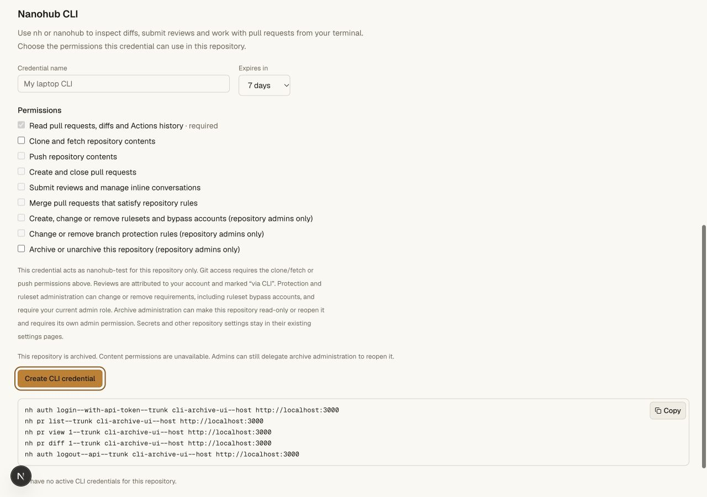
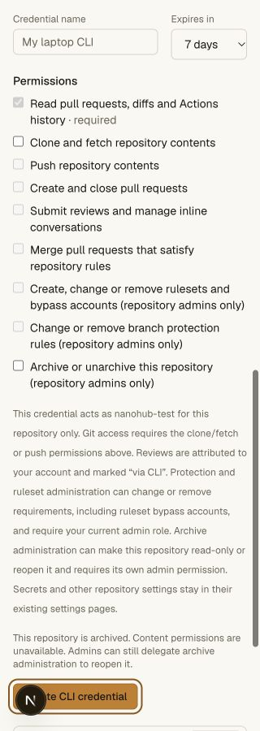
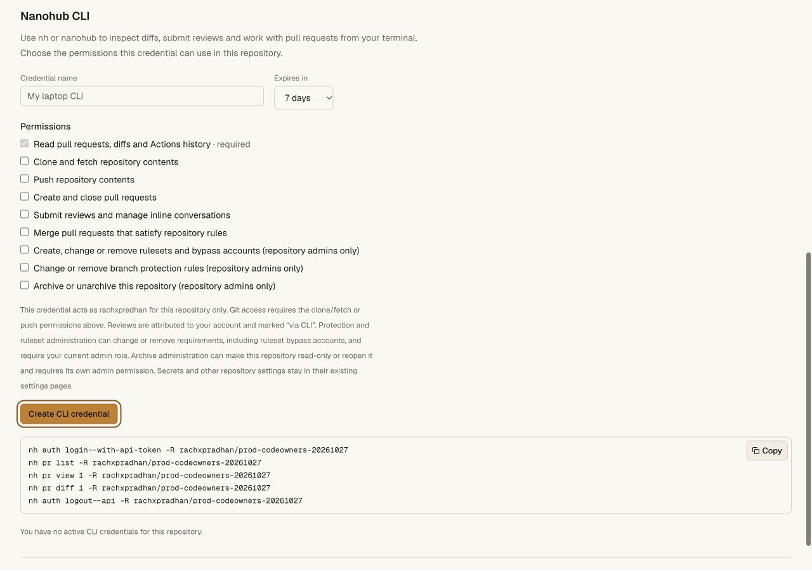
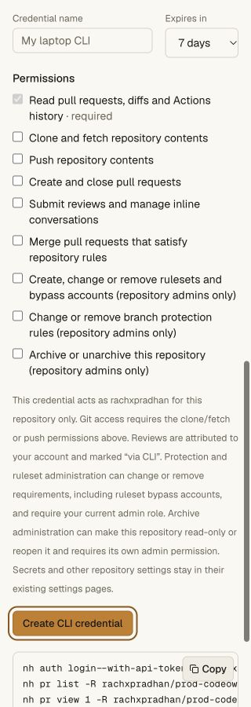

# Native CLI archive administration — 2026-10-27

The CLI now manages the existing repository-wide archive fence through a separate
current-admin grant. The [contract and commands](../hosting-cli.md#repository-archive-and-unarchive)
describe authorization, revision and recovery behavior.

## Local acceptance

- **245 API unit tests** pass. New coverage checks archive-only delegation while
  archived, current role restrictions, strict revisions including stale no-ops
  and ABA, interrupted reopening, persistent CLI provenance and mixed-version
  receiver refusal without legacy downgrade.
- **36 CLI tests / 293 assertions** pass, including exact selected-host/repository
  requests, revision/name requirements, invalid options, default scope exclusion,
  pending status and no automatic retry after a lost mutation answer.
- The full repository gate passes: **196 focused tests and all smoke checks**.
  New source and standalone bundled Bun executions archive/unarchive actual local
  Workers and verify current admin/demotion, separate scopes, immutable repository
  binding, confirmation/header validation, native Git write refusal, archived
  clone plus `git fsck --strict`, restart durability and retained main lock.
- Archived admins can issue a recovery credential with lifecycle access while
  content/rule/review scopes remain unavailable. Device consent can reduce a
  request to read plus lifecycle control; a demotion before exchange rejects the
  admin permission. Revoked credentials return 401.
- The final Hub writer independently rejects incorrect name confirmation and a
  non-admin actor. The repository name and revision are checked in the same
  transaction as current admin membership and transition creation.
- Archive-after-apply and committed-reopening interruption cases resume across
  restart with their original revision and exactly one attributed CLI audit per
  transition. Completed old revisions are rejected with 412.
- The existing archive smoke also passes for Git/review/issue/settings/permission
  fences, cancelled CI/read leases, retained drafts, Cloudflare secret values and
  paused workload access, and reopening without relaxing existing protections.
- Hosting/access/vault tests, pinned tsrs across API/web/Worker/vault, and the
  OpenNext production build pass. After the final name-check refinement, the
  dedicated source/bundle recovery gate and type/build checks pass again.

A separate empty local `cli-archive-ui` fixture verifies the archived permissions
form. Lifecycle administration is available to its admin and unchecked; content
writes/reviews/rule edits stay disabled. No UI credential was issued. Both desktop
1280 px and mobile 320 px document widths match their viewport. The fixture is
reopened after inspection.

## Published artifact

CLI **0.4.8**, portable Bun module **46,789 bytes**, SHA256:

`db5a3b089b91c03161f85c9d86c512f6bead424cb9afa131ad6449b53babcf11`

Production rollout, published installer and preserved repository state are
recorded below after observation. Local lifecycle mutations do not establish a
production credentialed archive/unarchive test or live cloud VM execution.

## Production acceptance

Final Worker **1af6359c-b04f-4078-8919-e03c38e7a3bf** is deployed. The preceding
**bbe616b8-12fa-4d49-a6fc-a882cf020420** rollout was followed by the final
repository-name transaction check and readiness markers.

A fresh signed-in archive read reports `conditionalWrites: true` and
`nameConfirmation: true`, which require both the updated Hub and Sequencer.
The canary remains active at archive revision 0 with no pending transition.
Initial observations lacked the markers; the eventual fresh request confirms
stateful readiness. A JSON-tab navigation/reload timeout was not treated as a
failed deployment or used to restart it.

The before/after repository comparison preserves all six refs, main/default
settings revision 0, archive state, environments and CI history. The three
classic policy objects remain identical at protection revision 3. The live
permission selector offers archive administration unchecked and shows no active
canary CLI credentials. Mobile viewport/document widths both measure 320 px.
No credential was created and no production lifecycle or policy write was made.

The published module matches the byte count and SHA256 above. The actual public
installer installs successfully outside the checkout in a quoted path; both
installed aliases report `nh 0.4.8`, and installed help lists all three lifecycle
commands plus the separate permission. Anonymous regular archive reads return
404; anonymous CLI archive reads return 401. Private machine receipts:

- `~/.config/nanohub/prod-validation-2026-10-27/cli-archive-public.json`
- `~/.config/nanohub/prod-validation-2026-10-27/cli-archive-stateful.json`

The private vault deployment is unchanged. Positive lifecycle writes remain
local acceptance evidence; this rollout does not establish credentialed
production archival or cloud sandbox execution.

