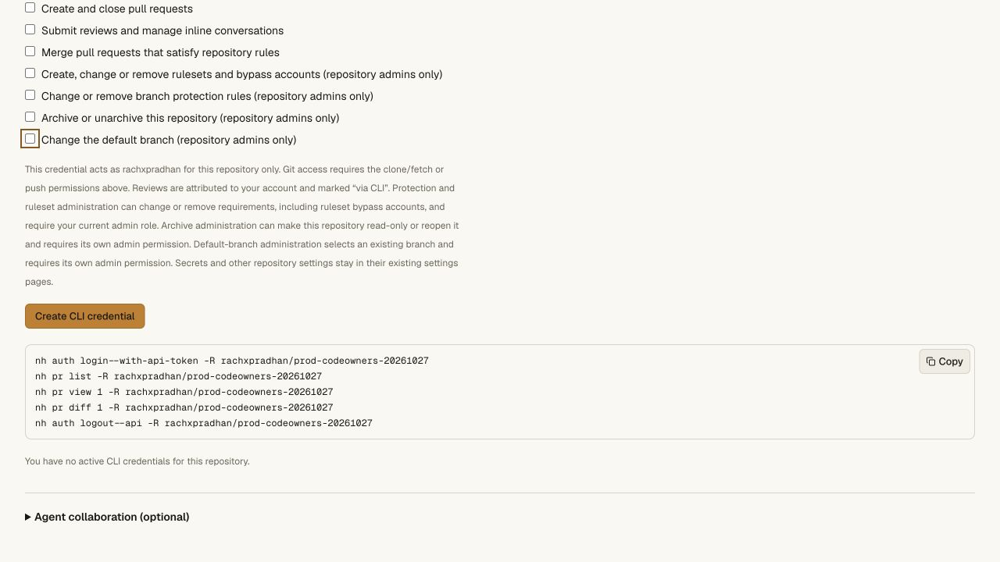

# CLI default-branch administration — 2026-10-27

CLI **0.4.9** adds `repo default-branch` and
`repo edit --default-branch BRANCH [--revision N]`. The
[contract](../default-branch.md#native-cli-selection) describes the separate
`repository:default` permission, exact-head/settings revision conditions,
fresh current-admin check and retained ref/lock behavior. The
[sanitized receipt](cli-default-branch-receipt.json) records the deployed version,
public CLI hash, actual production receiver and preservation checks.

## Local validation

- **262 API unit tests**, including three new permission/fence/rollout cases.
  They cover separate scopes, current admin versus writer/reader, archive,
  SQL update/ABA/delete/reinsert, old manual counters, rollback, stale no-ops,
  audit attribution and refusal to downgrade to older receivers.
- The full repository gate passes **205 unit cases** and every Worker/Git
  acceptance script. Source and standalone bundled CLI both make actual HTTP
  requests into real Miniflare Worker/DO/D1 state and change defaults without
  replacing refs or Git objects. Literal UTF-8/quote/shell-looking branch names
  survive unchanged. No shell executes that ref text.
- New real tests reject unrelated admin credentials, missing/mismatched
  conditions, stale settings, moved heads, spoofed fields, cross-repo access,
  demoted accounts and archived writes. Two concurrent settings writes yield
  one success and one 412. The final RPC independently rejects a demoted actor
  and performs a fresh external-provider check that fails during an outage.
- Classic `main` lock and `~DEFAULT_BRANCH` update restriction remain enforced
  through real Git pushes. Namespace aliases, restart, audit identity,
  device-exchange demotion, scoped revocation and clone symbolic HEAD/fsck pass.
  Test credentials are revoked and the isolated Worker storage is removed.
- **39 CLI tests** include three new exact-request/validation/lost-answer cases.
  No automatic retry follows a stale or uncertain write.
- **28 hosting/pool tests**, real namespace Worker/Git acceptance, access/vault
  acceptance, frozen offline Bun install, pinned tsrs, production Next.js and
  Cloudflare OpenNext builds, and `git diff --check` pass.

## Production rollout

Worker **5f06d7f5-7568-44ad-ac6d-9cea8bdb6f45** is deployed. Public
`/api/agent-help` reports that exact version. CLI 0.4.9 is **49,938 bytes**, with
SHA-256 `4cc9da686a99dc6d89d7c9dedb1afc9dbe2e633b9718ff33156caa6ed321db9a`.
Its downloaded bytes match the built manifest. It runs `--version` and `--help`
outside the checkout with only a clean environment. CLI 0.4.8 remains available
with its original bytes/hash.

The root Worker initially used the browser-compatible older settings receiver.
The same deployment was observed until the actual private canary receiver
advertised `conditionalWrites: true`, `cliAudit: true` and
`revisionTracking: "storage"`. A read-only dry-run bundle inspection confirmed
the new methods and triggers, and the same owned binding was checked. No
replacement deployment was issued because propagation was slow. A short
Cloudflare runtime tail was enabled during diagnosis, then closed; only a bounded metadata summary is retained
in the private validation directory. Readiness followed, without establishing
that tracing caused it. Cloudflare documents both
[eventual code propagation and software updates associated with tracing](https://developers.cloudflare.com/durable-objects/platform/known-issues/#code-updates).

Before/after signed-in reads of
`rachxpradhan/prod-codeowners-20261027` prove:

- `main` and all **six** branch entries retain their exact IDs and metadata.
- Settings revision advances **0 → 1**, and graph revision **5 → 6**, once for
  the persistent-fence migration. All three ruleset objects remain identical.
- All three classic protection objects and protection revision **3** remain
  identical, including the existing branch lock and CODEOWNERS requirement.
- The published permission form shows a separate, enabled, **unchecked** default
  branch permission. Its explanatory copy and keyboard focus were inspected.
  It still reports no active CLI credentials for this repository.

No production credential was issued and no production default was selected for
this validation. Positive settings writes were exercised against isolated real
Workers, while hosted observations verify actual rollout, receiver readiness,
distribution and preservation. These scopes should not be conflated. The vault
service was not redeployed. GitHub remotes and Meld cutover remain unchanged.
Unattended Codegraff image distribution and staging acceptance remain outstanding.
