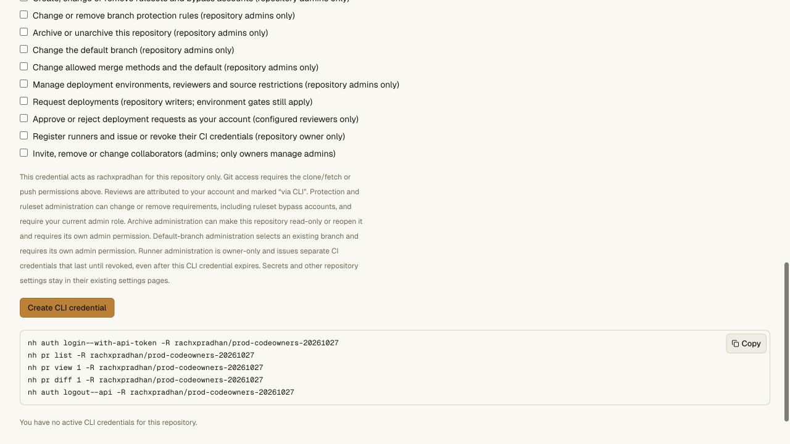

# Deployment approvals and CLI 0.4.17 — 2026-10-30

Worker **`a37ab061-a029-4480-9fb9-2b7cefeb19e3`** serves 100% of main traffic,
replacing `857257c1-18fa-4866-87f8-2e9a9216bf20`. CLI **0.4.17** is published:
85,565 bytes, SHA-256
`44d029819890d81384324fa159cb4c471cfb3c36e8b61e6c313eb7d96738d579`.
The [release receipt](cli-deployments-release-receipt.json) records frozen Linux
acceptance, disposable delivery, staging, promotion and preservation.

The release adds [native deployment requests and reviews](../cli-deployments.md)
through `nh` and `nanohub`. Separate explicit writer/reviewer grants retain
configured reviewer eligibility, self-review prevention, wait timers, conditional
request revisions and final credential/membership checks. Existing grants gain
no new authority. Approval is an attributed account decision, not proof of human
presence, a PR approval, secret access or permission to report trusted CI results.

## Frozen Linux acceptance and the clean-checkout correction

Runtime implementation `969757df608549d6f8641f2c765dd08c26978b91` and the
fixture correction in `6076c3b544e4df67607ae1a2fa3da188346b2d38` are frozen in
credential-free acceptance commit `cad4ec689092238639cecae24e9cdb4cf33ce56e`.
All 1,048 source files and 1,472 OpenNext output files match before staging,
promotion and release-documentation changes. Built output is checked separately
because generated files are excluded from Git. The complete OpenNext build and
production-configuration Wrangler dry run also pass.

The first Linux attempt passes install, API unit, repository, CLI, access and
hosting gates, then fails the fixture gate because a clean checkout lacks the
ignored generated web Worker declaration. That attempt remains failed; its VM
has independently confirmed destruction. Each fixture command now generates its
own types, and both commands pass in a private checkout without prior generated
declarations or build output. Recovery also passes independently after removing
only that private checkout's generated declaration.

The failure also exposes a log-capture bug: redirecting an ungrouped `A && B`
command captures only B. The gate runner now groups the entire command. Four
real shell cases verify failures on either side, stopping later gates, successful
compound commands and quoted log directories. Commands remain trusted operator
definitions; this does not add user-supplied shell execution.

A fresh Codegraff VM then passes **all nine gates**:

1. Frozen offline Bun install.
2. API unit tests: 374 passing cases.
3. The complete real Worker/Git/review/protection/CLI/archive/recovery chain.
4. CLI tests: 68 passing cases.
5. Access and the separate Vault service.
6. Hosting and shared capacity.
7. Both hosted-fixture regression commands.
8. The Next build and deployment-CLI checks using the exact release artifact.
9. Pinned tsrs/operator checks; all three workspace tasks run without cache hits.

Counts overlap. The retained toolchain digest is
`sha256:76f35e83a77df1d8eace6e8fc49b7f77d6dcd6d90bbaf40722c5c5f9f8bd6694`.
Candidate execution has no network, control credentials, npm/npx or Docker socket.
The controller destroys the VM and a separate provider read confirms destruction.
This uses the existing trusted CI account, not the configured Nanohub Actions key.

The exact artifact gate uses real Workers, Git and CLI commands to exercise
list/view/request/approve/reject, configured reader and connected-team consent,
scope/role/revocation boundaries, competing revisions, self-review/timers,
lost-acknowledgement idempotence, current membership at lease resume, audit,
restart/alias/archive behavior and a compliant protected merge with clone/fsck.
Its deployment reports and membership provider are synthetic; it executes no
real application deployment adapter. See [local acceptance](cli-deployments-validation.md).

## Isolated delivery, staging and promotion

A uniquely named disposable Worker uses the actual built entrypoint and assets,
with only ASSETS and version-metadata bindings. It has no production state,
service bindings or custom domain. Exact-name provider absence is checked before
creation. All **18 normal asset comparisons** pass: current CLI/manifest/checksum,
installer, eight checked earlier CLI modules and representative CSS/JS/fonts.

Its held version adds only `NANOHUB_RECOVERY_HOLD: "1"`. All **24 GET routes**
return private/no-store 503 with `Retry-After: 60` and `recovery_hold`; HEAD is
bodyless. Normal and held readiness both match on their first observation.
The Worker is deleted, and a separate pre-staging provider read confirms absence.
Unknown mutation results are not blindly replayed; Wrangler can retry HTTP
requests internally. These observations do not establish a global propagation bound.

Normal version `a37ab061-a029-4480-9fb9-2b7cefeb19e3` and held version
`7dd25d94-2189-448d-a04e-4252ca564bce` are uploaded before traffic changes.
Every normal binding definition matches the previous release's 27 bindings.
The held version adds only the hold flag. Both retain Worker-first assets and
the 50,000-subrequest budget. Public Worker/CLI reads remain on the previous
release throughout staging.

One controller promotion requests the normal version at 100%, with Durable
Object code update mode `immediate`. Fresh provider records and the public
version endpoint agree. The held version stays inactive. Request hold is an
operator fence, not an in-flight transaction drain or a completed recovery drill.
Vault is not deployed and independently remains on
`02dcb88b-5c99-49d9-a4b6-cb95451e6bb5`.

## Publication, consent and preservation

All **26 public asset comparisons** match built bytes, with expected MIME types
for JSON, JavaScript, stylesheets and fonts. They include every built stylesheet,
representative JavaScript/fonts, the current CLI/installer/checksum and eight
checked earlier CLI modules. The previous 0.4.16 module and installer retain
their independently captured public hashes.

The public installer verifies the module checksum and installs into a temporary
path with spaces and an apostrophe. Both aliases run outside the checkout,
report 0.4.17 and expose the deployment commands and earlier capabilities. The
temporary install is removed; global installation is unchanged. Unauthenticated
CLI deployment list/view requests return 401 with `invalid_token`.

Nine authenticated before/after comparisons match every returned field: branches
and their PR/review/CI state, classic protections, rulesets, default branch,
archive, environments, collaborators, secret metadata and runners. No repository
mutation or credential issuance is requested for this smoke. Authentication stays
in the browser; no session cookie is extracted and no secret value is read.

CLI discovery adds exactly `deployments:write` and `deployments:review`, from 14
to 16 scopes. The production form displays both optional controls enabled and
unchecked, with required read checked and no active CLI credentials. This proves
publication, consent and preservation. Production request/review mutations are
not exercised with a newly issued credential in this release check.

## Remaining launch gates

A fresh read-only preflight of the configured Nanohub Actions key returns HTTP
403 for missing sandbox scope: one provider GET, zero Nanohub requests and zero
allocations. The trusted CI account is not substituted for it. Hosted dispatch
and callbacks are not activated by this release.

Actual Meld CI/staging/cutover, complete changing-Git hosted recovery,
load/SLO/security/operations and broader GitHub parity remain open in
[production readiness](../production-readiness.md). Source changes are committed
locally; this release does not push them to GitHub or change original Meld remotes.
