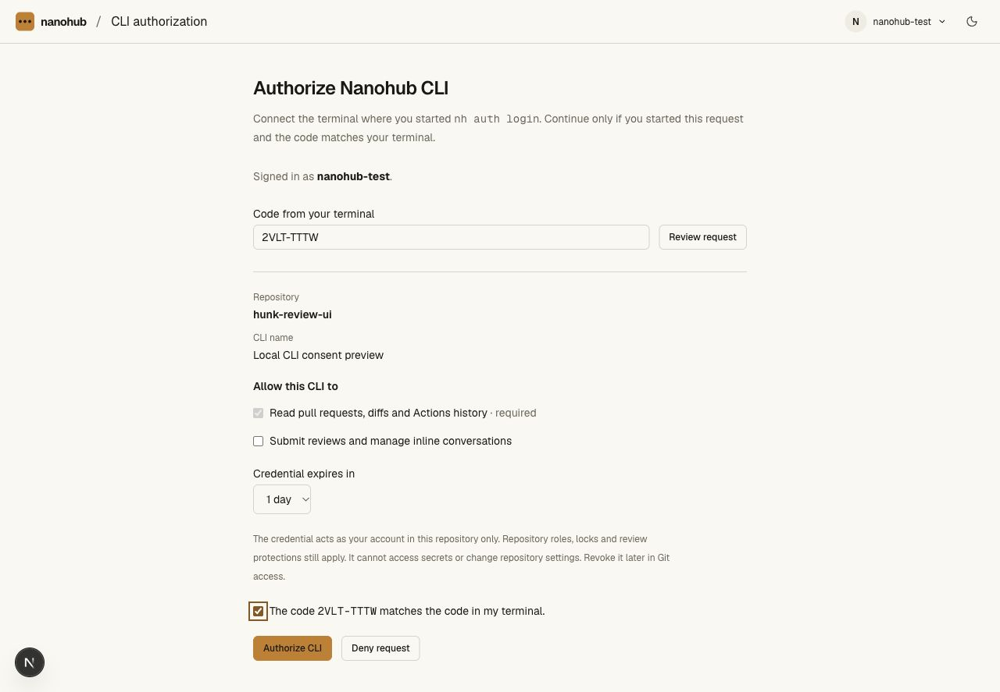
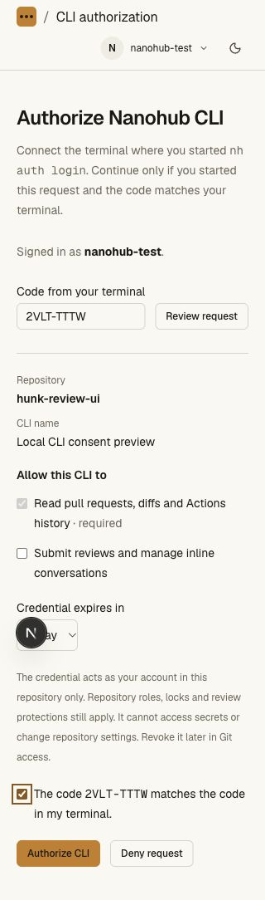
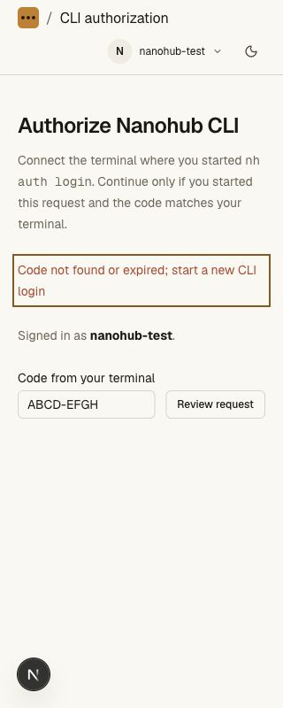
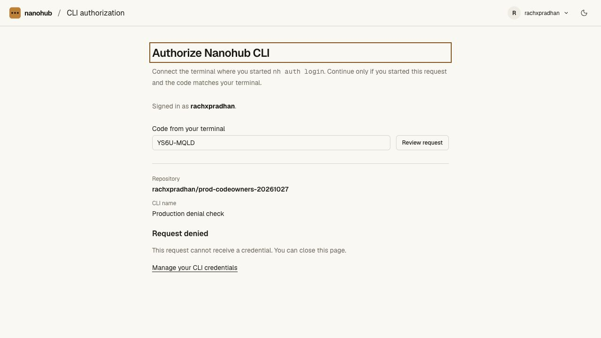
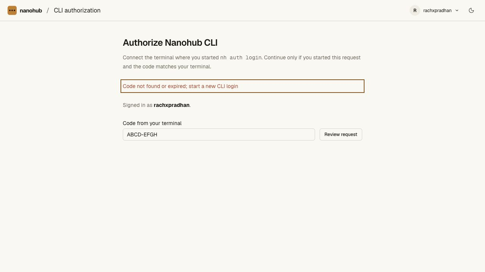

# CLI browser authorization validation — 2026-10-27

## Implemented flow

`nh` and `nanohub` v0.3.0 support repository-scoped browser authorization.
`auth login -R owner/repo` displays a short code and opens `/cli/authorize` on
the selected host. The browser signs in, shows account/repository/CLI name,
allows optional permissions and expiry to be reduced, and requires explicit
terminal-code confirmation before authorization. Denial issues no credential.
Default `auth status` and `auth logout` now address API credentials; `--git`
retains the separate transport credential operations. `--no-browser` supports
headless terminals; progress goes to stderr and final `--json` output to stdout.

This is a native JSON protocol inspired by [RFC 8628](https://www.rfc-editor.org/rfc/rfc8628),
not a general OAuth server or client registry. A 256-bit device secret stays in
CLI memory. Browser URLs contain only a 40-bit user code. D1 stores hashes of
both codes and the credential; plaintext tokens, device codes and user codes
are absent from stored records. Requests expire after ten minutes, with
separate code-creation and lookup rate limits. Poll intervals start at five
seconds and increase after early polling. Approval, scope/expiry reduction,
current membership and archive state are checked server-side.

Issuance and consumption share one D1 transaction. A lost response recovers the
same derived credential for up to two minutes within device expiry, without
plaintext storage or duplicate grants. Revocation cannot be undone by replay.
Failed local helper setup triggers revocation of the newly issued credential.
Only an explicitly configured loopback development frontend may have a
verification origin different from the API proxy's origin. Public hosts cannot
nominate another verification site.

## Automated verification

- **195 API unit tests** pass, including fixed CLI sign-in returns and native
  consent route ownership ahead of the legacy `/cli` prefix.
- The repository gate passes **151 unit tests and 19 real Worker/Git/HTTP
  scripts** (24 PASS observations, including archive interruption cases).
- **13 CLI tests** pass: native/Git credential separation, host and output
  boundaries, browser/headless code login, pending/slow-down behavior, network
  backoff, terminal denial/expiry, malicious verification URL rejection, and
  failed-helper grant cleanup.
- All three tsrs tasks, the OpenNext build and `git diff --check` pass. Bun lock
  metadata now matches the CLI package's v0.3.0; no dependency version changed.
- `smoke-cli-device.ts` runs real Worker/D1 consent, atomic competing decisions
  and polls, private repository existence isolation, reduction, denial, expiry,
  current-reader/demotion/archive boundaries, origin binding, rate limits,
  restart durability, response recovery and revocation non-resurrection. It
  also runs an actual headless Bun login/status/logout with an isolated memory
  helper and checks that public output contains neither secret code nor token.
- An intermittent CODEOWNERS smoke authentication failure exposed an inherited
  helper dependency. The fixture now clears inherited helpers and scopes lookup
  by path; it passes even with a synthetic stale global helper. User/global Git
  configuration was not modified. The full gate then passed.

## Browser evidence

Local development sign-in retained the consent request. Removing the review
permission and matching the terminal code enabled authorization. The request
was denied instead; no local credential was minted. Desktop (1280 px) and
mobile (320 × 800) views retained the complete form without horizontal overflow.
An expired/unknown-code check displayed recovery text and moved focus to its
alert; at 320 px the document remained exactly 320 px wide. Viewport overrides
were reset. Temporary device/helper files were removed.

An independent Impeccable review accepted the incumbent Paper/Geist extension
and requested themed native checkbox/focus states. The brand-token correction
was scored resolved, with `ship` for that fix. The installed detector launcher
was unavailable (exit 126); no detector pass is claimed. See
[design review](cli-device-design-review.md).

## Production

The main Worker release is `60270e9c-7244-4c3b-a9c7-132e68399b04` at 100%.
It follows the scoped-credential release `96b34dfc-f1aa-470f-8af2-86324664022a`.
The initial device build (`dcd83d2e-bb08-44bc-8e59-316b65507c16`) exposed an
inherited legacy `/cli` prefix routing conflict during validation. Exact native
consent ownership was corrected in `cda6fe3d-9db5-4801-8027-8dc1c1cf3f01`;
the final build adds human-readable consent error recovery. Legacy `/cli`,
`/install.sh` and `/download` continue to return 200 with the validation client.
They still serve the older swarm CLI, not a packaged v0.3 hosting CLI. Vault
deployment and bindings were unchanged.

An actual Bun CLI process requested **read only**, one day, label
`Production denial check`, for the existing private synthetic repository
`rachxpradhan/prod-codeowners-20261027`. Its signed-in browser consent showed
that exact repository, scope and expiry, with Authorize disabled until code
confirmation. **Deny request** reached the settled Request denied state and
returned focus to the heading. The same CLI process exited 1 with structured
`No credential was saved` feedback. It was not restarted after the routing
observation. No production credential, review, thread, policy or ref was created
by this device-flow check.

After the final deployment, `/api/agent-help` identifies the exact final version;
native consent and legacy CLI/download paths all return 200 with the validation
client. Signed-in account credential listing returns `[]`. An unknown-code
browser check on the final build displays “Code not found or expired; start a
new CLI login” and focuses the alert. No additional grant was requested.

The user subsequently approved the prepared manual credential, and authenticated
native production reads, Comment review, resolved hunk thread and verified
revocation passed; see [the authenticated CLI evidence](cli-api-validation.md#approved-authenticated-production-test).
That follow-up validates manual issuance and API use, while the hosted browser
device flow above remains a denial test. Local device approval evidence is not
presented as a hosted device approval. Account-wide authorization, CLI protection
administration and packaged hosting distributions remain open.
