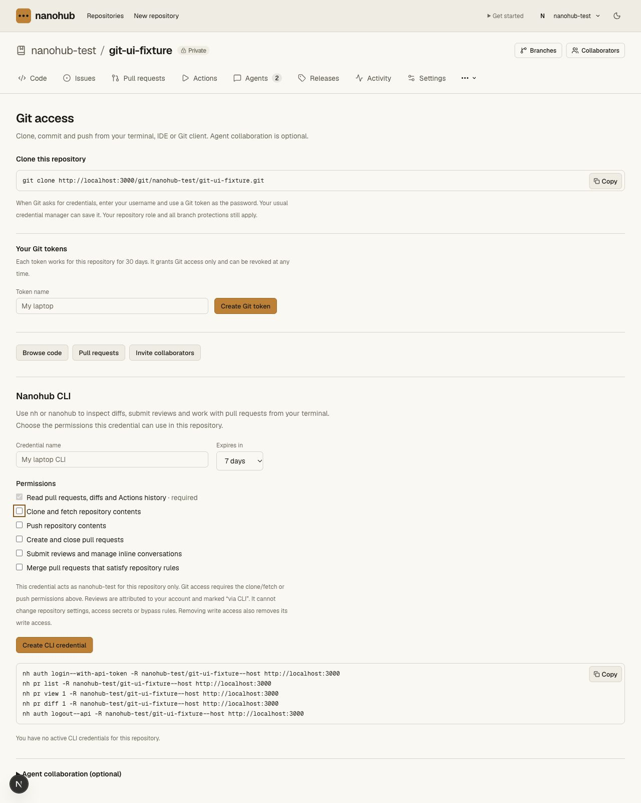
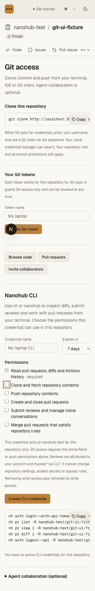
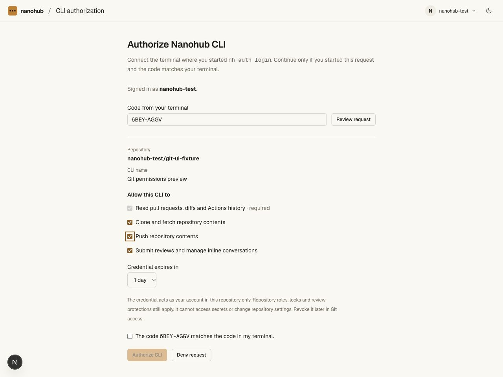
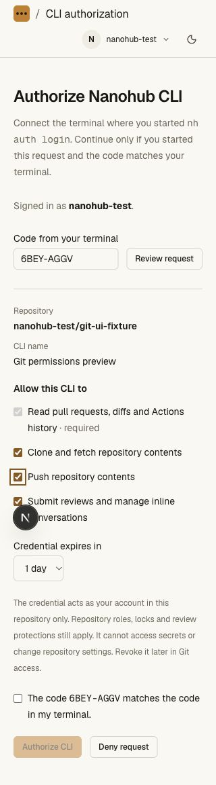
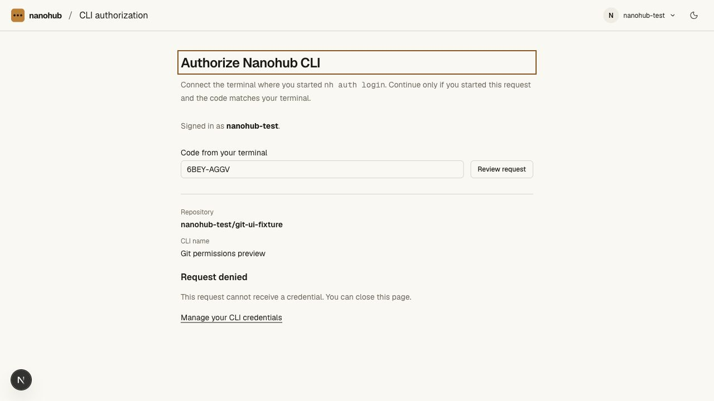
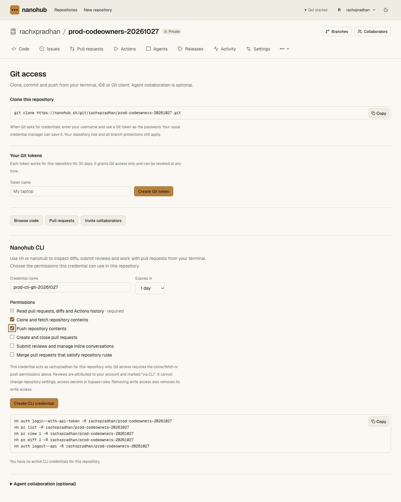
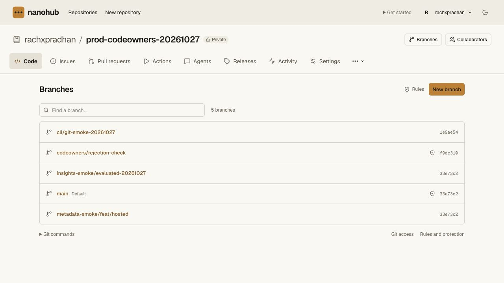
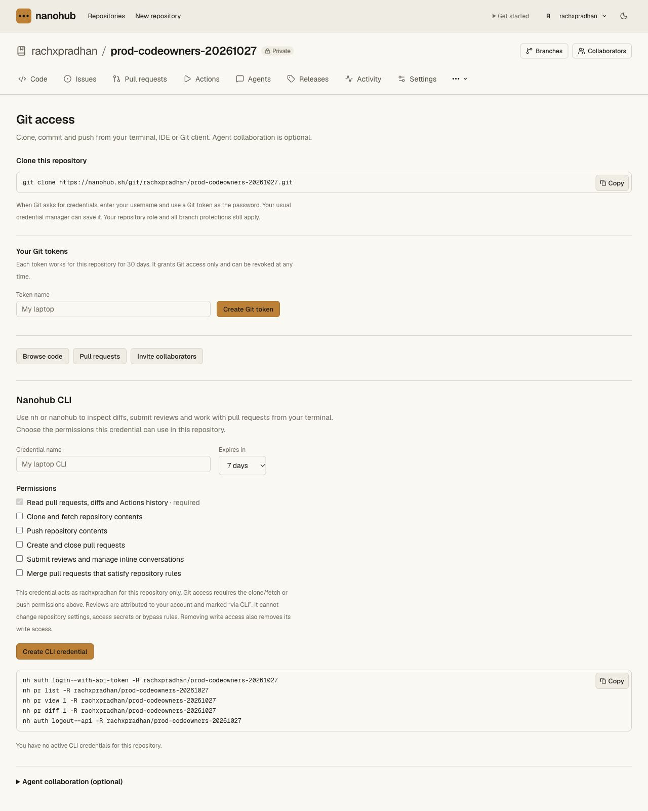

# CLI Git scope validation — 2026-10-27

Git content scopes were introduced in v0.4.0; the portable CLI is now v0.4.1. New `contents:read` and `contents:write` scopes permit
Git clone/fetch and push respectively; push requires clone/fetch. Previously
issued API credentials gain no transport permission. Reader and archived grants
may include clone/fetch but cannot include write scopes.

`repo clone` uses a content-scoped CLI credential when available. It configures a
repository-local helper referencing the selected Bun and CLI installation, clears
inherited helpers for that checkout, enables path matching and refuses redirects.
`auth setup-git` configures an existing checkout only after matching its origin to
the selected host/repository and verifying current scoped access. `--git` retains
independent Git-token clone. Tokens stay in the existing OS API helper entry or
process environment, outside remote URLs, arguments and repository config.

The hidden helper validates protocol, host, exact Git path and optional Git
username before looking up the credential. Git's private helper pipe is its only
credential output. Store/erase operations do not mint or revoke an API grant.
Server checks still enforce immutable repository/origin scope, current role,
expiry, revocation, archival and final branch protections. CLI Git identity never
receives browser-only ruleset bypass. Logout revokes both API and Git use; an
already-invalid API credential can still be cleared from its local helper.

## Checks

- 195 API unit tests and 17 CLI tests (145 assertions) pass.
- The repository gate passes 151 unit tests and 20 real Worker/Git scripts,
  including the new `smoke-cli-git.ts`.
- All three pinned tsrs check tasks, the OpenNext production build and
  `git diff --check` pass.
- The new smoke runs actual Bun login/clone plus ordinary Git feature push,
  exact SHA comparison and `git fsck --strict`. Its CLI source path contains
  spaces and an apostrophe, verifying real shell quoting.
- It verifies old API-only exclusion, cross-host/repository rejection, Git-only
  application API isolation, reader clone, owner read-only push denial, writer
  demotion, locks, archive, browser-bypass refusal, matching setup, unchanged
  global Git configuration, redirect refusal and revocation. Synthetic grants
  are revoked and the isolated cache is stopped during cleanup.
- The device smoke verifies clone/push dependency validation, reader scope
  reduction, archive clone grants, and current write access before issuance.
- Browser keyboard checks verified dependency selection in both the manual
  credential form and device consent. Both rendered at 1280px and 320px;
  document width matched the 320px viewport. The preview request was denied,
  issuing no credential. The temporary viewport override was reset.

## Visual review

This is an Operate extension of the existing Paper UI, using the existing
permission list, typography, spacing and amber checkbox/focus tokens. No palette,
page layout or design-system replacement was introduced. `PRODUCT.md` and
`DESIGN.md` remain absent. Impeccable's launcher was previously unavailable
(exit 126); no detector pass is claimed. The Next.js development badge in local
captures is development tooling.

## Production

The earlier approved native API test used `read` and `reviews:write` only, and
its credential is revoked; see [that receipt](cli-api-validation.md#approved-authenticated-production-test).

Worker `41521aa3-ad86-4a10-8293-c90668a16032` is deployed at 100%.
Public version, `/cli/authorize`, `/cli`, `/install.sh` and `/download` return
200. The hosted form fits at 320px without document overflow.

The user approved a one-day grant with exactly `read`, `contents:read` and
`contents:write` for `rachxpradhan/prod-codeowners-20261027`, one synthetic
commit on a new test branch, and immediate revocation. The first preflight
expected `refs` where this endpoint returns `branches`, so it stopped before
clone or writes. Its credential was revoked and API rejection verified. The
script was corrected and an equivalent grant used for the approved retry.

The actual Bun CLI cloned through its repository-local helper, verified the
original main SHA and passed `git fsck --strict`. Ordinary Git then pushed
commit `1e9ae54067d285b05689bd211aa1d443b2fec398` to the new branch
`cli/git-smoke-20261027`. The checkout's remote and config contain no token.
All four existing branches, protection policies and visible rulesets are
unchanged. Main remains `33e73c27c6d261a16c384cdad6d1514b40305a2f`; PR #1
head remains `f9dc310ab27e59ec429f159d7dccbeb847655815`. No merge or review
was submitted by this content-scoped credential.

The retry credential was immediately revoked. Whoami returns **401** and
ordinary Git `ls-remote` fails authentication. Fresh hosted settings show zero
active CLI credentials. Both test credentials are revoked; the private plaintext
transfer file was deleted and the browser display/binding cleared. A private
metadata-only receipt and the failed-preflight record remain in the local
production validation directory. This test used an environment-only credential,
so it does not establish real macOS Keychain persistence; isolated OS-helper
storage/lookup is exercised in the local smoke suite.

The subsequent [portable release](cli-distribution-validation.md) is now deployed
under Worker `f35a5b9f-a71f-422e-be5a-caabccfe0eda`. Its packaged helper also passes
the real local Worker/Git suite. No production test credential was recreated.
