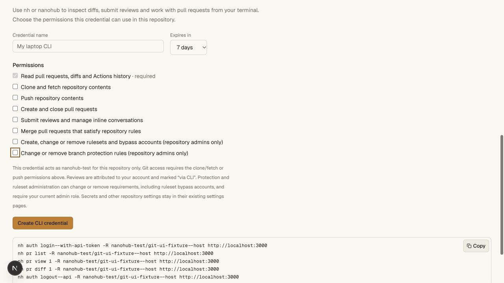
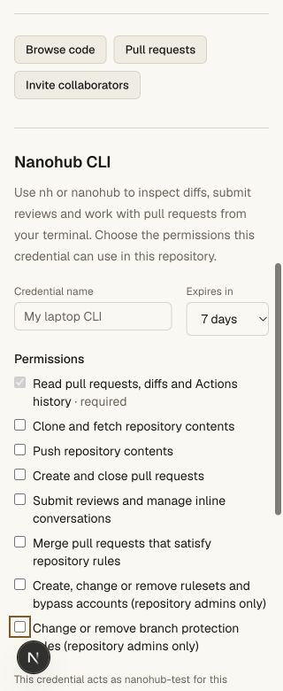
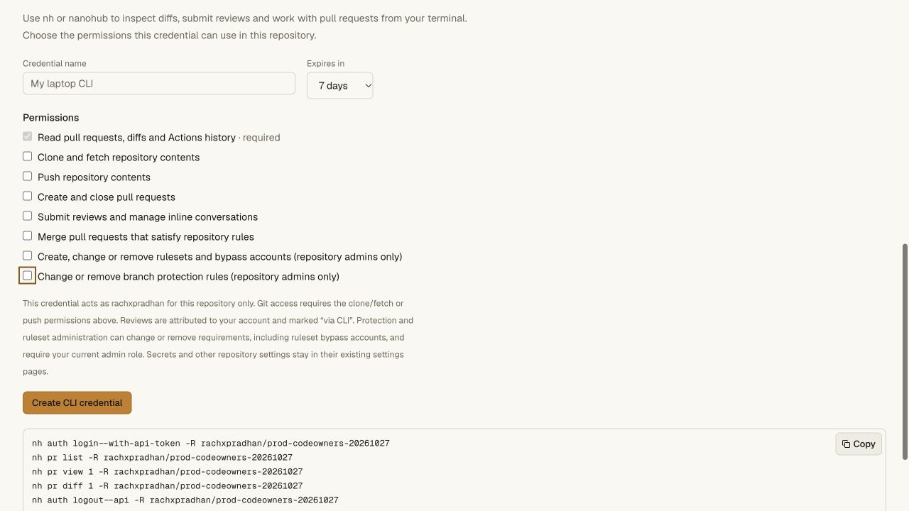
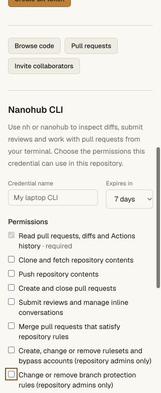

# Native CLI ruleset administration — 2026-10-27

CLI 0.4.7 supports list/view/complete export/create/update/delete for repository
rulesets. Edits require a separate `rulesets:write` grant and a current admin role.
Default login and existing grants retain their permissions. Complete exports
explicitly preserve bypass identities; ordinary metadata reads hide them.
[Command and API contracts](../hosting-cli.md#rulesets-from-the-cli) distinguish
this editing export from the bypass-free portable browser download.

## Local evidence

- **236 API unit tests** pass. New cases cover distinct scope/role/archival
  eligibility, old grant preservation, complete versus redacted exports,
  malformed/missing revision refusal, invalid bodies and mixed-version RPC
  refusal without an unconditional legacy downgrade.
- The complete repository gate passes **187 focused tests** and every real
  Worker/Git smoke. The new command smoke also passes as a standalone Bun module
  from a quoted temporary filename outside the checkout.
- Real Git rejects branch creation, tag creation and a prohibited file after
  the actual CLI creates their rulesets. A Git credential owned by a bypass
  account still cannot inherit a signed-browser bypass. An unchanged main and
  independent mirror clone pass `git fsck --strict`.
- Concurrent edits with one revision produce exactly one success and one 412.
  Browser edits and default selection invalidate earlier exports. Full rules,
  revisions and CLI before/after audit commit together. Explicit deletion
  confirmation, unknown envelopes, oversize/malformed UTF-8 files, current admin
  demotion, archive, namespace aliases, cross-repository privacy, restart and
  server-side credential revocation are verified.
- Actual SQL tests and a **test-only entrypoint** exercise older writers, ABA
  restoration, redundant application increments, transaction rollback and
  missing-trigger repair. Persistent triggers invalidate older exports even
  after rollback; a new fence installation invalidates old counters once.
  Neither production entrypoint exports the fault-injection hooks.
- Browser/device scope consent and token exchange recheck current admin access.
  The new administration grant does not confer classic protection, runner,
  vault, collaborator, credential issuance, historical restore or import access.
- CLI: **32 tests, 260 assertions**, all pass. No lost mutation is retried
  automatically; complete replacement requires explicit `bypass_actors`, and
  default login excludes the new admin permission.
- Full hosting and access/vault suites, pinned tsrs across all workspaces and
  web Worker types, OpenNext production build and diff checks pass.

The local browser shows the new admin permission unchecked and separate from
classic protections. At 320 px, the page and document width both measure 320 px.
No credential was issued through the browser UI.

## Distribution

The portable 0.4.7 CLI module is 43,944 bytes, SHA256
`449394c143fe0d033f459e4e2bb98a86addcceb0d79c85a32ed625338c0588f2`.
Production deployment and stateful storage-fence readiness are checked separately;
local positive write tests do not establish a production credentialed edit or a
live cloud VM run. No extra production credential was issued for the read-only metadata/UI comparison.

## Production acceptance

Worker **173ef7bb-1cf2-493d-9935-c79fd718bbeb** is live. The actual published
installer, manifest/checksum, both aliases, command help, isolated quoted-prefix
installation and legacy public entrypoints pass outside the checkout.

The existing repository receiver initially retained its previous code. The same
deployment subsequently advertises `revisionTracking: "storage"`, with ruleset
revision **4 → 5** and the same three complete ruleset objects. No additional
deployment was needed. The six refs, main default/settings revision 0, archive,
CI history and three classic protections at revision 3 are unchanged. PR #1
retains its head/target and trusted workflow base, still awaiting two CODEOWNERS
groups and a required deployment. The production permission is present, enabled
for the current owner and unchecked by default. No active canary CLI credential
is present; no new one was created. Hosted document width is 320 at 320 px.

This proves public distribution, stateful fence readiness, unchanged policy
objects and the opt-in UI. Positive CLI rule mutations were tested against the
isolated real local Worker, including the standalone bundle. No production rule
configuration was changed; this does not claim a credentialed production CRUD
run or cloud VM execution.

