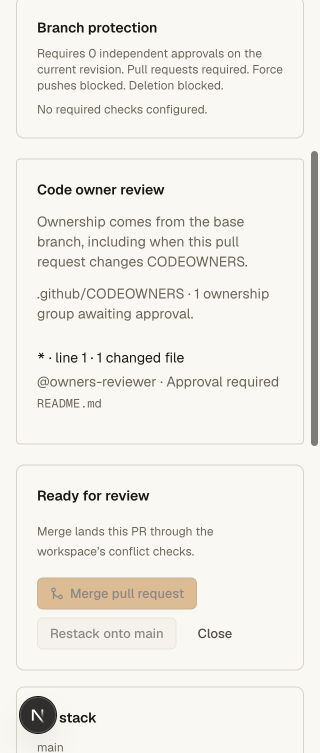
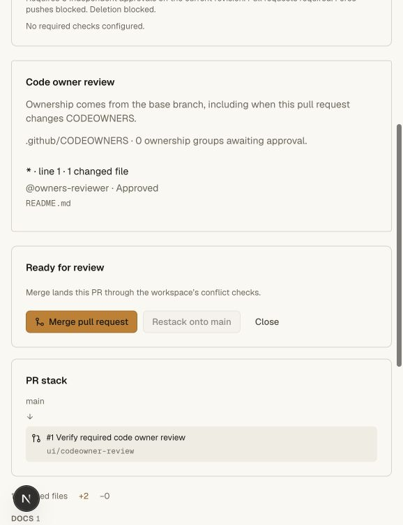
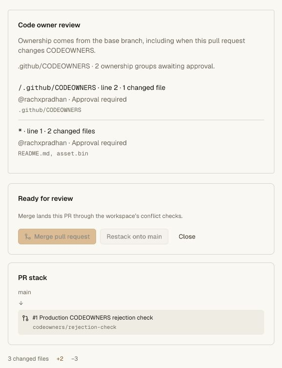
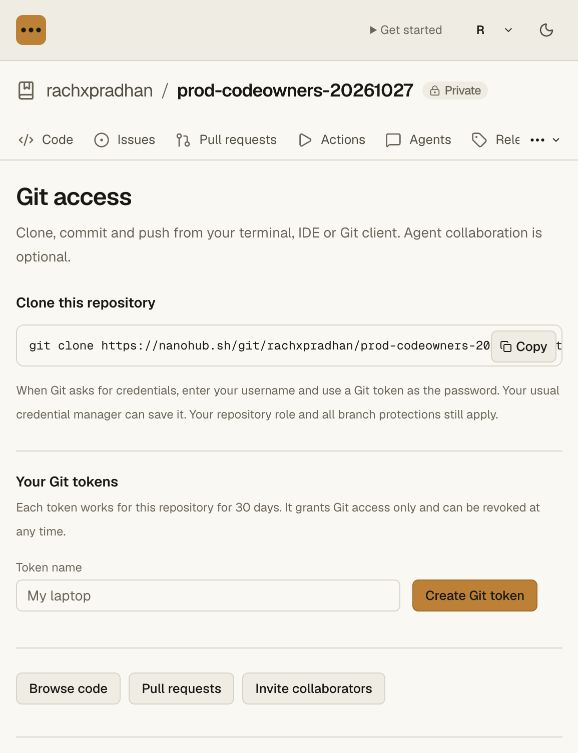

# Required CODEOWNERS review validation

The implementation follows the base-file, owner-permission and pattern behavior
documented in [GitHub's code owner guidance](https://docs.github.com/en/repositories/managing-your-repositorys-settings-and-features/customizing-your-repository/about-code-owners),
using native Nanohub namespaces as stable account identities. Team/email mapping
and automatic review requests remain open work.

## Automated evidence

Seven new unit cases cover documented pattern examples, root/directory/basename
matching, escaped spaces and Unicode, case sensitivity, location priority,
last-match and ownerless semantics, invalid-line notices, base-file selection
when the head changes ownership, binary/deletion/mode coverage across 3,102
changed paths, per-group OR approvals, demoted/unsupported owners, file/resource
limits, stale evidence and the final merge gate.

The real Git/HTTP fixture uses three synthetic human accounts, native namespaces,
a private independent repository, scoped Git access and a candidate that tries
to replace its own CODEOWNERS file. It verifies:

- Main rejects direct Git push when only owner review requires a PR.
- The base file controls both ordinary changes and changes to CODEOWNERS itself.
- Author approvals, the owner's actual registered-agent review and injected
  ownership JSON cannot bypass enforcement.
- A mapped independent human writer satisfies each owned group.
- Demotion invalidates that approver for a group with another eligible owner.
- A new head requires a fresh review; an authorized current review then merges.
- The merged PR retains its original base/head ownership decision.
- Fresh clone matches the merged head and passes `git fsck --strict`.
- The entire independent workflow succeeds while Codegraff room services are down.

The full repository gate passes 50 unit cases, the existing repository and normal
Git-client integrations, and this new CODEOWNERS integration. All API, web and
vault tsrs checks pass; the Cloudflare OpenNext bundle builds successfully.

Commands: `bun run --filter @swarm/api test:repository`, `bun run check`, and
`bun x opennextjs-cloudflare build --config wrangler.deploy.jsonc` in `apps/web`.

## Browser evidence

Created a separate local synthetic `codeowner-ui-fixture`, preserving the earlier
branch-layout fixture. A second local human writer owns its changed README via
the base `.github/CODEOWNERS`. Before approval the UI shows one missing ownership
group and disables Merge. After a legitimate independent review, it shows Approved
and enables Merge. The browser completed the merge and rendered the archived
base-ownership decision. Saving the protection form retains the enabled flag.

The UI was inspected at 320, 578 and 1280 CSS pixels; no horizontal document
overflow appeared at the narrow sizes. Temporary viewport overrides were reset.
The local setup token was revoked and its temporary Git checkout removed.

## Hosted acceptance

On 2026-10-27, the private production canary
`rachxpradhan/prod-codeowners-20261027`
(`repo-25411e7a970646f3bfa653f8d24f7d8a`) passed live Git and browser checks on
main Worker version `0c525e16-79c6-4233-891e-c6a115edb922`:

- Real Git pushed a base `.github/CODEOWNERS`, README and binary, then a feature
  changing all three and replacing the proposed head's ownership assignment.
- Main had only the code owner review requirement: ordinary PR requirement off,
  zero general approvals, no required checks, unlocked. The direct fast-forward
  push was rejected and the main ref remained unchanged.
- PR #1 resolved both changed-file groups from the base file to `@rachxpradhan`.
  The proposed unmapped head owner did not replace those requirements.
- The author's actual signed-in approval left both groups awaiting approval and
  Merge disabled.
- A fresh clone preserved both ref IDs and both different CODEOWNERS files and
  passed `git fsck --strict`.
- The temporary repository-only Git token was revoked through the UI. Git then
  returned an authentication rejection; the private plaintext token file was deleted.

Main remains `33e73c27c6d261a16c384cdad6d1514b40305a2f`; the open test PR head
is `63d7791e7f9ed15332fe1fb479940c884558dc48`. The canary remains private with
its protection active. No existing user repository was changed.

Positive independent approval in production still needs a second actual Nanohub
account; synthetic local accounts are not production identities. The positive
approval and merge path passed the local Git/HTTP and browser fixtures above.

