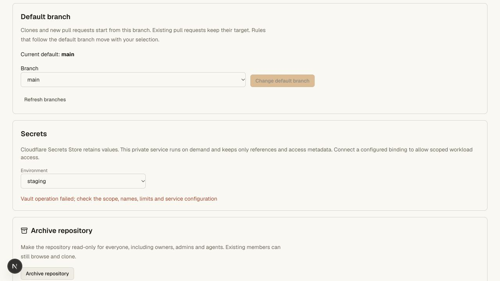
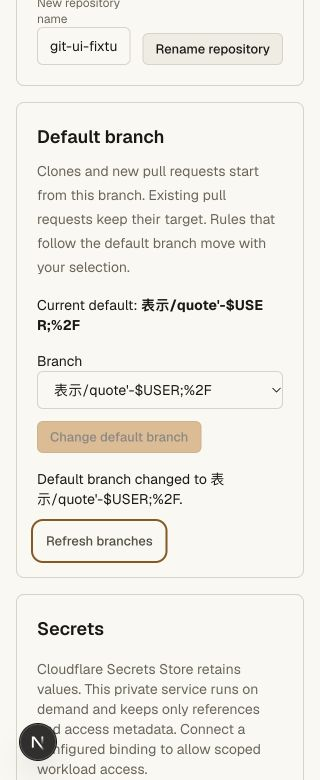
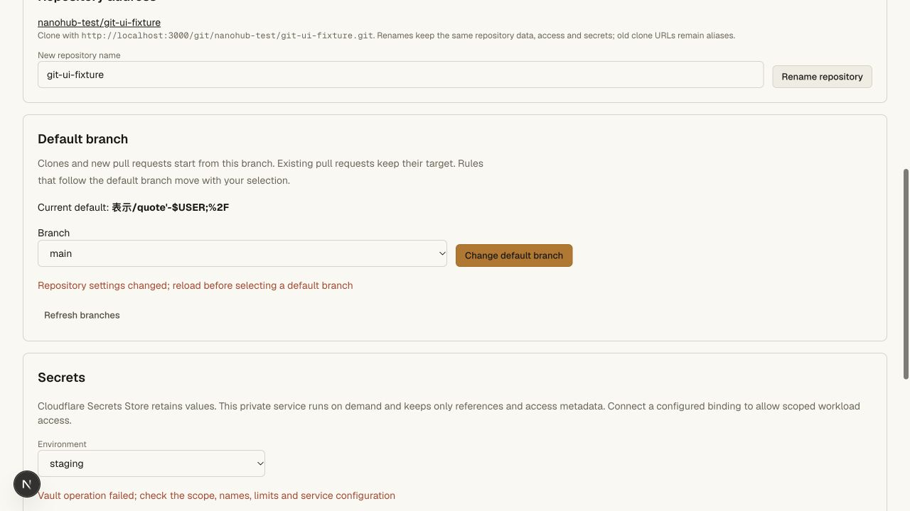
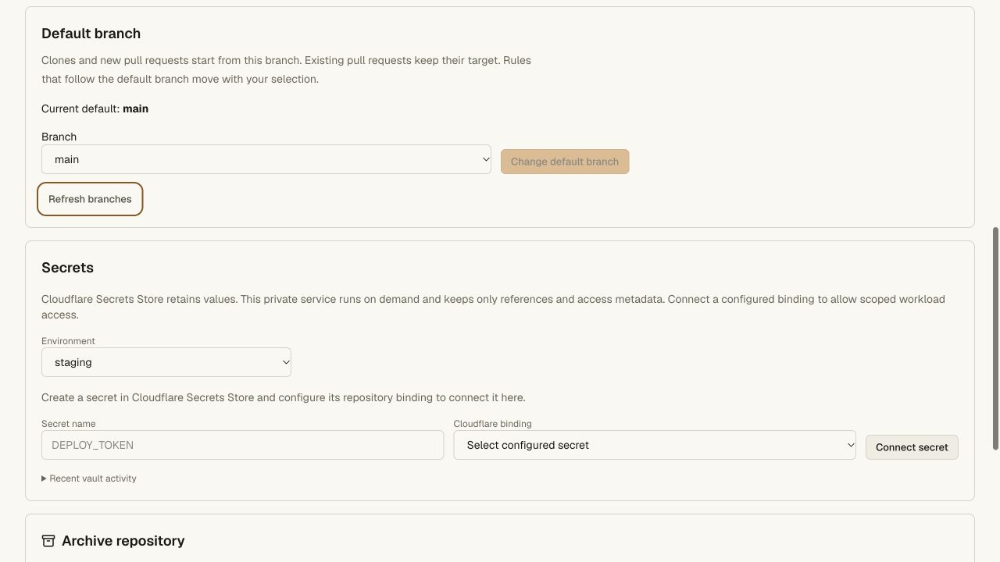
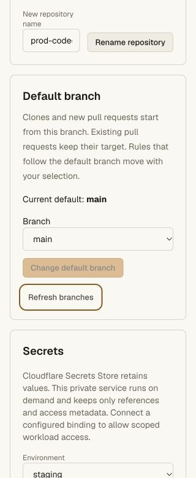

# Default branches and native PR targets — 2026-10-27

The default-aware build adds initial branch selection, existing-branch selection
by current human admins, native symbolic HEAD, actual PR targets, and separate
trusted workflow-source evidence. See [the contract](../default-branch.md).

## Local acceptance

- 233 API unit tests pass, including actual SQLite default-pointer persistence,
  immutable ref preservation, settings CAS/no-op, selected-default deletion,
  dynamic default rules, stale graph-proof refusal and old-target PR checks.
- Full repository gate: 184 focused tests and every Worker/Git smoke pass. The
  expanded default smoke separately passes after adding current-admin demotion,
  namespaced creation/invalid-name privacy, agent denial and divergent-target
  ancestry rejection.
- A main-less Unicode repository pushes and clones through actual Git. Its
  symbolic HEAD changes without moving any refs; migration preserves source
  refs and objects, passes an independent mirror/fsck, and survives restart.
- Existing PR target and independent approval survive default selection. The
  old target still requires its pinned current-default CI and approved exact
  deployment evidence before the immutable candidate can merge. A sibling
  workflow base is valid, while a candidate missing its actual target is denied.
- The trusted controller uses a **synthetic adapter**. Codegraff transport tests
  use mocks and inspect the trusted default's workflow rather than replacement
  candidate YAML; they do not allocate a cloud VM or prove a real deployment.
- CLI 0.4.6: 29 tests / 237 assertions pass, including omitted versus explicit PR
  bases and selecting the newly created PR in a newest-first snapshot. The
  portable module has 40,011 bytes and SHA256
  `6f70ef1a2596cea4ec05af682459369be20d387d1a550f0c79f5d8351814b06c`.
- Hosting gate (19 focused tests at that run) and access/vault gate pass. Pinned
  tsrs across all workspaces, web Worker types, OpenNext production build and
  diff whitespace checks pass. The added Codegraff sibling-workflow test passes
  in the final 233-test unit suite.

## Browser acceptance

The existing local `nanohub-test/git-ui-fixture` selected a literal Unicode and
shell-punctuation branch, showed success and then restored main. A second tab's
stale settings revision was rejected; the alert took keyboard focus and Refresh
branches recovered. Default controls wrap at 320 px. The People table now owns a
keyboard-focusable horizontal scroller instead of widening the page; measured
`documentElement.scrollWidth === innerWidth === 320`. Desktop width was 1280 px.
No local Git refs, policy objects or credential grants were changed by this UI
check. The unconfigured local vault error is unrelated to these default controls.

## Production acceptance

Worker **e647e78f-301d-49c3-860d-d2fe70db0cdb** was uploaded and deployed in full.
The actual published CLI 0.4.6 installer passes its checksum/manifest checks,
installs into an isolated path containing a quote and space, and runs both aliases
outside the checkout. Legacy public entrypoints still respond. No global
launcher or Git helper configuration was changed.

The first readiness checks correctly returned retryable 503 while the existing
repository object retained older code. The same deployment subsequently exposed
the new receiver. Read-only comparison confirms default main / settings revision
0, the same six refs and CI history, the same archive/environments, and the same
three protection objects at storage revision 3. PR #1 retains its head, main
target and current-default workflow base; two CODEOWNERS groups and a missing
required deployment still block the live Merge control.

The final UI-only wrapping refinement is Worker
**903efb9c-c80d-4f78-b24c-86fabf1274ad**. Long hosted account IDs and clone URLs now
wrap. A live 320 px check measured document width 320 px, and the default selector
and button fit; the desktop check used 1280 px. The final public Worker/version
and unchanged CLI manifest pass, and anonymous private-settings reads return 404.
No production default, refs, protections, reviews, runner or credential grants
were changed by these checks. No new test credential was issued. Existing test
credentials remain revoked. Positive selection/push/clone/merge/migration writes
were exercised in the isolated local Worker; this was read-only production
validation of the new setting, not a production default mutation or live VM run.

