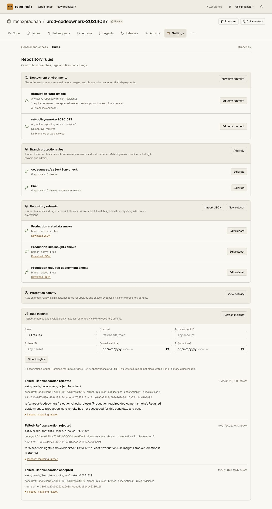
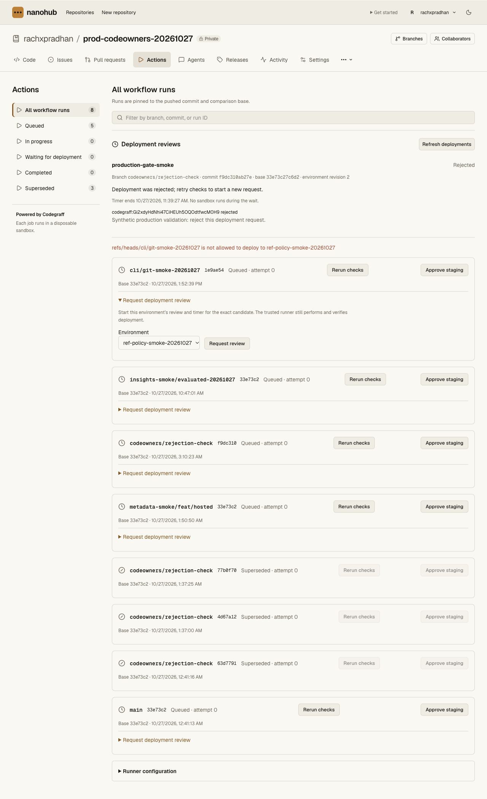
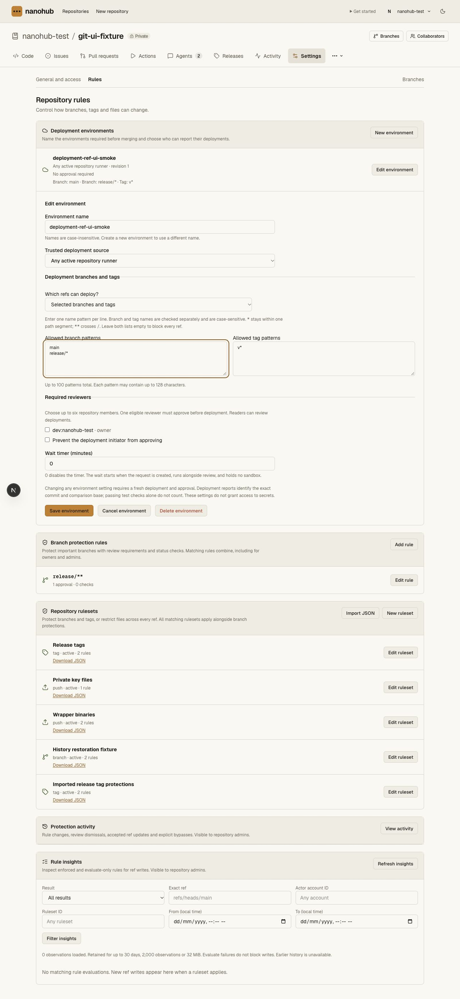
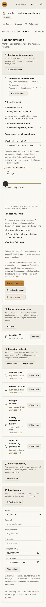

# Deployment branch and tag policies — 2026-10-27

Main Worker `3a997244-9e0f-4c56-b793-74ced36a08a5` is deployed at 100%.
The vault service and bindings are unchanged. CLI v0.4.2 is also published;
its human Actions listing now uses native run state and canonical branch/tag refs.

## Behavior

Environment configuration adds `deploymentBranchPolicy` with all, protected or
selected modes. Omission preserves the existing unrestricted behavior. A selected
policy has separate branch/tag patterns; an empty selection denies every ref.
The UI explains case-sensitive, path-aware matching and the protected-mode
fallback when no branch protection exists. Current classic rules and active
branch rulesets qualify; evaluate-only/disabled rules and actor bypass identities
cannot make an otherwise unprotected branch eligible.

Policy checks run at request, review status, authorization, report completion,
and use of stored success for protected merge. A restricted environment requires
pre-deployment authorization even without reviewers/timers. Environment revisions
invalidate older requests, authorizations and recorded success. Other reviewer,
self-approval, timer, runner-source, archive and exact-candidate checks continue.

CI now stores canonical tag refs, raw tag object IDs and peeled commit IDs.
Lightweight and annotated commit tags are executable; non-commit tags remain Git
objects without executable CI runs. Same-named branches/tags have independent
event keys and leases. Annotation changes and tag deletion supersede their own
runs, even when the peeled commit is unchanged. An unchanged tag can be retried
against a fresh current main base without rewriting its ref.

The trusted Actions controller accepts separate push branch/tag filters, exports
the correct reserved ref/type/name variables, and checks exact checkout SHA.
Older release tags need not descend from the current trusted workflow base.
Workflows still come from that pinned main base; full Actions expressions,
matrices, marketplace actions and `jobs.environment` remain unsupported.

## Verification

- **204 API unit tests** pass, including six SQLite policy/context tests and two
  controller tests for typed filters and reserved tag identity.
- **23 CLI tests / 187 assertions** pass, including the corrected native Actions
  text output and unchanged JSON contract, plus actual portable installation.
- The complete repository gate passes **157 unit tests and 22 smoke invocations**
  (21 script files plus the bundled CLI variant). The new real Worker/Git smoke
  covers branch/lightweight/annotated/non-commit tags, an older release commit,
  same-name isolation, typed patterns, authorization/report spoofing refusals,
  current active protection, revision invalidation, fresh independent reviewers,
  annotation retarget/delete lease invalidation, protected merge, unchanged-tag
  retry on a moved main base, restart persistence and exact clone/fsck.
- All three pinned tsrs check tasks, the real OpenNext build and
  `git diff --check` pass.
- Local UI creation and edit persisted separate branch/tag patterns. Switching
  modes retains unsaved patterns. Invalid glob submission focused the error and
  preserved the form for correction. A development Worker reload invalidated a
  local dev session; refreshing that session allowed the intended form check.
- Rendered at 1280px, 768px and 320px. At each size the document matched the
  viewport width. Mobile environment rows stack the edit action below their
  content, preserving space for long names and pattern summaries. The temporary
  viewport override was reset.

## Production

The signed-in private canary retains its original `production-gate-smoke`
environment at revision 2. A separate synthetic environment,
`ref-policy-smoke-20261027`, was saved at revision 1 with selected mode and empty
branch/tag lists. Its hosted summary explicitly says no branches or tags are
allowed. No reviewer, runner credential, secret binding or branch requirement
was added by this environment.

On Actions, requesting this environment for the existing
`cli/git-smoke-20261027` candidate returned:

> refs/heads/cli/git-smoke-20261027 is not allowed to deploy to ref-policy-smoke-20261027

No request was created for the denied environment; the existing rejected review
remains the only deployment request. The existing run counts and candidate SHA
are unchanged. No runner was registered or claimed, no sandbox/deployment ran,
and no credential was created. The synthetic deny-all environment remains for
inspection. Existing branch protections, rulesets and the original environment
were not edited during this hosted check.

The published v0.4.2 manifest/module checksum matched the build. Its real public
installer ran in an isolated quoted temporary prefix, both command aliases worked
outside the checkout, and the temporary installation was removed afterward.
Current public version and legacy routes pass, including `/cli`'s existing
same-origin 307 redirect to a 200 page. Earlier production Git/API test credentials
remain revoked. Private metadata receipts remain in the local validation folder.

This is a narrow Operate refinement of the incumbent Paper/Geist settings UI.
No visual-world replacement or design-system document was created. Impeccable's
launcher was unavailable earlier (exit 126); no detector pass is claimed. The
Next.js development badge in local captures is tooling, not production UI.
