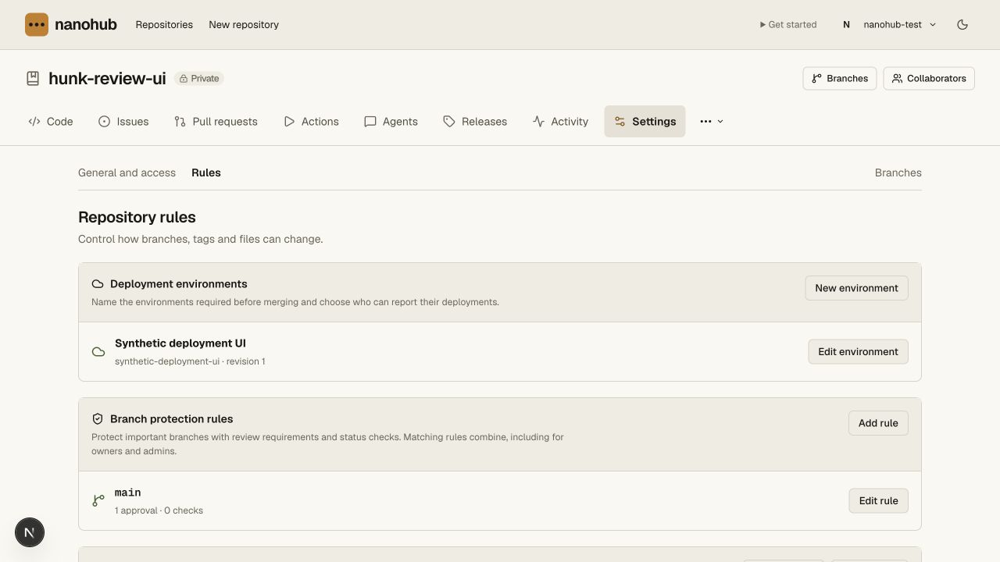
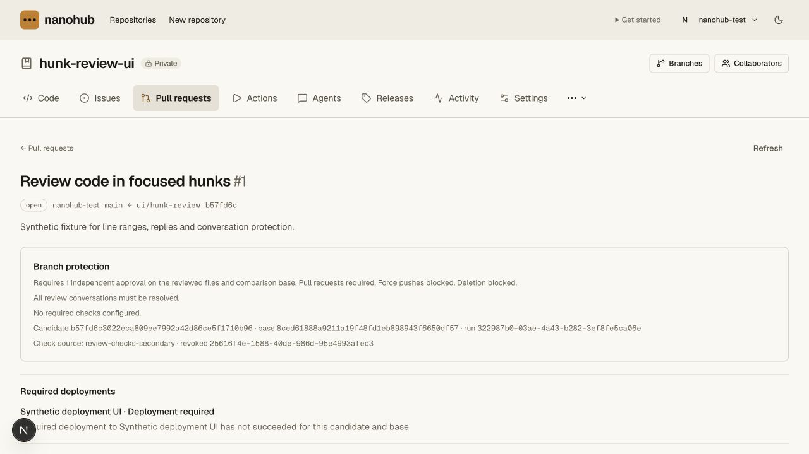
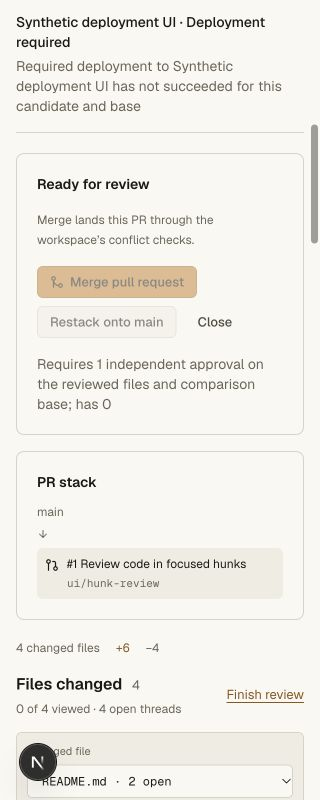
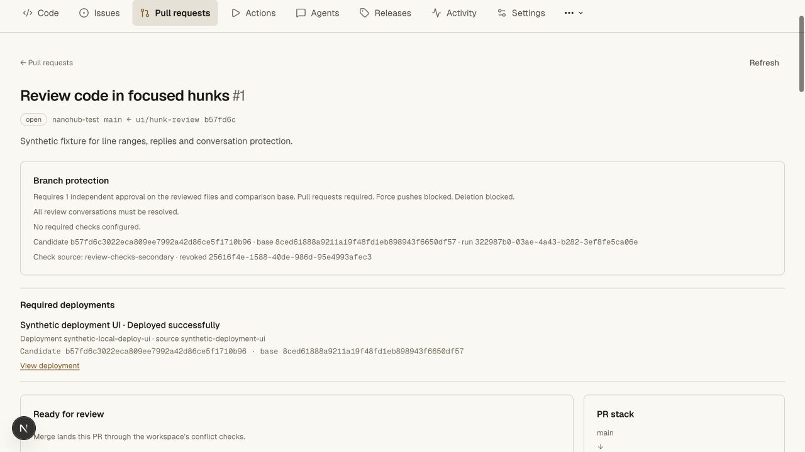
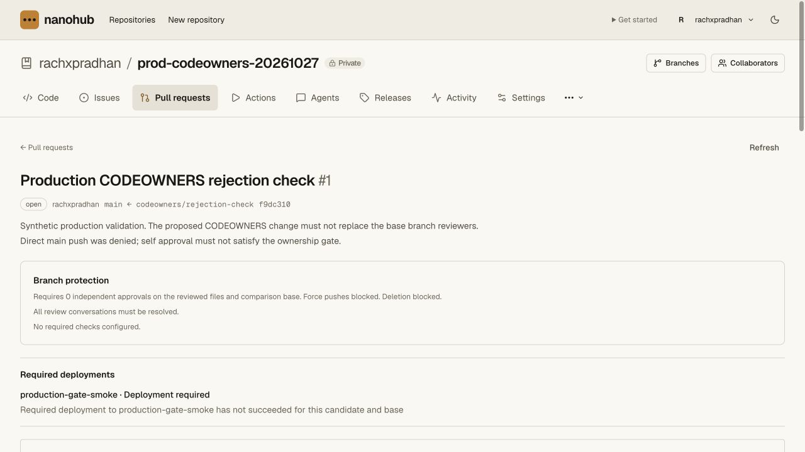
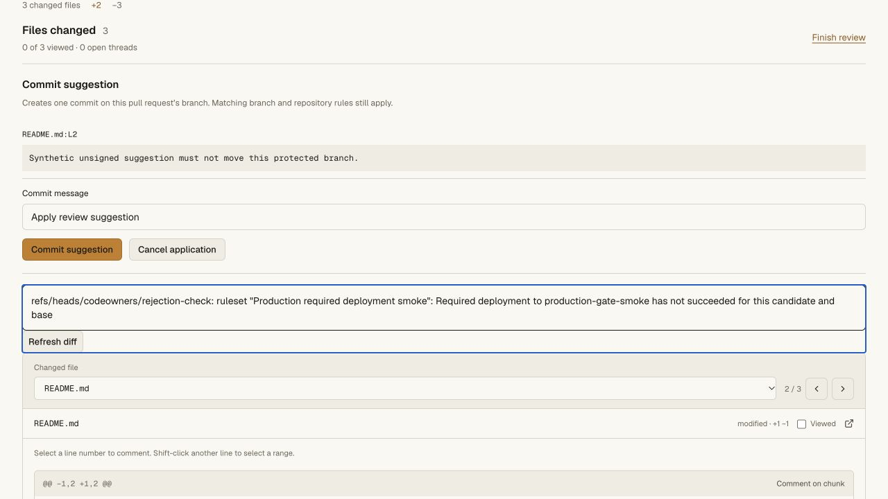
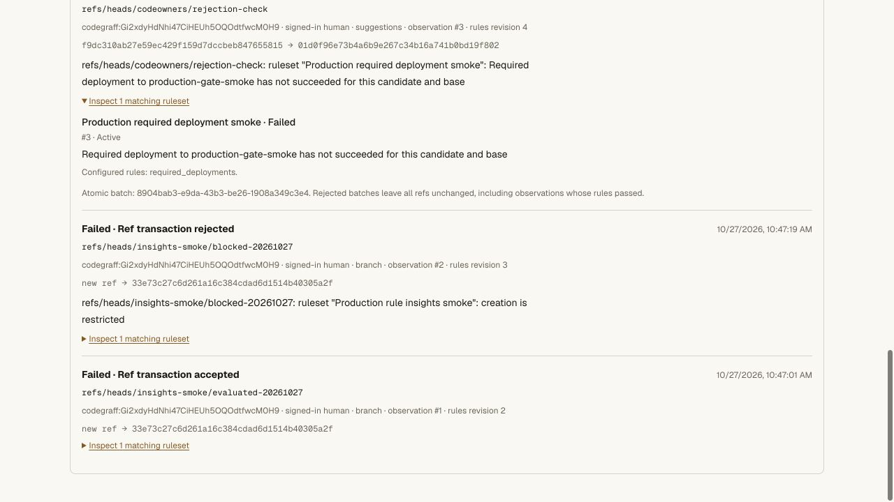

# Required deployment validation

## Implemented behavior

Named deployment environments have stable IDs, case-insensitive names and an
optional trusted repository CI registration. Human admin/origin boundaries,
configuration revisions and audit use the existing repository boundary. A
deleted environment cannot silently remove a requirement or reuse its old
verification records. No secret values are stored in this configuration.

Classic protections and branch `required_deployments` rules require successful
reports for the exact candidate/main-base. Requirements compose and enforce at
final serialized ref creation/update/merge, including suggestion and restack
paths. Evaluate rules report failure without blocking. Explicit human bypass is
ruleset-local; classic requirements still apply. Atomic batches bind every ref to
their pre-push main base.

Reports come only from an authenticated active CI lease. Runner ID, run, attempt,
environment ID and revision are derived internally. Wrong sources, candidate,
base, timestamps, unknown fields, invalid URLs and unknown environments reject.
Ordinary green checks do not count. A latest failure/cancellation, source change,
environment revision or reporter revocation invalidates eligibility. Reports
verified before a configuration change cannot acquire its new revision at
delivery. Exact completion retries do not duplicate records.

Deployment records and completed CI state commit in one transaction; a late
failure rolls both back. Successful merge snapshots retain their deployment
gate after later environment deletion. A CI retry alone does not erase a real
deployment, which remains bound to its exact IDs and current trust checks.

## Automated evidence

Eleven new SQLite cases cover environment validation/case identity and source
selection, idempotent configuration, revision/deletion/recreation, tests-only
denial, leased-source and exact head/base validation, unknown fields and URL
boundaries, latest failure/cancellation, completion retries, revocation and
same-name replacement, classic/ruleset composition and evaluate mode, human
bypass intersection, late rollback, owner-approved legacy staging bridging,
JSON transfer, timestamp/configuration races, protected creation and pre-push
base binding for atomic main-plus-release updates.

A real Worker/Git/HTTP suite exercises owner/admin settings and reader/writer
denial, wrong origin and source rejection, ordinary Git pushes and independent
review, green tests without deployment, forged merge JSON, malformed reports,
wrong reporter, source changes, revoked/same-name replacement registrations,
separate check/deployment reporters, overlapping named requirements, native
`required_deployments` import/export, final protected merge, archived evidence
after environment deletion, audited changes, exact fresh clone and strict fsck.
Temporary runner and Git credentials are revoked in cleanup. Deployment reports
are synthetic trusted-reporter fixtures, not claims of live provider deployment.

The final gate passed **133 repository unit tests and fourteen real Git/HTTP
suites**. All **174 API unit tests**, API/web/vault tsrs checks and the hosted
OpenNext build passed. The existing RPC disposal warning remains without a
failed test.

Commands: `bun run test:repository`, `bun run --filter @swarm/api test:unit`,
`bun run check`, and `bun x opennextjs-cloudflare build --config
wrangler.deploy.jsonc` from `apps/web`.

## Local browser evidence

The synthetic `hunk-review-ui` fixture received one named environment and a
temporary required-environment selection on its existing main policy. Its PR
showed the missing deployment and disabled merge. The settings editor displayed
the configured source and selected environment without changing them.

A synthetic authenticated lease report then showed **Deployed successfully**,
with deployment ID, source, full candidate/base and external evidence link. The
independent approval gate still blocked merge. No PR or main ref moved. Desktop
and 320 CSS-pixel views were visually inspected; document width remained 320.
The viewport override was reset. Original policy was restored, synthetic alias
and environment removed, runner revoked and private fixture receipt deleted.

## Hosted validation — 2026-10-27

Worker `8c4e266a-593b-4f2f-9083-7aacb040e629` replaced
`8c2c6301-b314-40f4-bbd9-c30dd2d48ccd` at 100%. The authenticated production
browser used the existing private `rachxpradhan/prod-codeowners-20261027` canary
and signed-in owner session.

- Created environment **production-gate-smoke** without creating any runner
  credential. Its source selector correctly showed no active registrations.
- Imported active **Production required deployment smoke**, ruleset #3, scoped
  only to `refs/heads/main` and `refs/heads/codeowners/rejection-check`, requiring
  that one environment. Existing classic policies and other rulesets were
  retained, including source signature requirements and main CODEOWNERS.
- The PR displayed its missing deployment and disabled merge. Reused the
  already-resolved synthetic suggestion thread
  `32ca00a8-39d3-42fb-ae44-f60e4eb8a9d6` without creating another comment.
- Applying that suggestion returned the explicit ruleset error:
  `Required deployment to production-gate-smoke has not succeeded for this candidate and base`.
  The application was cancelled and selection cleared. No application receipt
  or applied indicator was produced, and the thread stayed resolved.
- Insight observation #3 persisted after a full reload, with source `suggestions`,
  rules revision 4, failed active `required_deployments`, rejected transaction,
  old source `f9dc310ab27e59ec429f159d7dccbeb847655815` and refused candidate
  `01d0f96e73b4a6b9e267c34b16a741b0bd19f802`.
- Branches still showed source `f9dc310` and main `33e73c2`; the PR remained
  open with zero unresolved threads, two outstanding CODEOWNERS groups and merge
  disabled. There are still four branches. No Git ref, main classic policy,
  signing key, member, runner credential or vault value changed in this check.

The named synthetic environment and added ruleset remain enabled as canary
evidence. Production rejection and its retained insight are verified; positive
production deployment/provider execution is not claimed. Multi-reporter positive
deployment/merge behavior is proven by the local Worker/Git/HTTP suite above.
The private Cloudflare vault version/bindings were unchanged.

## Remaining work

This implements required deployments and trusted reporting. Required environment
reviewers, self-review prevention, wait timers, deployment branch policies,
workflow `jobs.environment`, environment-scoped secret release, nonterminal and
inactive deployment statuses, complete deployment history APIs and full GitHub
response-schema compatibility remain open. The staging adapter retains its
existing owner approval and real-service/version acceptance contract. Live
Codegraff/Meld activation and positive cloud deployment are not established by
the synthetic tests above. Cloudflare vault values and idle behavior are
unchanged.

Required reviewer and wait timer coverage was subsequently added; see
[environment approval evidence](environment-approvals-validation.md).
