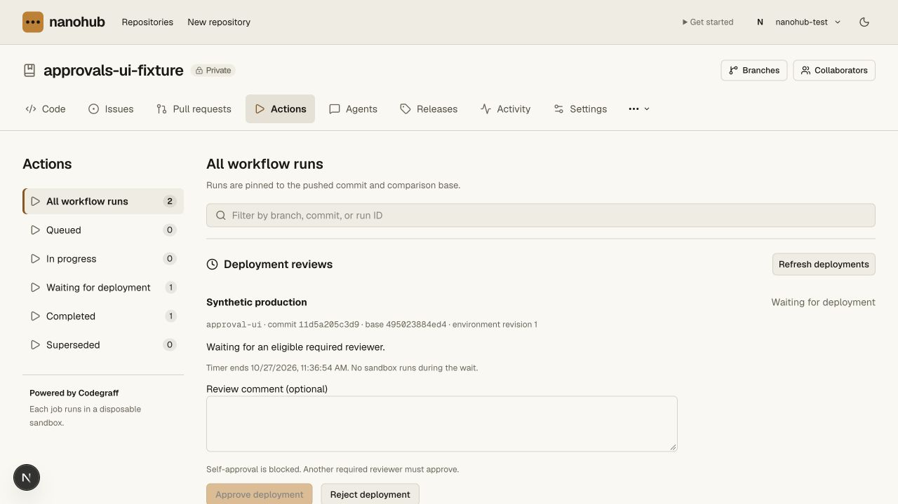
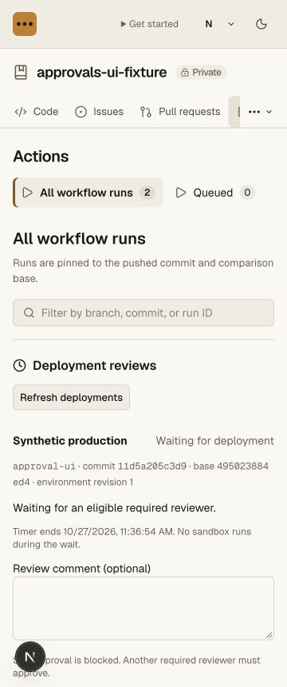
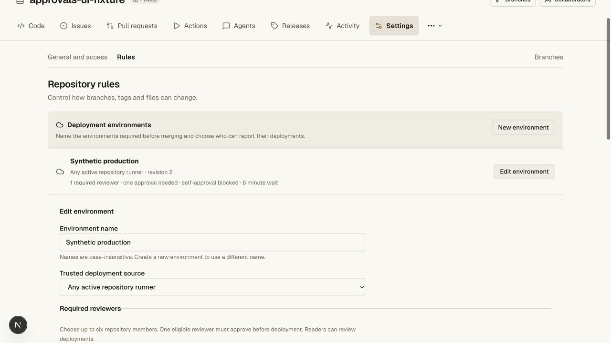
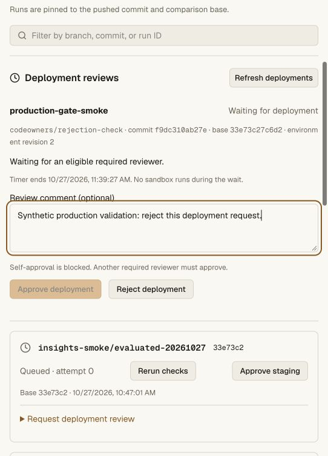
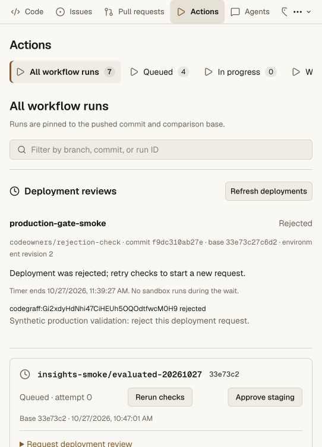

# Deployment approvals and timers — 2026-10-27

Protected environments now accept up to six stable account reviewers, optional
self-approval prevention, and an integer wait timer of 0–43,200 minutes. One
configured current repository reader or higher can approve. An initiator may
reject their own deployment but cannot approve it when prevention is enabled.
These limits follow [GitHub's environment API](https://docs.github.com/en/rest/deployments/environments).

Requests bind environment ID/revision, exact candidate/main base, source branch,
CI run generation and trigger identity. They are idempotent within that context.
A retry, reintroduced run, source revocation, environment edit, candidate change
or base move invalidates old approval context. A reintroduced event records its
new triggering actor. Unknown initiators fail self-approval prevention closed.

Waiting is durable SQLite state, without a running sandbox, CI lease or Git read
lease. A matching runner registration can later claim the request with a new
attempt and lease. Saved successful checks can be reused; a combined check/deploy
adapter that deferred before execution reruns its checks after approval. Waiting
lookups rotate in bounded pages instead of repeatedly scanning only the oldest
blocked requests. Changing the registration requires a new generation and fresh
review. Stale environment requests require an explicit retry, rather than
silently using an altered policy.

Immediately before trusted dispatch, the controller obtains a server receipt
bound to the actual runner/attempt/lease. Reports must carry that receipt for a
protected environment and must have been verified after issuance. The server
rechecks current reviewer membership and the current environment in the final
completion transaction. The receipt ID is not a bearer credential. Candidate
code cannot approve itself or issue a deployment report. Meld's trusted adapter
refuses to reuse a deployment job observed before authorization.

Required reviewers and timer run concurrently. Rejection is terminal for that
request. No implicit admin bypass or secret release is added. Historical
successful reports retain their previous semantics: an environment revision or
reporter revocation invalidates them, while a reviewer later leaving does not
retroactively erase an already completed deployment.

## Local evidence

- Eight new SQLite-backed approval tests cover validation, readers, self approval
  and rejection, 30-day timer/resumption, read-lease invalidation, current access,
  unknown/stale authorization, exact generation/source/attempt, retry/revocation,
  candidate/configuration change, late transactional rollback and trigger identity.
- Controller tests cover durable deferral, the approval/deferral race, rejected
  requests, legacy unconfigured staging and refusal of pre-approval job reuse.
- Real Worker HTTP/Git smoke verifies human/CI/origin boundaries, a reader's
  approval, removal/reinvitation, lease release/resumption, unauthorized reports,
  environment revision changes, wait timers, rejection and a protected positive
  merge followed by a fresh clone and `git fsck --strict`.
- Browser QA at 1280 and 360 CSS pixels verifies self-approval disabled, exact
  candidate/base/revision copy, rejection, successful timer edit and mobile layout.
  The isolated local environment was removed and runner revoked afterward.

The full API unit suite passes **185 tests**. Repository verification passes
**143 unit tests and 16 real Worker/Git smoke suites** (the additional trigger
identity case also passes in the final all-unit run). The CLI adds **5 unit
tests** plus its real transport smoke in that repository suite. All three tsrs
check tasks and the OpenNext production build pass.

## Production evidence

Final main Worker `91b8c258-6909-4642-8d30-cd540f7be5b2` was deployed at 100% after build
and type checks. The hosted request/rejection UI check ran on
`eb3abace-e636-4710-9756-f2716cae3515`; the final release adds the tested
trigger-identity correction for reintroduced runs. Previous main was `8c4e266a-593b-4f2f-9083-7aacb040e629`;
intermediate `5e79bf73-59c1-4efb-be61-8192e3e6fa99` added the initial approval gate.
The final verification reran public health and the unchanged persisted canary state. The private Cloudflare vault was unchanged.

Only `rachxpradhan/prod-codeowners-20261027` was modified. Its synthetic
`production-gate-smoke` environment moved from revision 1 to 2 with its existing
owner as required reviewer, self-approval prevented, and a one-minute timer.
Actions created a request on current candidate
`f9dc310ab27e59ec429f159d7dccbeb847655815`, main base
`33e73c27c6d261a16c384cdad6d1514b40305a2f`. The owner could not approve in the UI
and successfully rejected it; the persisted request showed that rejection.
No runner or Git credential was created, no deployment was dispatched, and no
branch/tag ref moved. The PR remained open with missing deployment and CODEOWNERS
requirements, and merge remained disabled. The synthetic restrictions and
rejected request remain as canary evidence.

Positive approval/timer/resume/deploy/merge behavior is proven locally with real
Workers and Git, not claimed as live Codegraff or Meld deployment validation.
The Codegraff activation prerequisites and full Meld migration remain unresolved.
Deployment branch policies, workflow `jobs.environment`, environment-secret
release, reviewer teams, custom protection providers and admin-bypass controls
remain parity gaps.
