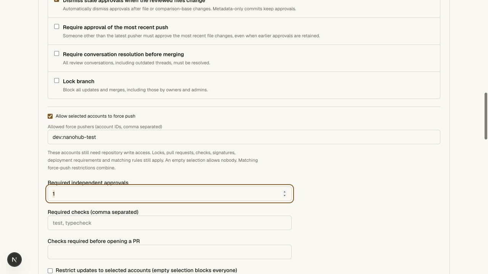
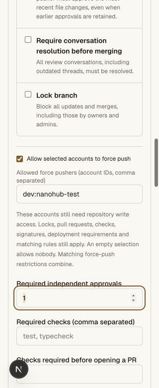
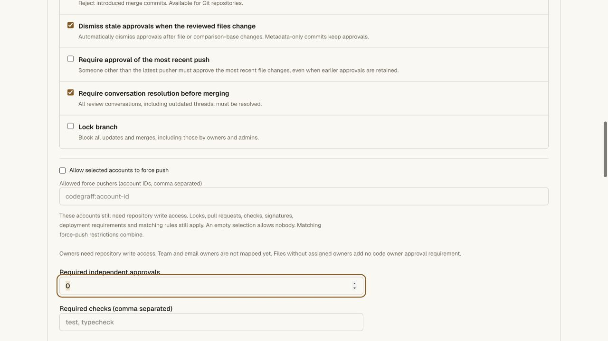
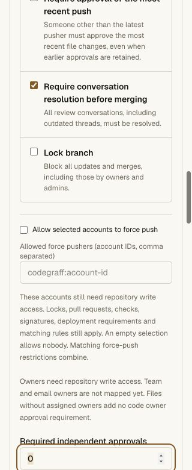

# Selected force-push accounts — 2026-10-27

Classic protection now distinguishes ordinary push access from selected accounts
allowed to rewrite Git history. All other restrictions remain enforced. See
[the configuration contract](../github-parity.md#selected-force-push-accounts).

## Local acceptance

- **242 API unit tests** pass. Five new cases cover validation, normalized IDs,
  ordinary fast-forward writes, empty/default denial, intersecting restrictions,
  current permission at final write, independent protections, force audit and
  refusal to send new fields to an older receiver.
- A new graph regression first failed against the earlier implementation. It now
  rejects rewinds and divergent descendants restoring restricted paths,
  extensions, long paths or oversized files from already reachable history.
  Nested annotated tags and evaluate mode are included. Updated final writers
  reject earlier file evidence missing the transition marker.
- Full repository gate: **193 focused tests** and every smoke pass. The real Git
  case verifies selected owner/CLI/agent rewrites, denied writer/admin rewrites,
  ordinary writer fast-forwards, explicit force-with-lease, HTTP restack, overlap
  intersection, unconditional/empty denial and preserved main.
- Actual Git still rejects locks, deletion, PR/check requirements, merge-bearing
  history under linear rules, unsigned commits, independent no-force and path
  rules, and missing deployment evidence. An allowed account cannot use an
  atomic multi-ref push to partly apply a permitted rewrite beside a denied one.
- Content-changing force pushes dismiss tree-bound approvals and supersede
  old-head CI. Current role demotion, archive, restart, independent mirror clone
  and `git fsck --strict`, accepted force/actor audit and revocation pass.
- Native CLI protection exports preserve the field; revision-bound edits and
  stale refusal pass through actual Bun. The existing CLI module remains 0.4.7,
  43,944 bytes, SHA256
  `449394c143fe0d033f459e4e2bb98a86addcceb0d79c85a32ed625338c0588f2`.
- CLI **32 tests / 260 assertions**, hosting, access/vault, pinned tsrs across
  workspaces and web Worker types pass. The production bundle is rebuilt after
  the graph-proof change. No cloud VM execution is established by these tests.

The local browser checks the default disabled account field, enabling a draft
selection, entering an account ID, disabling the field again and cancelling.
These are unapplied drafts; no local existing protection was weakened by the UI
check. The backend smoke separately exercises real writes. Desktop width is
1280; mobile document and viewport widths are both 320 px.

Production rollout/readiness and preserved configuration are recorded separately
below; positive local rewrites are not a production credentialed force-push test.

## Production acceptance

Worker **1b67a6fb-1538-48df-ac52-31c7b985d668** is deployed. The stateful
protection snapshot reports `forcePushActors: true`, storage-backed revision 3
and the same three policy objects as before rollout. All six canary refs,
default main/settings revision 0, archive state, environments and CI history
are unchanged in the before/after comparison.

The live main-rule editor shows the selected-account option unchecked and its
account input disabled. The existing force-push restriction remains checked.
Desktop and 320 px mobile views were inspected; the mobile document width is
320 px. The production form was cancelled without saving. No new production
credential, force push, review or policy mutation was performed for this rollout.

Public verification passes for the deployed Worker version, unchanged published
CLI 0.4.7 module bytes/checksum, private protection refusal for an anonymous
request and CLI API authentication refusal. The private machine receipt is at
`~/.config/nanohub/prod-validation-2026-10-27/force-push-public.json`.
The Secrets Store Worker was not redeployed. Cloud VM execution remains outside
these results.

