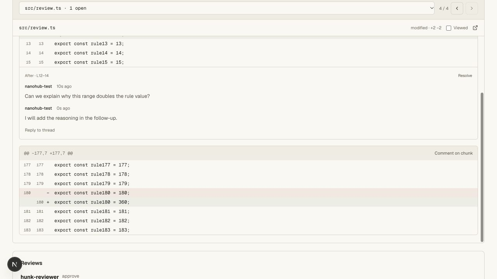
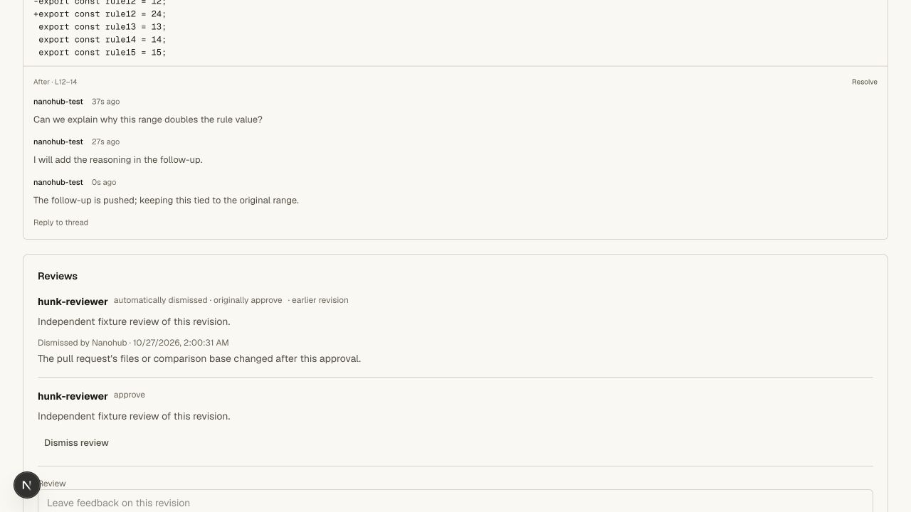
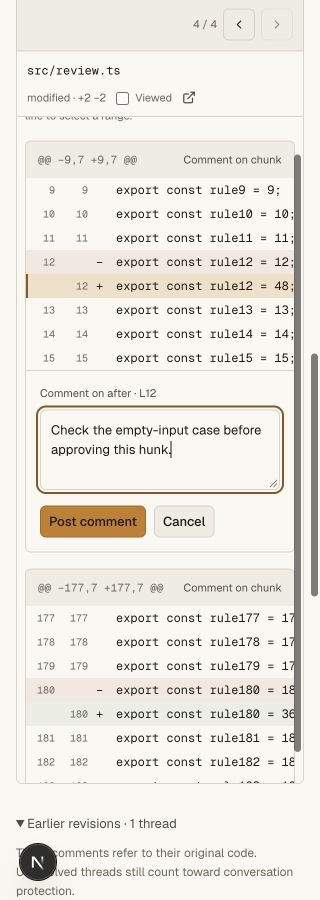
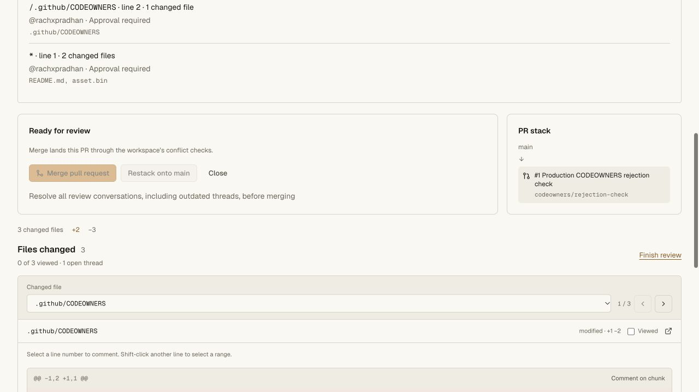
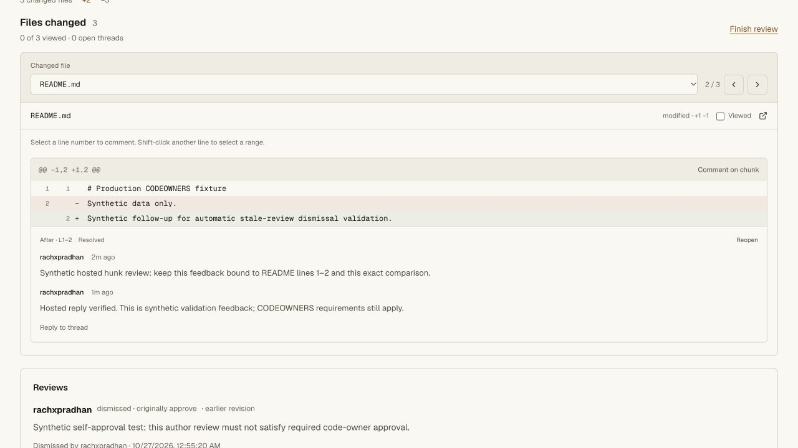
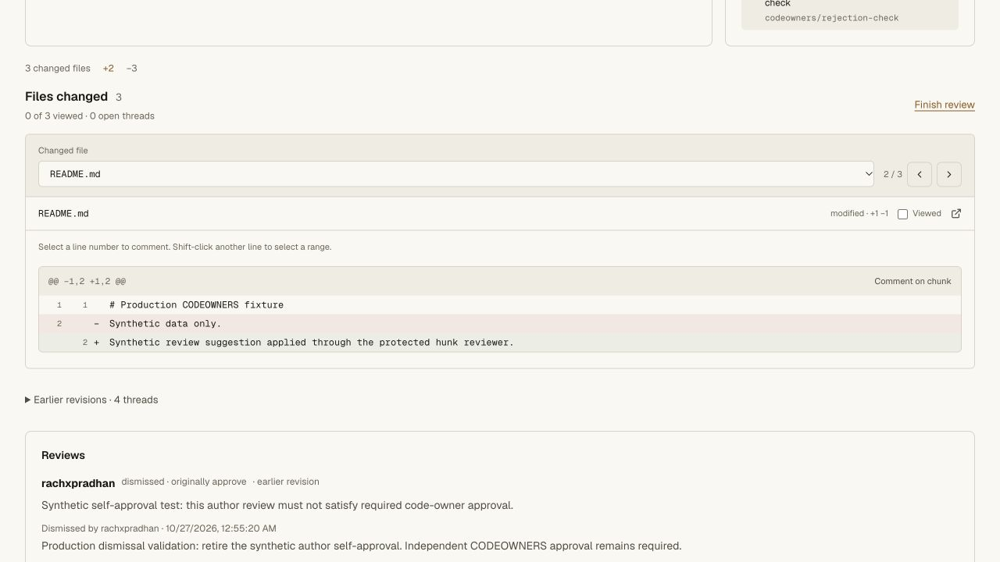
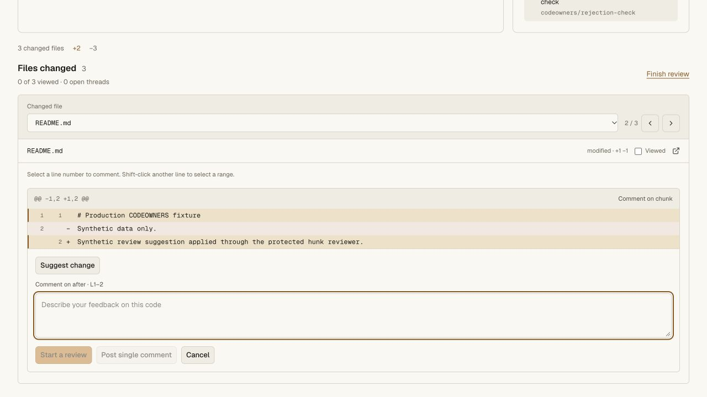
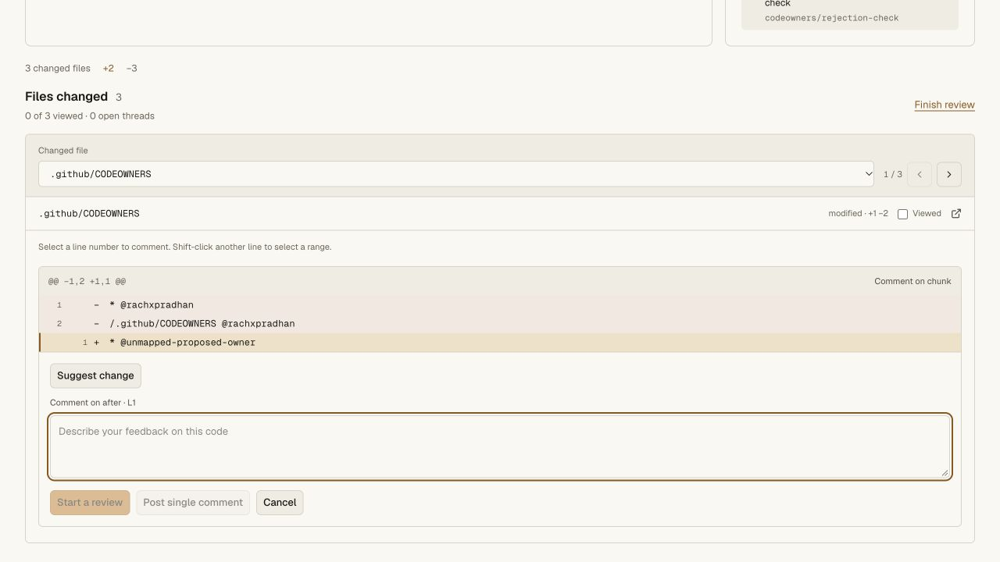

# Native PR hunk review validation

## Scope

Pull requests now have a bounded file-by-file hunk reviewer, line/range comments,
replies, resolve/reopen controls, and an earlier-revision discussion section with
the original server-derived code excerpt. General Comment/Approve/Request changes
reviews and their existing protection rules remain separate.

New threads are scoped to one PR, immutable head/comparison, path, side and line
range. The server validates the actual visible patch and rechecks current writer
membership and observed revision before its serialized write. Replies derive
their original selection from the root. Unknown fields cannot assert an author,
resolution, or trusted anchor. All unresolved PR roots participate in final merge
protection, including earlier revisions and deleted files.

## Automated checks

- Five new SQLite/graph tests cover PR isolation with identical commits,
  idempotency without reopening resolved threads, identity/ID conflicts,
  head/comparison races, closed PRs, outdated replies, cross-thread/side/revision
  rejection, deleted-file merge gating and bounded hunk ranges.
- The real Worker/Git/HTTP suite exercises private repository access, reader and
  same-origin boundaries, invalid path/side/range rejection, spoofed-author and
  unknown-field rejection, stale requests, duplicate retries, independent review,
  blocked merge, a second PR sharing its commit, removed-file threads, a new push,
  original-anchor replies, resolve/reopen, writer demotion, compliant merge,
  read-only merged discussion, exact fresh clone and `git fsck --strict`.
- The full repository gate passes **75 unit tests and seven Git/HTTP suites**.
  The two existing published-version comment tests also pass after the shared
  comment types were moved into a type-only module.
- API, web and vault tsrs checks pass. The OpenNext hosted build passes.

Commands: `bun run test:repository`, `bun run check`,
`node --experimental-transform-types --test packages/api/scripts/code-comments.test.mjs`,
and `bun x opennextjs-cloudflare build --config wrangler.deploy.jsonc` in `apps/web`.

## Browser checks

Private local `hunk-review-ui` uses four synthetic files: two separated TypeScript
hunks, a removed source file, a Markdown edit and a binary asset. A browser-created
comment selected new lines 12–14 by Shift-click. Its draft survived switching
files. Posting and replying preserved the range and returned focus to the thread.
With an independent fixture approval already present, the unresolved thread
disabled Merge and displayed the server's conversation-resolution reason.

A real follow-up Git push moved the discussion to Earlier revisions. The original
hunk still showed the prior value, and a new reply remained attached to that
original selection. Resolving enabled the otherwise compliant merge; reopening
disabled it again. The PR was left open. Temporary Git credentials were revoked
after each fixture operation and the temporary checkout was removed.

The 320 CSS-pixel page had document width 320. The file controls reflow, code
scrolls within the diff and the comment composer fits the panel. A temporary
mobile draft was cancelled; viewport overrides were reset and temporary tabs
closed. Desktop and mobile screenshots were visually inspected.

## Hosted release

Validated release `151d9d28-b92b-4b96-8841-56dbb96b013c` was deployed at 100%.
At validation, public `/api/agent-help` identified that exact version. Legacy `/install.sh`
and `/download` return HTTP 200. Private vault version and bindings are unchanged.

Hosted inline conversation validation passed in the existing private
`rachxpradhan/prod-codeowners-20261027` synthetic canary, using the existing signed-in
owner session. No new credential or Git push was needed.

- **Comment on chunk** created root `cf96a3c7-f868-4eb1-8469-d321c148b75b` on
  README.md, RIGHT lines 1–2, head `77b0f70` and the existing comparison. The
  synthetic root and reply both persisted after a full page reload.
- Enabled conversation resolution on the canary's existing main rule. All other
  protections were retained, including required CODEOWNERS, strict stale
  dismissal, force/deletion blocks and the existing dismissal-account restriction.
- The unresolved thread produced the exact server conversation-resolution reason.
  Resolve cleared that reason; Reopen restored it; a final Resolve cleared it
  again. Keyboard focus returned to the thread after each mutation.
- Merge remained disabled by the two outstanding CODEOWNERS groups throughout;
  resolving the conversation did not satisfy independent owner approval.
- The binary fixture offered its full-file link without false line-comment
  controls. File navigation and Viewed controls worked. Viewed marks reset on
  full reload as documented.
- The thread is left resolved and the PR open; conversation protection remains
  enabled. No ref, main commit, application source, credential or vault value was
  changed by these hosted review operations.
- The final normal preview measured 1280 CSS pixels, document width 1280 and
  reviewer width 1216, with code contained inside its panel.

## Limits

Private pending review batches and protected suggestion application were added
in subsequent releases; see [pending-review validation](pending-review-validation.md)
and [suggestion validation](suggestion-validation.md). New inline mutations require human writer sessions; ordinary
general-review agent APIs are unchanged. Earlier threads are retained without
automatic line relocation. Comments and drafts bind to exact comparisons; users
must refresh after a concurrent push. Viewed marks last for the page/revision.
No full GitHub review/API parity is claimed.

## Current release recheck — 2026-10-27

The production PR still renders the file selector, bounded diff, line/chunk
controls, earlier-revision threads, review history and disabled merge button
under Worker `f8dd378e-b5d2-4a44-b6a7-fa53198ad60c`. Selecting README.md changed
the displayed patch. At 1280 CSS pixels the document stayed 1280 pixels wide;
the diff panel was 1214 pixels wide with `overflow: auto`.

A focused rerun passed all **24** comment, pending-review, suggestion and
reviewer-access unit tests. The current full gate also passed **114 repository
unit tests and twelve real Worker/Git/HTTP suites**, with **155 total API unit
tests**, all three tsrs checks and the hosted build passing.

This recheck could not reopen the composer through browser automation: button
activation had no visible effect on both hosted pages and an unchanged local
Dev login control, while input editing and file selection worked. No cause is
confirmed. The prior successful production comment/publication/application
receipts above remain historical evidence; a fresh successful hosted composer
interaction is not claimed. No new review, thread, credential or ref was created
by this recheck.

### Follow-up interaction verification

The user confirmed that Add rule/Edit rule work by clicking. Native keyboard
Space activation then opened and cancelled those forms and the production hunk
composer under release `8c2c6301-b314-40f4-bbd9-c30dd2d48ccd`. The README hunk
selected RIGHT lines 1–2 and displayed the private-review/single-comment controls.
Its empty draft was cancelled. No application handler changes were needed.
The earlier interaction-verification gap is resolved; the pointer-control cause
was not diagnosed. A later synthetic signature test also published and resolved
one hunk suggestion without changing the source ref; see [signature evidence](signature-validation.md).

### Production confirmation — 2026-10-27

The user confirmed that the Rules forms open normally. A fresh check of the
existing production PR under Worker `7ba197aa-201b-4901-aefc-2b5b23e8d6d9`
opened **Comment on chunk** with keyboard Space on `.github/CODEOWNERS`.
The composer selected after-side line 1 and displayed Suggest change,
Start a review and Post single comment. The empty composer was cancelled;
no review, comment, credential, policy or ref was changed. The PR remained
blocked by two outstanding CODEOWNERS groups and its required deployment.

All **44 focused unit tests** passed across inline comments, pending reviews,
suggestions, reviewer membership, staleness, dismissal and CODEOWNERS.
Both real Worker/Git suites (`smoke-pull-comments.ts` and
`smoke-pending-reviews.ts`) passed, including protected merge and clone/fsck
checks in isolated fixtures. `bun run check` succeeded with all three existing
tsrs task results restored from the local Turbo cache. This recheck did not
require a deployment or claim a new production publication test.

