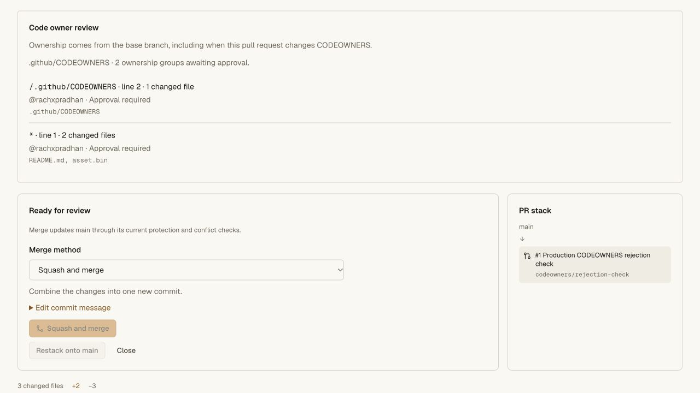

# Protected merge methods and CLI 0.4.14 release — 2026-10-28

Worker **`c5be9de5-8aa1-4a54-bcd9-5f4e067a542a`** replaces
`993b659a-8d24-442b-92b4-f5270a94029a`. The
[sanitized receipt](merge-methods-release-receipt.json) pins the runtime source,
frozen Linux acceptance, independent cleanup, deployment and live read checks.
CLI **0.4.14** is published with 70,056 bytes and SHA-256
`2e0cc05c1efaf28acaa75f1c6bd4214994961df3416141709ae245b6936c4eb3`.

The release includes credential-private CLI batch reviews, shared-head pending
and requested-change blocking, and protected merge/squash/rebase choices. The
existing fast-forward default and strict current-target ancestry requirement
remain. See [behavioral acceptance](merge-methods-validation.md) for the exact
commit graphs, review/CI/deployment binding and remaining merge-method limits.

## Frozen source and Linux acceptance

Runtime implementation `f7e501e449da09fe43e655fe3d067f74995e5781` is copied into
the clean, credential-free acceptance commit
`986ec5906cda9fae72eb23d89ac90a33c2cb9b59`. All **956 source files** match before
rollout. Private deployment configuration and controller credentials are
excluded. No GitHub branch is pushed.

A fresh Codegraff VM pulls the retained private Cloudflare image with a new
short-lived pull credential. Candidate execution has no control credentials,
network access or Docker socket. All eight gates pass: frozen offline install,
API unit tests, the full Worker/Git/protection/CLI/recovery repository chain,
CLI tests, access/vault tests, hosting/pool tests, production Next build and
pinned tsrs checks. The local regression counts are 330 API, 261 repository and
53 CLI cases; the bounded Linux log establishes each complete gate's success
rather than supplying additional inferred counts.

The first attempt fails during registry credential issuance before candidate
upload. A diagnostic reports that the existing OAuth token has expired and its
refresh endpoint cannot be reached; a later refresh succeeds. The retry uses
the same frozen source and separate logs. Both VMs are confirmed destroyed by
the controller and independent provider GETs. The original failure and cleanup
remain recorded.

## Production delivery and state preservation

The full OpenNext Worker build and Wrangler dry run pass before deployment.
The earlier plain Next build cannot be reused with `--skipNextBuild` because it
does not contain OpenNext's standalone output; the full build supplies that
output. No manual manifest or generated-file workaround is used.

Fifteen live asset comparisons match local bytes and MIME types, including the
new CLI/installer/checksum, CSS, JavaScript and fonts. Checked older CLI releases
0.4.8 through 0.4.12 retain their exact bytes. The live version endpoint reports
the new Worker. All **27 bindings**, Worker-first asset routing and the
**50,000-subrequest** budget are unchanged; the recovery hold is off.

Nine authenticated private canary snapshots preserve all existing fields:
branches including PR/review/CI state, protections, rulesets, default branch,
archive, environments, collaborators, secret metadata and runners. The branches
response additionally advertises the four merge methods. Browser authentication
stays inside the browser; no repository credential is issued, and no canary ref,
review, draft or setting is written.

The live PR page renders all four choices with the established theme and Geist
font. Selecting squash changes only the local form; the merge action remains
disabled while CODEOWNERS and required deployment conditions are unmet. The
temporary tab is closed. This is live UI observation, not a production merge
mutation test.

The published installer is downloaded over HTTPS and matched against the built
installer hash. It downloads and verifies CLI 0.4.14, installs into a temporary
prefix containing spaces and a quote, and runs both `nh` and `nanohub` outside
the checkout. Both report 0.4.14; help includes generated merge methods and
pending reviews. The temporary installation is removed and the user's global
installation is unchanged.

Anonymous private Git discovery still returns HTTP 401, a Basic challenge and
private/no-store caching. Vault is not redeployed; its latest deployment remains
**`02dcb88b-5c99-49d9-a4b6-cb95451e6bb5`**.

## Open launch gates

The Nanohub Actions account's configured key still returns HTTP 403 for missing
sandbox scope on a fresh read-only check. Frozen Linux acceptance uses the
separate trusted CI key; it does not replace the Nanohub key or activate an
unattended dispatcher, hosted callbacks or application staging.

Generated merges and private-review mutations are covered by local and frozen
Linux Workers. This rollout adds production delivery, installer, capability and
state-preservation evidence, not live successful mutation evidence for those
new paths. Changing-Git cloud recovery, real application CI/staging acceptance,
load/security/operations gates, primary-host cutover and broader GitHub parity
remain open. Source has not been pushed to GitHub, and production traffic
readiness is not established.
