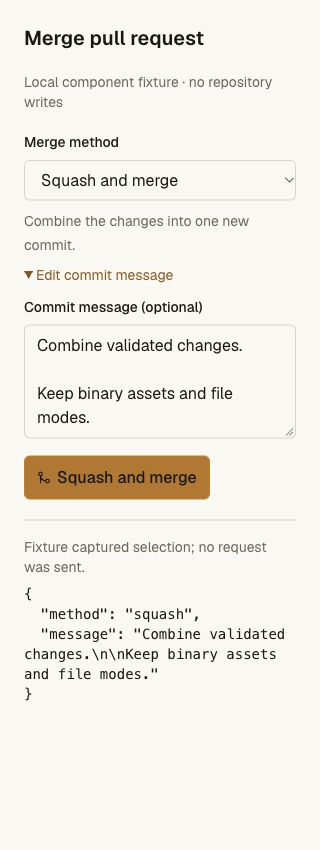
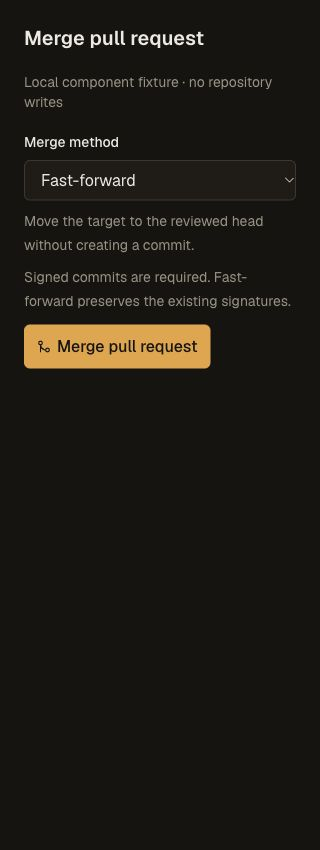
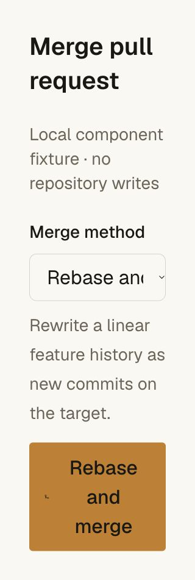

# Strict merge methods — 2026-10-28 JST

The local candidate adds merge-commit, squash and rebase choices to the existing
fast-forward path, browser controls and CLI 0.4.14. At this local checkpoint the
candidate is not deployed or pushed; the subsequent
[release validation](merge-methods-release-validation.md) records deployment.
The [receipt](merge-methods-receipt.json) pins runtime-source hashes,
test logs, standalone CLI bytes and component captures.

## Exact content and final restrictions

All methods require the current target B to be an ancestor of reviewed head H.
Merge commits have parents B/H and tree H; squash commits have parent B and tree
H. Rebase rewrites a linear sequence onto B, preserving raw author identities,
timezones, messages and encoding, dropping originally empty commits and removing
invalidated signatures. Every new result M has H's exact tree and a distinct
commit identity. The feature branch and its original objects stay unchanged.

Current independent approvals, CODEOWNERS, conversations, same-head peer
reviews and trusted checks still apply to H. Actual generated graph proofs
apply file, metadata, linear-history and signature requirements to M. Required
classic/ruleset deployments retain exact H/current-workflow-base evidence
through a trusted old/new/tree-bound merge proof. The final writer checks that
proof against the actual current head, target and result tree. Ordinary pushes
cannot opt into the bridge. The merge receipt distinguishes reviewed H from
landed M, with its method, original target and CI workflow base.

Generated commits are unsigned. Native tests require signatures both through
classic policy and a ruleset and observe rejection; no head-signature flag can
substitute for the generated commit's signature. A generated two-parent merge
fails linear history, while squash/rebase satisfy the actual resulting graph.

## Real Worker/Git acceptance

Both the source CLI and actual standalone distribution built by the release
builder execute all three methods against isolated Workers, SQLite DOs, D1 and
R2. Each case starts with two authored commits, a binary asset, executable file
and symlink. It verifies:

- Missing approvals/checks and reader access are denied. Wrong target SHA and
  unknown method are refused, with the protected target unchanged.
- A requested-change peer PR at the same head blocks every generated method.
- Current locks, signatures, restricted paths, committer metadata and linear
  history remain independent gates.
- Tests without the required deployment are insufficient. Successful trusted
  H/current-base deployments satisfy both classic and ruleset requirements
  after restart, without pretending M was separately deployed.
- An injected missing-method receiver returns 503 with Retry-After 5 and no
  ref movement or fallback to an older merge method.
- The protected merge succeeds through the scoped CLI credential. A lost-answer
  retry returns the already-recorded result; credentials are then revoked.
- An independent clone passes `git fsck --strict`, with exact M/tree/parents,
  original authored names on rebased commits, binary bytes, executable/symlink
  modes and the unchanged feature head. Rebased original H is not an ancestor of
  the newly rewritten chain.

Seven graph/evidence unit cases additionally cover raw non-UTF-8 message bytes,
author timezone and encoding preservation, signature stripping, empty commits,
nonlinear/all-empty refusal, invalid messages/timestamps, distinct SHA creation
and invalid deployment-bridge bindings.

## Regression and UI checks

The API suite passes 330 unit cases. The full repository suite passes 261 unit
cases and its complete real Worker/Git/protection/CLI/recovery chain. All 53 CLI
tests pass, including mutually exclusive flags, observed target binding,
unsupported receiver/policy and refusal without a target observation. Frozen
offline Bun installation passes without dependency changes. Pinned tsrs passes
for API, frontend and web Worker configurations; the production Next build
passes after the final enlarged-text correction.

An artifact comparison exposed working-directory-dependent source-path comments
in Bun's bundle output. The release builder now strips whitespace/comments while
leaving syntax and identifiers unminified. A subprocess regression test first
fails on the original builder, then verifies identical CLI bytes, installer
bytes, manifests and checksums from the repository, API, web and unrelated
working directories. This establishes reproducibility for the pinned Bun
toolchain across those directories, not across arbitrary toolchain versions.
The packaged Worker/Git scenarios and web build are rerun after the correction;
both produce CLI 0.4.14 with 70,056 bytes and SHA-256
`2e0cc05c1efaf28acaa75f1c6bd4214994961df3416141709ae245b6936c4eb3`.
The broader API/repository suites ran before this builder-only correction; the
final CLI suite also exercises installation and execution outside the checkout.

The actual interactive component is rendered in isolation using current
Tailwind/Harness CSS and the local Geist font. Browser tests exercise method
selection, optional message entry and callback payloads, signed-required option
disabling, read-only controls and an older fast-forward-only surface. At 320 CSS
pixels, inputs use 16 px type, the normal action is 44 px high and document width
does not overflow. A 200% root-text-scale check exposed fixed-height button
overflow; automatic height now keeps all three text lines inside the action
(scroll/client height both 176 px). This is CSS text scaling, not a physical
device or browser-zoom acceptance test. The temporary tab, viewport override and
preview server are cleaned up.

## Remaining parity and release work

The default remains fast-forward. Loose checks/divergent three-way merging,
repository method allowlists/defaults, automatic coauthor trailers, nonlinear
automatic rebasing and server signing remain open. Automatic rebase is limited
to 200 commits and 16 MiB of commit metadata. Dependent branches may need a local
restack after squash/rebase because original head refs are preserved.

The subsequent [release checks](merge-methods-release-validation.md) add frozen
Linux acceptance, production delivery and real installer validation. These local
tests do not establish changing-Git cloud recovery, unattended Actions, actual
application staging or production traffic readiness.
