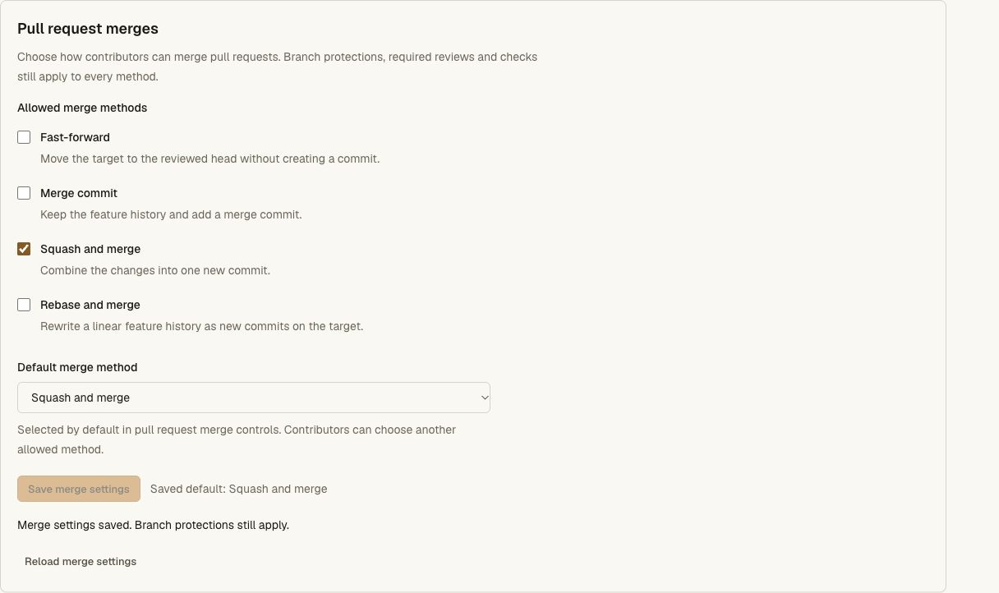
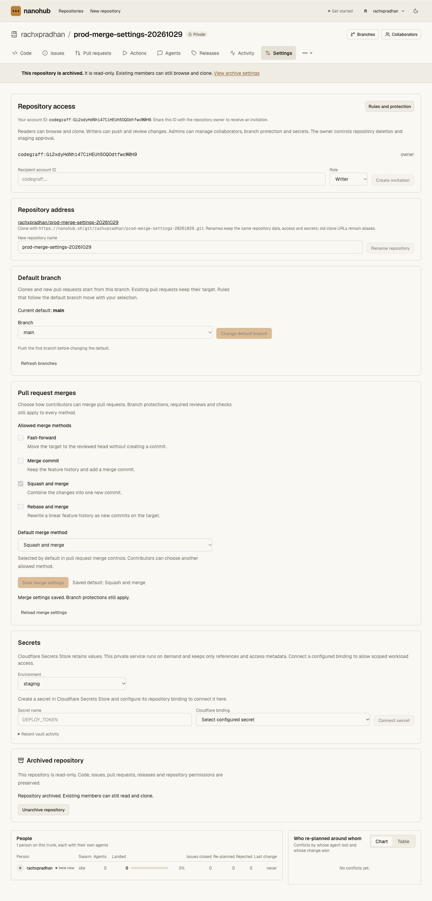

# Repository merge settings and CLI 0.4.15 release — 2026-10-29

Worker **`31d951d3-6a6d-4784-aeaf-34c39995733b`** now serves 100% of main
traffic, replacing `c5be9de5-8aa1-4a54-bcd9-5f4e067a542a`. CLI **0.4.15** is
published with 74,141 bytes and SHA-256
`1ae5bb99a22299d7703e2cdf562e3c4e56c8b0276f1673ff2548faa27befba81`.
The [sanitized receipt](merge-settings-release-receipt.json) pins frozen source,
Linux gates, cleanup, staged metadata, delivery and live acceptance.

Owners/admins can configure allowed PR merge methods and a default. Browser and
native CLI merges use that default; final writes recheck the allowlist and
observed revision. Existing repositories retain all four methods and
fast-forward until an explicit edit. See the [contract](../merge-settings.md)
and [local behavioral acceptance](merge-settings-validation.md).

## Frozen Linux and disposable delivery acceptance

Runtime implementation `d85d53243807e71fcafb2daced0cb1a1ee6fcbb6` is copied into
credential-free acceptance commit `190d30f1fb948b0e01e4ac91d0cd0bdf458c2688`.
All **1,001 copied files** match before rollout and at release verification.
Private deployment configuration and controller credentials are excluded. No
GitHub branch is pushed.

A fresh Codegraff VM pulls the retained private Cloudflare image with a
short-lived pull credential. Candidate execution has no control credentials,
network access or Docker socket. All eight gates pass: frozen offline install,
API unit tests, the complete Worker/Git/protection/CLI/cold-recovery repository
chain, CLI tests, access/vault, hosting/pool, production Next build and pinned
tsrs. The bounded Linux log retains every gate's pass marker. Local acceptance
records 348 API unit cases, 272 overlapping repository cases and 59 CLI cases.
The controller confirms VM destruction; a separate later provider GET confirms
the destroyed state. Host dependencies were restored with the frozen Bun
lockfile after their removal, with no tracked-source changes.

The complete OpenNext build and production Wrangler dry run pass. A disposable
Worker serves the actual application entrypoint and built assets with only
asset/version-metadata bindings: no repository storage, production service
bindings or custom domain. Sixteen exact-byte/MIME checks pass in normal mode.
With the recovery hold enabled, all 22 GET cases—including previously served
assets, API, Git and page routes—return private 503; HEAD is bodyless. The
Worker is deleted and an independent exact-name read confirms absence.

## Staging, promotion and recovery fence

Normal version `31d951d3-6a6d-4784-aeaf-34c39995733b` and held version
`50bde0d5-54bb-454c-8991-0cc31d7532eb` are uploaded before changing traffic.
The normal version preserves all 27 bindings; the held version adds only
`NANOHUB_RECOVERY_HOLD: "1"`. Both retain Worker-first assets and the
50,000-subrequest budget. Public version and CLI reads remain on the previous
release until promotion.

The first held-version comparison fails because it compares serialized binding
objects whose JSON property order differs. A fresh structured comparison of
both uploaded versions confirms zero unexpected binding changes before
promotion. No source fix, duplicate upload or traffic mutation is used to
resolve that comparison failure.

Cloudflare's deployment record then confirms the normal version at 100%; the
live version endpoint agrees. Durable Object code update mode is explicitly
requested as `immediate`. The held version remains inactive and available for
an operator request fence. An older application version lacks merge-setting
enforcement, so switching back to it after settings edits must not silently
waive those restrictions. The held build retains the new enforcement. Its
production traffic is not activated during this release.

The request hold is not an in-flight transaction drain or a complete recovery
workflow. Normal production traffic remains enabled. Vault is not redeployed;
its active version remains **`02dcb88b-5c99-49d9-a4b6-cb95451e6bb5`**.

## Public delivery and state preservation

Twenty-four live comparisons match built bytes and MIME types, including every
built stylesheet, representative JavaScript/fonts, CLI, installer and checksum.
The six checked earlier CLI modules (0.4.8–0.4.12 and 0.4.14) retain their exact
bytes. The published installer is hash-verified, installs into a temporary path
containing spaces and a quote, and runs both `nh` and `nanohub` outside the
checkout. Both report 0.4.15 and expose the merge-settings commands. That
installation is removed; the user's global installation is unchanged.

Nine authenticated canary snapshots preserve every existing field: branches
including PR/review/CI state, protections, rulesets, default branch, archive,
environments, collaborators, secret metadata and runners. The new fields are
merge settings and role hints. The existing canary advertises all four methods,
fast-forward and revision 0. Authentication remains in the browser; no canary
ref, review, credential or setting mutation is requested.

An initial Git snapshot has the new outer permission hints but omits merge
settings. A later dedicated settings RPC and fresh snapshot advertise the
expected baseline. Browser navigation also times out during some reads; the
exact cause and global propagation bound are not established. Cloudflare
[documents cross-version Worker/DO interactions](https://developers.cloudflare.com/workers/versions-and-deployments/gradual-deployments/with-durable-objects/),
so capability checks and the final revision recheck remain required. No live
merge mutation is attempted during the missing-capability observation.

Anonymous private Git discovery still returns HTTP 401, a Basic challenge and
private/no-store caching.

## Live synthetic settings and archive smoke

A new private `rachxpradhan/prod-merge-settings-20261029` repository is created
through the ordinary production UI with no agent registration or Git token.
Its ID is `repo-4d164452e7be40f6a1bcadb98a980c3e`. The UI saves squash-only
methods and automatically selects squash as the allowed default. An independent
authenticated GET confirms revision 1 and exactly that configuration. An empty
draft allowlist disables save and displays recovery guidance; it is not sent.

The repository is then archived through the name-confirmed UI. Settings controls
become disabled. Independent reads confirm the completed archive transition,
retained squash-only revision 1, `readOnly: true` and `canManage: false` for
merge settings. Git and CLI credential lists are empty. The synthetic empty
repository remains private and archived; it is not deleted or reopened. No Git
push or review mutation is performed in this smoke.

Desktop captures are valid and inspected. The live browser viewport override
requests 320px but DOM measurements remain 1280px; the mislabeled capture is
discarded. This release therefore claims live desktop verification and exact
production CSS delivery, with the earlier local 320px checks recorded
separately. It does not claim a live mobile-device or browser-zoom test. Owned
verification tabs are closed and the viewport override is reset.

## Remaining launch gates

A fresh read-only check of Nanohub's configured Actions key returns HTTP 403
with missing sandbox scope. It makes one provider GET, zero Nanohub requests and
zero allocations. The separate trusted CI account used for Linux validation
does not replace that key or activate unattended Actions, hosted callbacks or
application staging.

Git merge races, disabled-method final-write rejection and scoped native CLI
administration are covered by local and frozen Linux Workers; the live smoke
adds real configuration persistence and archive/UI evidence, not a production
Git merge or CLI-grant mutation. Actual application staging, complete
changing-Git recovery, sustained load/monitoring/security acceptance,
primary-host cutover and broader GitHub parity remain open. Source is committed
locally and has not been pushed to GitHub. Production traffic readiness is not
established by this feature release.
