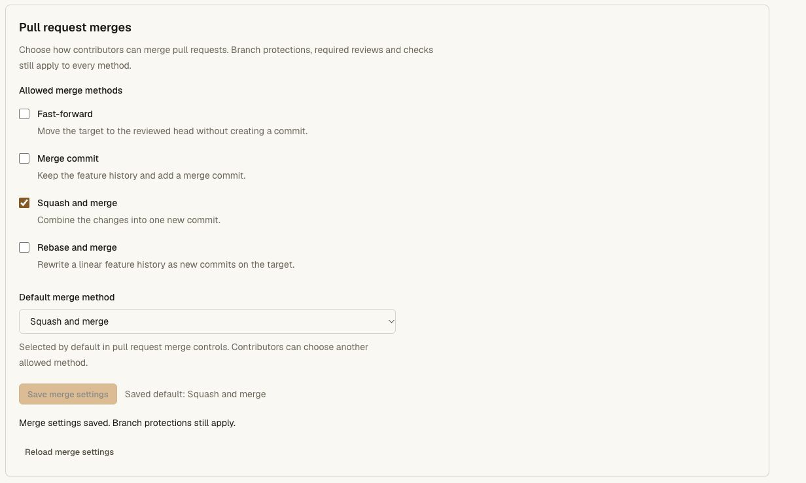
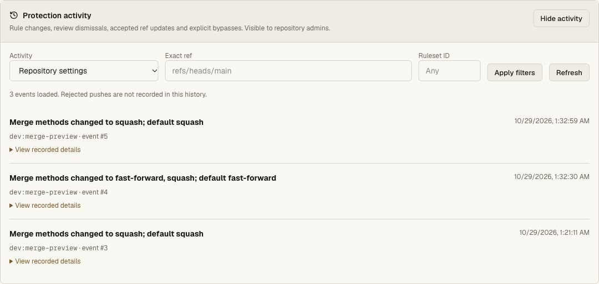

# Repository merge settings — local acceptance, 2026-10-29 JST

The candidate implements repository allowed PR methods and a default in the
existing Settings UI, native CLI 0.4.15 and final Git writer. At this local
checkpoint it was built and committed, without deployment or GitHub push.
The subsequent [release acceptance](merge-settings-release-validation.md)
records frozen Linux checks and deployment. The
[receipt](merge-settings-receipt.json) pins source, test logs, distribution bytes
and synthetic local screenshots. See the [behavioral contract](../merge-settings.md).

## Permission and storage acceptance

Eight unit cases verify the unchanged all-method/fast-forward baseline,
normalization, invalid/empty/duplicate settings, no-op stability, stale writes,
before/after CLI audit, no ref/default-branch changes, raw SQL and ABA revision
tracking, rollback and trigger repair. They also check deletion/reinsertion,
missing/corrupt settings, invalid stored revisions and archive fences. Final
review writers reject disabled methods, stale observations and legacy commands
without a revision after an edit. A separate lower-level ref guard refuses a
disabled merge while an ordinary permitted Git push still works.

The real Worker/Git acceptance runs twice: through the source CLI and through
the actual portable distribution produced by the release builder. Both verify:

- Separate `repository:merge` administration scope, read-only inspection and
  refusal for readers, writers, ordinary merge grants and wrong repositories.
- Complete/valid bodies, same origin, CLI conditional headers, stale writes,
  exactly one accepted concurrent edit and no settings write after demotion.
- Fresh authority in the final RPC, external membership-outage refusal,
  archive fences, device consent and post-consent demotion.
- Current settings and attributed audit after restart, plus the owner/repo
  alias using the same policy.
- Squash-only configuration and omitted-method use of the repository default.
  Browser/CLI HTTP and a direct legacy final writer cannot use disabled
  fast-forward. A branch lock still blocks the allowed method.
- An injected setting change between preparation and final merge leaves the
  protected target and open PR unchanged. An older missing receiver returns
  retryable 503 with no downgrade.
- A successful default squash followed by independent `git clone` and
  `git fsck --strict`, exact final tree and binary bytes. The credential is
  revoked afterward, and subsequent API access is denied.
- Reader snapshots advertise `canMerge`, `canReview` and `canManagePulls` as
  false; a writer can review. These hints do not replace server authorization.

The race and legacy-call injectors live solely in the test Worker entrypoint;
production Wrangler configurations do not reference it.

## Regression and build

Final acceptance passes 348 API unit cases, 272 repository unit cases and the
entire real Worker/Git/protection/CLI/cold-recovery chain. The final source/test
files are pinned before this regression and compared again afterward. The
repository count overlaps the API unit suite and is not an additional total.
All 59 CLI cases pass, including explicit-only administration login, malformed
flags before requests, server capabilities, stale/archive/admin refusal,
lost-response handling and default-method/revision binding.

`bun run check` passes the operator-binding preflight and pinned tsrs for API,
frontend and the web Worker. The Next/OpenNext production build passes. The
built CLI reports 0.4.15, contains 74,141 bytes and has SHA-256
`1ae5bb99a22299d7703e2cdf562e3c4e56c8b0276f1673ff2548faa27befba81`.
The immutable 0.4.14 module remains byte-identical, with SHA-256
`2e0cc05c1efaf28acaa75f1c6bd4214994961df3416141709ae245b6936c4eb3`.
The installer remains byte-identical too. Build outputs are local generated
artifacts; these checks do not publish the CLI.

## Browser and design acceptance

An actual local Next app and isolated API Worker serve the synthetic private
`merge-preview/review-workbench` repository. Browser checks exercise checkbox
changes, automatic allowed-default fallback, empty-list save prevention,
successful save, concurrent stale save rejection with focused error and reload
recovery. Settings changes preserve all Git refs.

The PR view uses the sole allowed squash method with optional commit-message
entry. A temporary signing policy produces an explicit no-usable-method
explanation, then is removed. Reader Settings shows the configuration without
save controls; its PR disables merge/close/restack and replaces the review form
with a write-permission explanation.

At 320 CSS pixels, the document is exactly 320 pixels wide. New merge controls
use 16px native input text and at least 44px save/merge targets. Desktop 1280 and
dark PR captures retain the incumbent Harness palette and layout. The existing
shared hunk-review hint still says “Sign in” for a signed-in reader; that
pre-existing copy is outside this merge-settings change. Physical-device and
browser-zoom acceptance are not established here.

The one static detector run reports no findings. The fresh Impeccable full
review requests one correction: the history filter must cover merge settings
instead of saying only “Default branch changes.” After the rename to
**Repository settings**, real desktop/mobile filtering shows exactly the three
merge-setting events. The reviewer's follow-up **ship** verdict scores that
single fix resolved; it is not a second whole-surface or production approval.
The separate [documentation report](merge-settings-design-review.md) verifies
the incumbent system is preserved and records pre-existing missing system docs.

All thirteen original captures are retained byte-for-byte in
[merge-settings/](merge-settings/). They contain synthetic local data and are
verification evidence, not product image assets. The owned temporary preview
tab, viewport override and both local preview servers are cleaned up. The
local fixture state remains private for reproducibility; its seed Git token is
revoked and it contains no production secrets or Cloudflare resources.

## Remaining release gates

This local record alone does not establish frozen Linux acceptance, disposable
hosted delivery or production merge-setting mutation. The subsequent
[release record](merge-settings-release-validation.md) establishes those gates,
asset checks, private-canary comparisons and live settings/archive acceptance.
This feature does not close unattended Actions, actual application CI/staging,
the complete changing-Git recovery workflow, load/capacity, monitoring or
primary-host cutover acceptance. Broader GitHub differences remain explicit in
the [compatibility contract](../github-parity.md).
