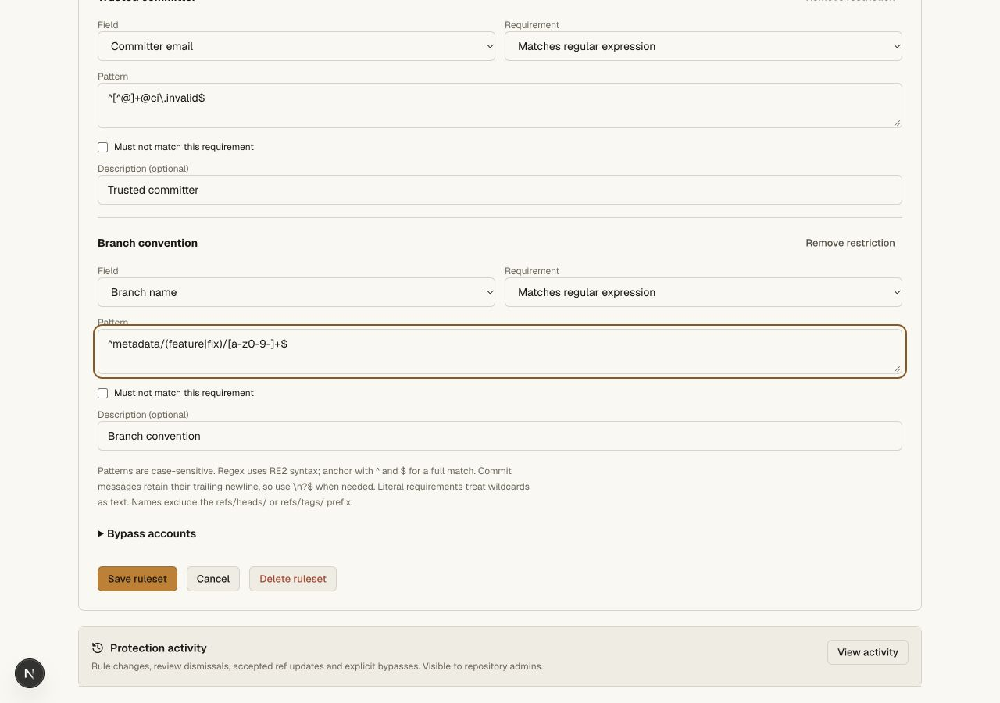
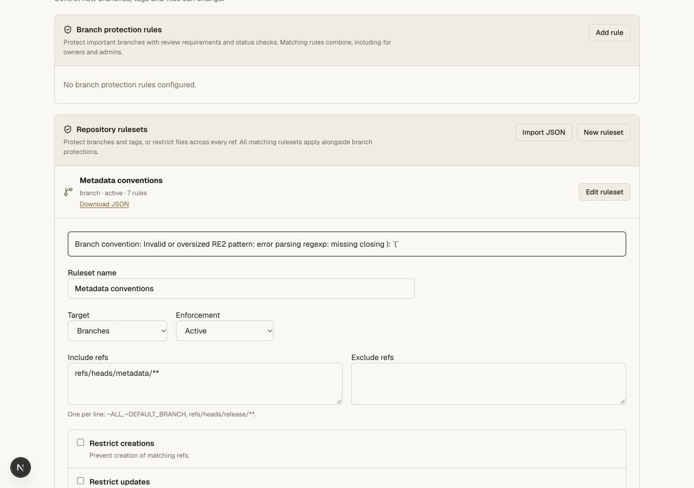
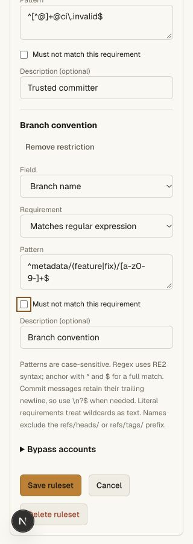
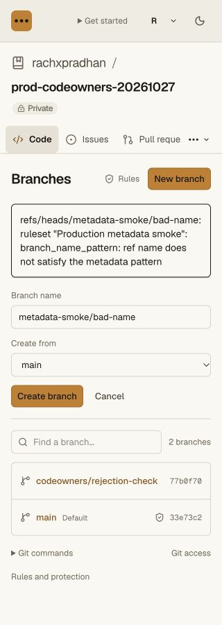
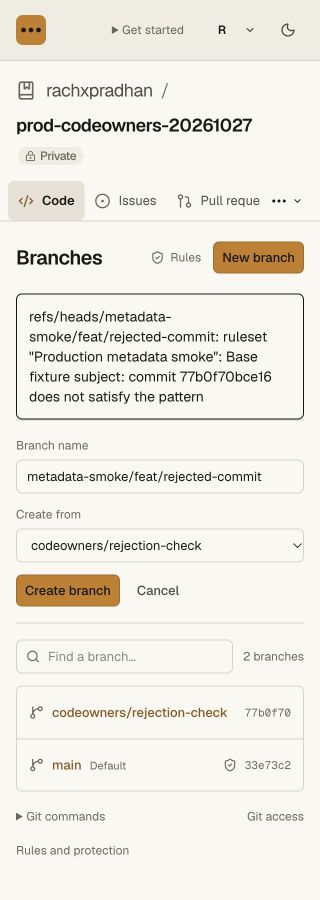
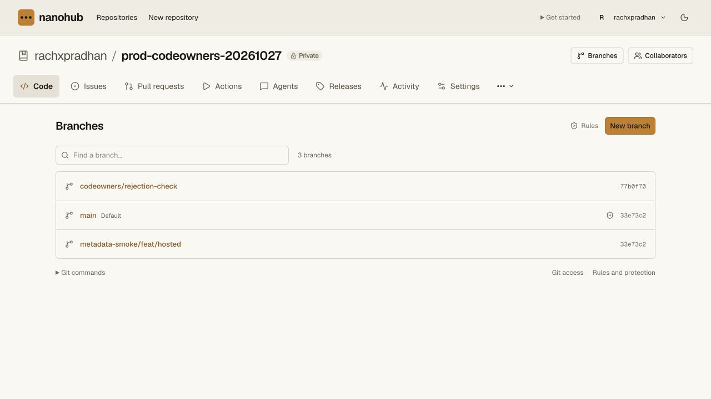

# Metadata restriction validation

The change implements the five branch/tag metadata rule types and pattern
parameters in [GitHub's rules schema](https://docs.github.com/en/rest/repos/rules).
Multiple restrictions on the same field are preserved and enforced together.
Regex uses pinned `re2js` 2.9.0 with explicit compilation, work and memory limits.

## Automated evidence

Seven new SQLite/graph cases cover literal/regex/negation semantics, case
sensitivity, a nested-quantifier input without catastrophic native backtracking,
unsupported syntax and expansion budgets, duplicate metadata fields, portable
JSON, names/deletion, intermediate and merge-side commits, excluded old ancestry,
author versus committer, complete message trailers and newlines, nested annotated
tags, non-commit tags, unverifiable/invalid UTF-8 metadata even under negation,
ref/policy/old/new proof binding and explicit human-only audited bypasses.

The real Worker/Git/HTTP fixture verifies branch-name rejection from Git and HTTP,
separate message restrictions, rejected PR merges for subjects, forbidden content,
author and committer email, unchanged main after rejection, a compliant merge,
hidden intermediate rejection, nested annotated tags, raw-blob tag rejection,
writer administration denial, server JSON transfer, and a final clone with exact
main and `git fsck --strict` success. Caller-supplied metadata/proof JSON has no
authority. RE2 executes in the real local workerd runtime, without dynamic-code
evaluation or native Node regex bindings.

The full gate passes **70 unit tests and six Git/HTTP suites**. API, web and
vault tsrs checks, Bun frozen-lockfile installation and the OpenNext hosted
bundle all pass. Additional malformed-metadata assertions pass in the focused
seven-case suite after the full gate.

Commands: `bun run --filter @swarm/api test:repository`, `bun run check`,
`bun install --frozen-lockfile`, and `bun x opennextjs-cloudflare build --config
wrangler.deploy.jsonc` in `apps/web`.

## Browser evidence

A separate private local `metadata-ui-fixture` was created without issuing a
Git token. Through the browser, its ruleset was configured with two independent
message restrictions, author email, committer email and branch name, alongside
the existing deletion/force restrictions. Save and reopen retained all seven
rules; the downloaded JSON retained both message rules and negation.

Malformed regex was rejected without changing the stored rule or losing form
values. The error identifies **Branch convention** and receives focus, bringing
it into view in the long form. Adding a restriction focuses its Field selector;
saving or cancelling returns focus to the invoking ruleset button.

The editor was visually inspected at actual 1280 and 320 CSS pixels. At 320px,
document width remained 320px. Temporary viewport overrides were reset.

## Hosted release

Validated release `553a1850-8f57-488c-86e2-9d062f9486f8` was deployed at 100%.
At validation, public `/api/agent-help` identified that exact version. Legacy
`/install.sh` and `/download` both continue to return HTTP 200.

On 2026-10-27, the existing signed-in owner configured **Production metadata
smoke**, ruleset 1, in the private `rachxpradhan/prod-codeowners-20261027` canary
(`repo-25411e7a970646f3bfa653f8d24f7d8a`). Its scope is only
`refs/heads/metadata-smoke/**`; existing main protection remains unchanged.
Saving and reopening preserved seven rules: deletion and force protection, two
message constraints (including negation), author and committer email constraints,
and a branch-name RE2 pattern. No new credential was issued for these checks.

The production Branches UI produced these results:

- **Rejected:** `metadata-smoke/bad-name` from main, with the branch-name rule
  identified in the error.
- **Rejected:** `metadata-smoke/feat/rejected-commit` from
  `codeowners/rejection-check`, with the named **Base fixture subject** rule and
  offending commit `77b0f70bce16` identified in the error.
- **Accepted:** `metadata-smoke/feat/hosted` from main. A fresh browser tab lists
  exactly three branches, excludes both rejected names, and shows main and the
  accepted branch at `33e73c2`, with the prior feature still at `77b0f70`.

The accepted branch is an alias of the existing fixture commit. No production
application code was pushed or merged. The scoped ruleset and accepted synthetic
branch remain as evidence. The final preview was inspected at actual 1280 CSS
pixels with document width 1280; temporary narrow test tabs were closed and
viewport overrides reset.

The completed [stale-review production test](review-staleness-validation.md)
used previous release `84c8696b-861d-4558-a393-1991c3f64180`. Its temporary token
was revoked, actual Git authentication was denied afterward, and its plaintext
file was removed.
