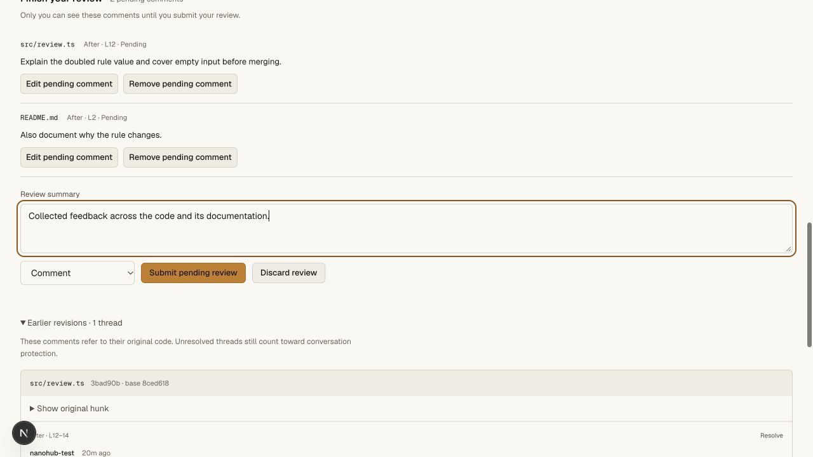
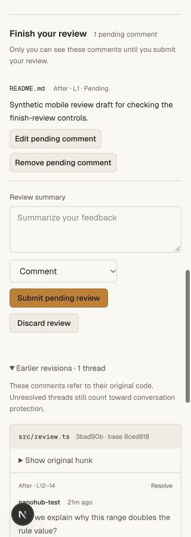
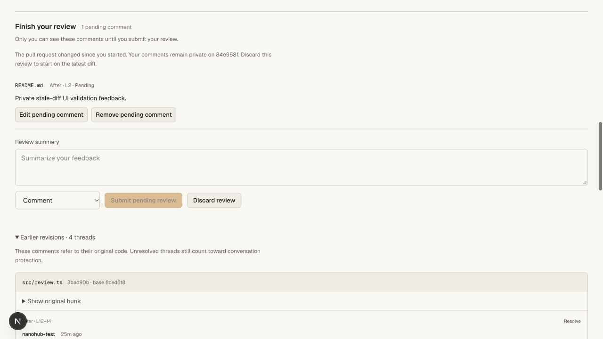
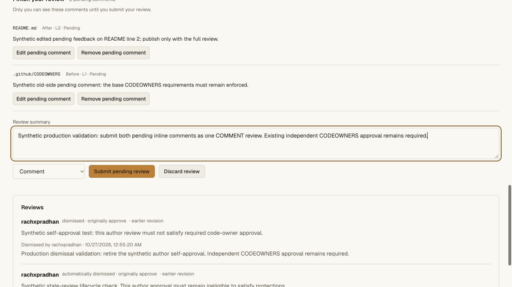
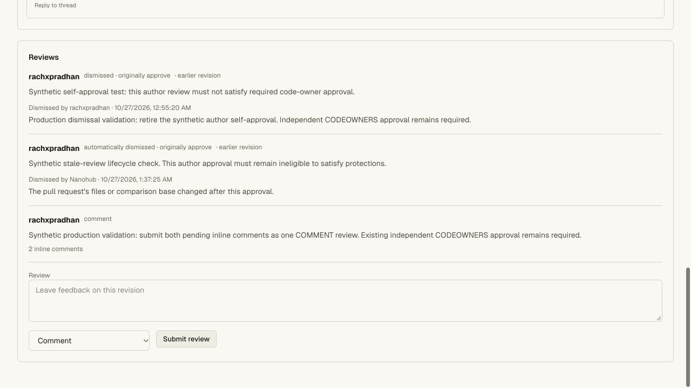

# Private pending review validation

## Implemented behavior

Start a review from a hunk, collect comments across files, edit/remove private
comments, discard the draft, or submit every comment with one verdict. Only the
reviewer can retrieve their own pending draft. Public review snapshots, owner
views and public discussions never contain another reviewer's pending feedback.

Pending feedback has no effect on approval, change requests or conversation
resolution. Submission publishes the verdict, all threads and the submission
receipt in one transaction. Each thread records its review ID, and the public
review records its inline-comment IDs. Duplicate submission cannot create a
second verdict or duplicate threads. Current human write membership is rechecked
before the transaction; agent, Git and CI credentials cannot impersonate it.

Draft revisions prevent lost edits across tabs. A changed head/comparison keeps
the draft private and blocks submission without relocating its lines. Discarded
IDs remain reserved against late request retries. Comments persist across page
reloads; the summary composer stays local to the page.

## Automated evidence

Six new SQLite tests verify private account/PR isolation, no premature gate
effect, optimistic revision conflicts, exact comment retries, atomic publication
and review association, exact submission retry after a push, a late-comment quota
failure that rolls back the verdict and first inserted comment, stale head and
comparison retention, edit/remove/discard, discarded-ID reservation, closed PRs,
100-comment and 1 MiB bounds.

The real Worker/Git/HTTP test uses separate author, writer and reader identities.
It checks owner/public-list privacy, per-reviewer drafts on the same PR,
reader/agent/Git/mixed-cookie/origin denial, unknown/spoofed fields, graph-derived
selection, stale edits, private persistence, edit/remove/discard, requested-change
batch publication, exact duplicate submit, changed-verdict retry rejection,
stale-draft rejection after a real Git push, unresolved conversation gates,
positive independent approval, protected merge, post-merge idempotency, and a
fresh clone with exact head and strict fsck. Fixture credentials are revoked in
the cleanup path.

The full repository gate passes **81 unit tests and eight Git/HTTP suites**.
All three API/web/vault tsrs checks and the OpenNext hosted bundle pass.

Commands: `bun run test:repository`, `bun run check`, and
`bun x opennextjs-cloudflare build --config wrangler.deploy.jsonc` in `apps/web`.

## Browser evidence

In private local `hunk-review-ui`, a browser-created TypeScript line comment was
saved using Start a review, edited privately, and joined by a second README
comment. Both survived a full reload. The pending form identified both original
paths/line selections and said the feedback was visible only to its reviewer.
The discard confirmation was opened and cancelled without losing comments.
Submission published both comments as one COMMENT review with the summary and
inline count; focus returned to that public review.

A second synthetic draft was inspected and submitted at actual 320 CSS pixels.
Document width stayed 320, private comment actions reflowed and decision/submit
controls fit the page. Its submission created one public review with one inline
comment. Temporary viewport overrides were reset and local test tabs closed.
Both screenshots below were visually inspected. No local pending draft remains
from these browser checks.

A further real local Git push changed the candidate while one draft was pending.
The browser retained its original revision, displayed the stale-diff explanation
and disabled submission/decision controls. That synthetic draft was discarded
through the local API afterward; its temporary Git token was revoked and checkout
removed. The stale-state screenshot was visually inspected.

## Hosted release

Validated release `ed63fda6-1453-40aa-a95d-a5abac4d24ea` was deployed at 100%.
At validation, public `/api/agent-help` identified that exact version; legacy `/install.sh`
and `/download` return HTTP 200. The preceding main Worker was
`151d9d28-b92b-4b96-8841-56dbb96b013c`. The private vault is unchanged.

The existing signed-in owner tested private `rachxpradhan/prod-codeowners-20261027`
PR #1 through the production browser:

- Saved a pending README comment on RIGHT line 2, edited it, then added a second
  pending comment on `.github/CODEOWNERS`, LEFT line 1. Both survived a full page
  reload; neither added a public thread or review before publication.
- Published both as **COMMENT review #3**, with a summary and an inline count of
  two. Original comment IDs are `8be4d31d-e831-40fe-ad8f-46d2573f1e50` and
  `60cb227a-cf4f-4dab-b5e3-5ca40c254d53`.
- The published unresolved threads activated the conversation-resolution gate.
  Resolving both cleared that gate; a reload still showed exactly reviews #1–3,
  one two-comment batch label, no pending form and zero open threads.
- The two CODEOWNERS groups still required independent approval, and Merge stayed
  disabled. Head remained `77b0f70`. No Git push, ref update, new credential or
  vault-value operation was performed for this hosted check. The PR is left open
  and all synthetic published threads are resolved.

Production testing used one real signed-in account. Cross-account draft privacy,
positive independent approval, quota rollback and stale/retry races are proven
by the separate multi-account Worker/Git/HTTP and SQLite fixtures above.

## Remaining differences

Pending replies and attachments are not implemented. Applying suggested code
changes was added subsequently; see [suggestion validation](suggestion-validation.md).
Exact head/comparison binding is stricter than carrying a pending
review across changed files. Stale feedback remains private until explicitly
discarded; no automatic re-anchoring is claimed. All other GitHub parity gaps in
the main compatibility document remain open.
