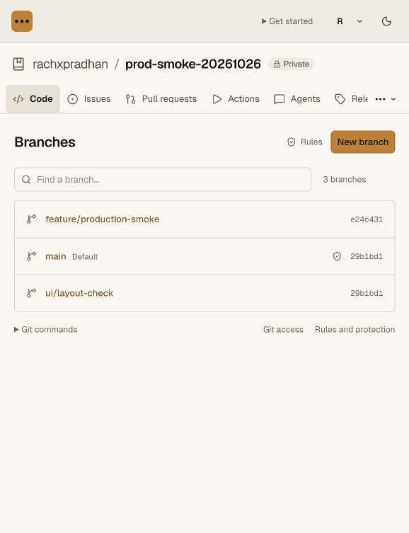
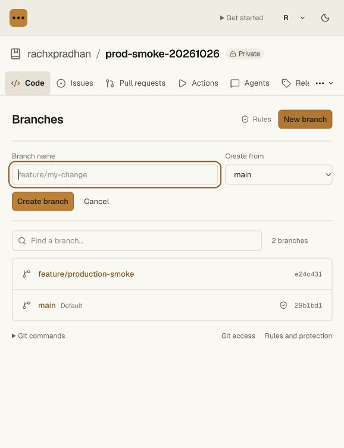

# Production validation — 2026-10-26

Target: `https://nanohub.sh`, Worker `nanohub-swarm`.
Private synthetic repository: `rachxpradhan/prod-smoke-20261026`
(`repo-49463a86f5914dc99fcd6b85f8978aa3`). All Git writes and settings changes in
this validation target that repository. Existing repositories and Meld deployment
pipelines were not used as write targets.

## Deployment

- Browser code authorization for the hosting CLI:
  `60270e9c-7244-4c3b-a9c7-132e68399b04` (current main Worker; real hosted
  device denial passed without issuing a credential; subsequent user-approved
  manual CLI credential/read/review/thread/revocation checks also passed;
  [device authorization evidence](cli-device-validation.md),
  [authenticated CLI evidence](cli-api-validation.md#approved-authenticated-production-test)).
- Scoped native hosting CLI API credentials and protected PR commands:
  `96b34dfc-f1aa-470f-8af2-86324664022a` (see
  [CLI API evidence](cli-api-validation.md)).
- Previous production version: `834db819-a1fb-495a-9e4e-39b8b7b64d0c`.
- Git-first hosting, protection and vault integration: `3acaa666-48fd-460c-9565-314e32b01eba`.
- Token reveal/manual-copy fallback: `d68437b9-57c4-49fe-8b40-222743bfbea3`.
- Private vault service: `b36378c3-591e-482d-ae23-2bccb063a151`.
- Vault alarm metadata and isolated hosted provider binding: `02dcb88b-5c99-49d9-a4b6-cb95451e6bb5` (current vault version).
- Compact branch layout and dedicated rule settings: `cb794944-f716-4118-adc2-84907d116c6e`.
- Ruleset compare and restore: `b3077477-abeb-4701-bbfe-236abf404fd0`.
- Ruleset JSON import and current/historical export: `d791c92a-0e7c-4ec2-b0f9-e5ed29c6c75a`.
- Required native CODEOWNERS review: `0c525e16-79c6-4233-891e-c6a115edb922` (hosted direct-push rejection, base ownership and self-approval rejection verified on 2026-10-27; see [CODEOWNERS evidence](codeowners-validation.md)).
- Reasoned review dismissal, dismissal restrictions and current review gate UI: `7b4d4b52-d25a-4adf-aff4-fd726fcae8e7` (see [review dismissal evidence](review-dismissal-validation.md)).
- Configurable stale approval dismissal and latest reviewable-push approval: `84c8696b-861d-4558-a393-1991c3f64180` (see [stale-review evidence](review-staleness-validation.md)).
- Branch/tag names, commit messages, author and committer metadata restrictions: `553a1850-8f57-488c-86e2-9d062f9486f8` (hosted scoped rejection/acceptance checks passed on 2026-10-27; see [metadata evidence](metadata-rules-validation.md)).
- Native PR hunk reviewer, revision-bound conversations and outdated-thread merge gates: `151d9d28-b92b-4b96-8841-56dbb96b013c` (see [hunk review evidence](hunk-review-validation.md)).
- Private pending reviews with atomic batch publication: `ed63fda6-1453-40aa-a95d-a5abac4d24ea` (hosted two-comment submission, persistence and protected conversation gates passed; see [pending-review evidence](pending-review-validation.md)).
- Current reviewer write membership at preview and final merge: `2fccd22e-4aba-44d8-8e37-3af358f093c9` (hosted human-review creation and retained protection state verified; multi-account demotion/removal/outage cases pass locally; see [reviewer access evidence](reviewer-access-validation.md)).
- Protected application of hunk review suggestions, singly or in batches: `1b3900d1-838e-4e25-8a59-9ff06bc2e3da` (hosted synthetic suggestion commit, resolved application receipt and unchanged protected main verified; see [suggestion evidence](suggestion-validation.md)).
- Expected trusted runner sources for required checks: `44998612-4744-46da-bd55-56b2a7e409cc` (hosted editor and unconfigured-source state verified; two-source enforcement passes in real local Worker/Git tests; see [source evidence](check-sources-validation.md)).
- Cryptographically verified SSH/OpenPGP signed commits and account public signing keys: `f8dd378e-b5d2-4a44-b6a7-fa53198ad60c` (public version and authenticated key listing verified; crypto and enforcement pass in real local Worker/Git tests; a subsequent hosted unsigned-suggestion rejection also passed; see [signature evidence](signature-validation.md)).
- Evaluate-only rulesets, retained accepted/rejected rule insights and native Git atomic negotiation: `8c2c6301-b314-40f4-bbd9-c30dd2d48ccd` (hosted evaluate acceptance, active rejection and persistent insight details passed; hunk composer keyboard verification passed; see [rule insight evidence](rule-insights-validation.md)).
- Required deployment environments and exact-candidate trusted reports: `8c4e266a-593b-4f2f-9083-7aacb040e629` (hosted release; hosted named environment, missing-deployment PR state, refused suggestion and persisted insight verified; positive multi-reporter merge passes locally; see [deployment evidence](deployment-validation.md)).

- Protected environment reviewers, self-approval prevention, durable waits, runner authorization and Actions review requests: `91b8c258-6909-4642-8d30-cd540f7be5b2` (hosted release; bounded production request/rejection and unchanged PR gates verified; see [environment approval evidence](environment-approvals-validation.md)).

- Repository-wide archival, monotonic recovery, final writer fences and read-only UI: `7ba197aa-201b-4901-aefc-2b5b23e8d6d9` (current main Worker at 100%; hosted archive of the older private smoke repository preserved all exact refs, cancelled three queued runs and persisted audit #11; see [archive evidence](archive-validation.md)).

Production settings were read through the authenticated Cloudflare API into a
private host backup. The deployment configuration preserves existing DO classes,
D1/KV/R2 targets, Artifacts, legacy service routing, plaintext vars and secret
bindings; only the private VAULT binding was added. No secret values were read.
The account-specific deployment config remains ignored by Git. Both Wrangler
validation and a real OpenNext hosted bundle succeeded before upload/activation.

## Real Git tests

- PASS: normal Git push of main and annotated tag.
- PASS: fresh clone, exact refs/tree modes and binary bytes, Unicode, symlink and git fsck --strict.
- PASS: Git-only token cannot access application APIs.
- PASS: anonymous private repository access denied.
- PASS: main lock rejects an ordinary fast-forward push.
- PASS: unprotected feature branch accepts ordinary Git push.
- PASS: tag replacement protection rejects --force.
- PASS: tag deletion protection rejects deletion.
- PASS: push rules reject restricted file extensions.
- PASS: rejected writes preserve main/tag refs and publish no blocked branch.
- PASS: revoked credential denied by HTTP and actual Git fetch discovery.

A 2 MiB binary, embedded zero/0xff bytes, Unicode path, executable, symlink and
annotated tag were pushed with an ordinary Git HTTP client. A fresh clone matched
refs, tree modes and file bytes and passed `git fsck --strict`. A real feature
push remained accepted while main was locked. Forbidden pushes left main/tag
refs unchanged and did not publish the prohibited branch.

The user approved one temporary repository-scoped Git token for these tests.
The first unused token was revoked when the embedded browser could not copy its
masked value. A replacement with the same scope was used after adding an explicit
Show/Hide fallback. It was revoked after testing; both HTTP and real Git denied
it afterward. Its private plaintext file was removed. No test token is retained
in the repository or these receipts. No registered coding agent was required.

## Browser and access checks

- Hosted sign-in completed through the existing account flow.
- Private repository and namespace creation succeeded; creating the repository
  does not automatically issue a credential.
- Git-only credentials were refused by admin, secret and token-management APIs.
- Anonymous repository/API access returned 401/404.
- Existing legacy install and download routes returned HTTP 200.
- Development login remains disabled on production.
- Actions candidates were queued from the real pushes. No live Codegraff VM or
  workflow success is claimed: the supplied account key lacks sandbox scope.
- The on-demand vault service is deployed privately, with workers.dev and preview
  ingress disabled. Its hosted synthetic-value lifecycle receipt is below.

## Layout correction

Branches now has a bounded, searchable list and a New branch disclosure with
compact controls. Rule/protection/audit administration moved to Settings → Rules;
staging approval remains under Actions. A shared workspace style no longer
stretches the branch page and creation form across the whole desktop viewport.
Local browser checks covered 320, the real 578-pixel panel, and 1280 CSS pixels,
including search, empty result, form opening/cancel and rules navigation. No
horizontal document overflow was observed; desktop page/form widths are bounded
to 1120/720 pixels. Temporary viewport overrides were reset.

The final production layout was rendered at the normal panel width. The new form created `ui/layout-check` successfully and returned focus to New branch; existing lock/tag/extension rules remain visible under Settings.

The production Settings page also loaded the private vault’s empty binding/reference metadata without a service error. No secret value or workload grant was created in that check.

## Hosted secrets lifecycle

Created the account's `nanohub` Secrets Store and one synthetic value, scoped by
the vault manifest to this test repository's `validation` environment only.
The vault configuration was inspected before deployment: no pre-existing
provider bindings were replaced. Its generated account-specific config remains
ignored by Git. No user credential was copied into the store.

A private localhost probe used Wrangler's remote service binding to the deployed
`VaultService`. The probe itself was not deployed publicly. It exercised the real
Cloudflare DO/Secrets Store and `https://nanohub.sh` workload read endpoint. Values
were compared by SHA-256 inside the probe; receipts contain no values or tokens.

- PASS: provider binding resolves through private RPC and the production workload API.
- PASS: value writes to Nanohub are rejected; management accepts references only.
- PASS: another repository/environment cannot connect or redeem this binding.
- PASS: workload credentials cannot access management APIs.
- PASS: revocation blocks both direct RPC and production HTTP redemption.
- PASS: active grants schedule their expiry alarm; revoking the last grant clears it.
- PASS: real 60-second grant expiry blocks RPC and HTTP redemption; its cleanup alarm clears.
- PASS: provider rotation becomes visible without a vault deployment.
- PASS: disconnecting a reference revokes its grant; reconnecting recovers the retained rotated value.
- PASS: final scope has zero references, zero grants and `nextCleanupAt: null`.
- PASS: Cloudflare management metadata confirms the synthetic provider secret remains.
- PASS: workers.dev and preview ingress remain disabled; the localhost probe was stopped.

The first immediate rotation probe returned HTTP 500; a subsequent probe passed
before the original grant expired. The exact initial transient failure was not
captured. This establishes rotation without deployment, not instantaneous
propagation. Nanohub resolves the provider on each read and has no value cache.

No polling, keepalive or recurring alarm keeps the idle vault awake. The empty
alarm schedule establishes eligibility to idle, not proof of a particular runtime
eviction event or time; Cloudflare controls eviction. The synthetic value was
retained after the quiet interval, expiry and disconnect/reconnect.

Local access integration and the pinned tsrs vault check passed after adding
`nextCleanupAt`. Private host receipts and probe source are retained under
`~/.config/nanohub/prod-validation-2026-10-26/`; no credential appears in this file.
Other repository secret bindings and actual deployment credentials still require
owner provisioning. This does not establish Codegraff or Meld staging execution.

## Hosted ruleset restore

The production UI restored a name-only change to `Production tag protections`
from recorded event #4. The comparison showed the changed Name field before
applying; the original ruleset ID and restrictions were retained. New event #9
records the source version and before/after snapshots. The success notice received
keyboard focus. Main remains locked and the tag/file rules remain configured.
No credential was created or revived. See [the restore receipt](ruleset-restore-validation.md)
for the local concurrency/enforcement cases and hosted screenshot.

## Hosted ruleset JSON transfer

The production browser previewed and imported a synthetic tag policy scoped only
to `refs/tags/import-smoke-*` in this private canary. The preview explained source
metadata omission and the explicit mapping of an all-repositories selector to
this repository. Creation assigned local ruleset #3 and recorded event #10.
Current and historical browser downloads matched the reviewed configuration,
omitting source IDs and bypass accounts. Anonymous downloads were denied and
legacy routes still returned HTTP 200. No credential was created. See
[transfer validation](ruleset-transfer-validation.md) for the full receipt and screenshot.

## CLI Git content scopes

Main Worker `41521aa3-ad86-4a10-8293-c90668a16032` is deployed at 100%.
Existing vault bindings and deployment are unchanged. Real local Bun/Git/Worker
tests cover explicit clone/push scopes, the repository-local helper, protections
and revocation. Hosted permission controls and public routes load successfully.
The approved live CLI Git clone/fsck and ordinary Git push passed on the new
`cli/git-smoke-20261027` branch. Existing branches, protections and PR head stayed
unchanged. Both the failed-preflight and successful-retry credentials were revoked;
Git access is denied and API whoami returns 401. See [Git scope validation](cli-git-validation.md).

## Portable CLI distribution

Current main Worker: `f35a5b9f-a71f-422e-be5a-caabccfe0eda`, at 100%.
The portable v0.4.1 module, checksum manifest and Bun installer are live under
`/nh/`. A real install from the published assets succeeded in an isolated user
prefix, and both aliases worked outside the checkout. Legacy downloads retain
their behavior. No new production credential was created; the approved Git test
credentials remain revoked. See [distribution evidence](cli-distribution-validation.md).

## Deployment source ref policies

Current main Worker `3a997244-9e0f-4c56-b793-74ced36a08a5` is at 100%.
The hosted synthetic `ref-policy-smoke-20261027` environment denies all refs, and
a request for the existing CLI smoke candidate was rejected before creating a
deployment request. Original environments/protections remain unchanged. No new
credential, runner or sandbox was created. The portable CLI is now v0.4.2 and
its actual published installer passes. See [ref-policy evidence](deployment-refs-validation.md).

## Agent contribution MCP service

Current main Worker `85bb3ccd-65a7-4628-97ec-54a5f864e8ee` is at 100%.
The optional official-SDK MCP work service, contributor sidebar, Agents history,
PR-linked activity and connection template are live. Unauthenticated access to
the private canary is denied without revealing it. The approved positive production SDK test passed. One synthetic session is
linked to PR #1, with unchanged refs and review/deployment gates. Its temporary
agent credential was immediately revoked: MCP/API return 401 and SDK connection
is denied. The temporary plaintext input was removed; work history is retained.
See [MCP contract](../agent-mcp.md) and [validation](agent-mcp-validation.md).

## Required-check terminal conclusions

Current main Worker `4a81681c-4d5b-49dd-a8a9-0f22b5c92baf` is at 100%.
Native ordinary required checks accept success, neutral and skipped, while
failure/cancellation/timeout/action-required/stale block. Exact candidate/base,
source policy and actual verified deployment requirements remain. Actions and
PR panels retain the actual conclusions; portable CLI is v0.4.3 and its actual
published installer passes outside the checkout. No production CI credential,
check result, policy change, push, environment deployment or review was created for this
rollout. The approved MCP test credential is revoked; its synthetic work remains
visible. See [conclusion validation](check-conclusions-validation.md).

## Git-compatible UTF-8 ref names

Current main Worker **9e23df34-1afa-44a0-aa5c-41af6f297545** is live.
The private canary accepts a new Unicode branch and persists an exact Unicode
lock that denies creation. Existing refs/review gates and the retained MCP work
remain intact. One new canary branch and its separate exact test lock remain for
inspection. No new credentials, pushes or reviews were required. An initial
version-only rollout still returned old validation behavior; full deployment
resolved it and real stateful checks now pass. Portable CLI **0.4.4** and the
actual published Bun installer pass. See [ref-name evidence](ref-names-validation.md).

## Native CLI branch protection management

Current main Worker **086c3a3b-555e-4735-a9e3-97465c85a224** is live.
CLI **0.4.5** adds revision-checked classic protection list/export/edit/delete,
with explicit current-admin permission. The actual published installer passes;
the production stateful snapshot returns the original three policies and a
numeric revision. Browser reads remain available across mixed-version RPC
rollouts; conditional writes never downgrade to the legacy writer. A new
approved one-day canary admin credential passed the actual published CLI's
synthetic lock creation, stale-edit rejection and removal. Original protections,
refs and review gate stayed unchanged. The credential is revoked; identity and
protection reads return 401, and the temporary plaintext input is deleted. See
[CLI protection evidence](cli-protections-validation.md).

## Protection revisions across rollback

Worker **60678f89-9637-4b9c-8e69-e243e7ae4b8d** introduced the storage fence.
Persistent SQLite triggers invalidate protection exports even when older
application SQL writes. Startup installs them atomically and invalidates existing
exports once; new CLI operations require storage-fence readiness. Production
read-only comparison confirms revision 2 → 3 with identical policy objects and
unchanged branch refs. The published 0.4.5 installer still passes. The approved
CLI test credential remains revoked; no further credential or production write
test was created. See [storage-fence validation](protection-revision-validation.md).

## Default branch and actual PR targets

Default-aware Worker **e647e78f-301d-49c3-860d-d2fe70db0cdb** is followed by the
UI wrapping build **903efb9c-c80d-4f78-b24c-86fabf1274ad**.
CLI 0.4.6 is published and its actual installer/checksum pass. Stateful readiness
was observed after initial retryable 503s, with default main/revision 0 and all
six canary refs, three protection objects/revision 3, CI history, archive and
environments unchanged. The PR still awaits two CODEOWNERS groups and its
required deployment, and Merge stays disabled. Hosted settings fit 320 px after
wrapping long IDs/clone URLs and containing the People table's scroll region.
No production credential or default mutation was created for this rollout.
See [default branch validation](default-branch-validation.md) for the positive
local Git/CLI/migration/review/CI tests and exact production limits.

## Native ruleset CLI

Worker **173ef7bb-1cf2-493d-9935-c79fd718bbeb** published CLI 0.4.7
with a distinct `rulesets:write` current-admin permission and revision-bound
ruleset create/export/update/delete. The actual published installer and both
aliases pass. Stateful receiver readiness is observed: ruleset storage revision
4 → 5, `revisionTracking: "storage"`, identical three rule objects. All six
refs, default/main settings revision 0, archive, CI history and classic policies
at revision 3 are unchanged. The canary PR still requires two CODEOWNERS groups
and a deployment. Production shows the new permission unchecked and no active
canary CLI keys. No production credential or rule edit was created. Positive
source and bundled CLI writes passed on an isolated Worker/Git fixture. See
[ruleset CLI validation](cli-rulesets-validation.md) for limits and evidence.

## Selected force-push accounts and restricted-file rewinds

Worker **1b67a6fb-1538-48df-ac52-31c7b985d668** added selected-account
force-push exceptions while preserving independent protections. It also checks
the actual ref-tree transition, rejecting rewinds and divergent descendants that
restore restricted files from already reachable history. Mixed-version proof
and receiver guards prevent earlier code from silently omitting these checks.

All 242 API unit tests, the full repository gate (193 focused tests and every
smoke), 32 CLI tests/260 assertions, hosting/access/vault checks, pinned tsrs and
the rebuilt production bundle pass. Real positive and negative Git writes ran
on isolated local Worker fixtures. Production stateful readiness is confirmed;
its three classic policies/revision 3, six refs, default/settings revision 0,
archive, environments and CI history are preserved. The live editor defaults to
no selected exceptions, with the account field disabled, and fits 320 px. The
production form was cancelled. Public Worker/module/checksum/authentication
checks pass; CLI remains 0.4.7. No new production credential or write test was
created. See [force-push validation](force-push-actors-validation.md).

## Native CLI archive and unarchive

Worker **1af6359c-b04f-4078-8919-e03c38e7a3bf** published CLI **0.4.8**.
The actual published installer, module checksum and both installed aliases pass.
Native lifecycle commands require a distinct `repository:archive` current-admin
grant, explicit repository-name confirmation and a revision checked in the final
Hub transaction. Conditional lifecycle/name readiness is now observed on a fresh
production archive read. The canary stays active at archive revision 0; six refs,
default/settings revision 0, three classic protections/revision 3, environments
and CI history are unchanged. The new permission is unchecked, no active canary
CLI keys exist, and production lifecycle state was not changed.

Local source and standalone CLI writes prove archive/unarchive, current role and
scope checks, device consent reduction while archived, Git refusal/clone/fsck,
retained locks, restart recovery and one attributed audit per interrupted
transition. 245 API unit tests, 196 focused repository tests plus every smoke,
36 CLI tests/293 assertions, hosting/access/vault checks, tsrs and the production
build pass. See [CLI archive evidence](cli-archive-validation.md) for test scope,
readiness and production limits.

## Current-role ruleset bypass

Current Worker **9a672bf3-e90b-4a27-ae65-568def2ca65e** adds explicit admin/owner
and writer role bypass, retaining the signed-human credential boundary and all
independent protections. Fresh stateful reads advertise role support from the
rules engine and Hub receiver. Three rulesets/revision 5, three classic
policies/revision 3, six refs, default/settings revision 0, archive, environments
and CI history remain unchanged. Both role controls show No bypass; the inspected
production form was cancelled without saving. No grant or credential was created.

251 API unit tests, the full repository regression gate/smokes, tsrs and the
production build pass. Local native/provider role changes, demotion, PR-only
merge, suggestion applications, CLI JSON preservation, independent locks and
required deployments, audit/insights, restart and clone/fsck are verified. The
public Worker/module/checksum/authentication checks pass; CLI stays unchanged at
0.4.8 and the vault deployment is untouched. See
[role-bypass evidence](ruleset-roles-validation.md) for coverage and limits.

## Real Codegraff VM acceptance

The actual trusted dispatcher passes a synthetic Bun 1.4.4 workflow on a
production Codegraff VM against an isolated local Nanohub Worker. Exact head,
accepted-base workflow selection, private log/result delivery, anonymous log
refusal, absent candidate control credentials and confirmed destroyed state are
verified. Earlier fixture assertions were corrected for the seed queue event and
Codegraff's destroyed tombstone; all three allocated test sandboxes are destroyed.
The existing CI key was used only in the control process; the Nanohub-specific
key still lacks sandbox scope. No production Nanohub credential, ref or policy
was changed, and no hosted Worker/vault redeployment was made. Full-project
image/service activation and hosted callback delivery remain unverified. See
[real cloud acceptance](codegraff-live-validation.md).
