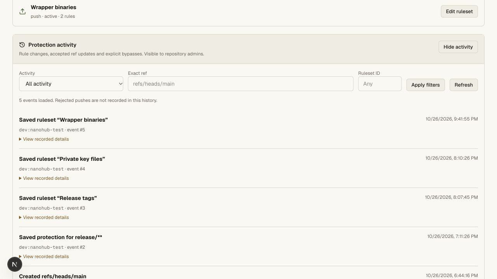

# Protection activity validation — 2026-10-26

Added the human-admin-only **Branches → Protection activity** view and the
repository audit endpoint. Rule and branch-protection settings now record the
normalized previous configuration atomically with successful updates/deletions.
The view filters by category, exact ref and ruleset ID, including deleted rulesets.
Accepted ref writes and explicit human bypasses remain linked to their event IDs.

Validation:

- `bun run --filter @swarm/api test:unit`: 77 tests pass.
- `bun run test:repository`: 36 cases plus real Git/HTTP/DO integration pass.
- `bun run --filter @swarm/api test:access`: unit and vault/ACL integration pass.
- `bun run --filter @swarm/api test:hosting`: dispatcher/pool and real namespace
  integration pass, including owner/repo audit isolation.
- `bun run check`: API, web and vault pass pinned tsrs.
- `bun run --filter @swarm/web build`: production build passes.
- `git diff --check`: pass.

The new pagination case reads 261 original audit events in pages while inserting
another event between page reads. Original IDs remain unique and ordered with no
misses. Filters reject malformed input and project only known audit fields.
HTTP cases prove deleted-rule history, successful bypass receipts, normalized
before/after snapshots, no-store responses, and rejection of writers, outsiders
and agents (including the owner's agent).

The synthetic local repository was viewed through the browser. Opening activity,
expanding a historical record, applying a ruleset-ID filter and clearing it all
show the expected results. Historical records without a previous snapshot are
labeled “Saved”; this does not invent missing history.

The Git integration continues to emit the previously recorded non-fatal workerd
RPC-result disposal warning. Rejected-push insights, evaluation, restore/export
UI and live hosted acceptance remain incomplete. No production deployment or
Codegraff VM allocation was performed during this work.
