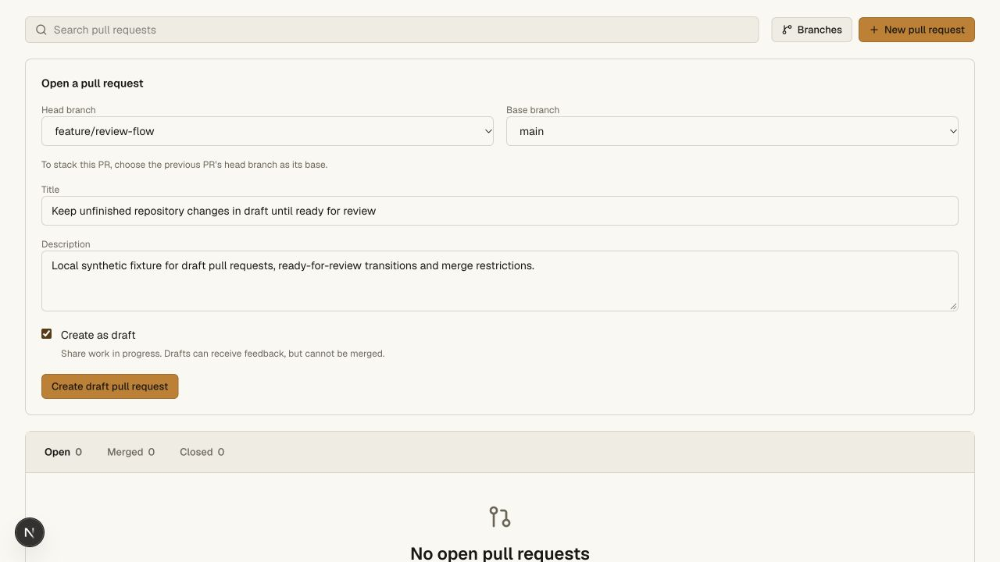
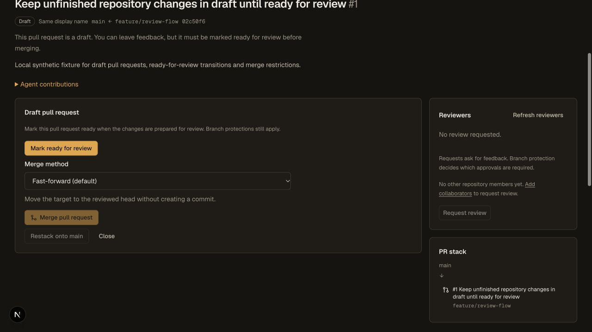
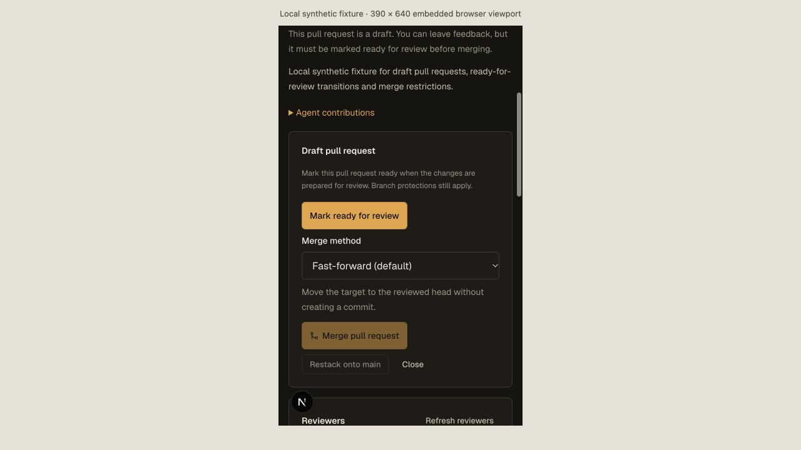

# Draft PR source validation — 2026-11-09

This is a source candidate and local acceptance record. CLI **0.4.22** is built
and pinned at 103,226 bytes, SHA-256
`30d7cb952fba35ced89bfe3fd2c93ec5897a440c6ff1a28fb20dab041b5e1b34`.
All 21 previously published modules and checksums match their catalog records.
Production still serves CLI 0.4.21 and Worker
`64bda897-a8ba-4834-a98c-7b68c380a33f`; no draft-feature rollout is claimed.

The [receipt](pull-drafts-validation.json) records 565 passing API cases with
zero failures/skips, 107 passing CLI cases, three successful workspace tsrs
checks (one unchanged task cached), the full existing repository regression
chain, access/Vault and hosting checks. The draft-specific gate executes the
source CLI and independently bundled CLI against actual Miniflare/workerd
SQLite/D1/R2 and ordinary Git. The separate distribution gate executes the exact
0.4.22 module and verifies its checksum before testing.

Coverage includes draft creation, ready and undo, unchanged before-open staging
requirements, reader/scope/origin boundaries, current writer verification,
agent-free scoped API calls, optional generic registered-agent calls and retained
legacy-token rejection. Missing receiver methods stop creation/edits. Stale
diffs/revisions and simultaneous edits cannot overwrite current state. Direct
final merge calls and every HTTP merge method reject drafts. Reviews and refs
survive readiness edits. Revoked CLI/agent credentials fail in the final RPC,
with no credential values in audit. A compliant ready PR merges through its
required review/conversation policy and a fresh clone passes `git fsck --strict`.

Native SQLite probes also verify that older JSON writers cannot erase the draft
or reset its revision. A persisted merge fence aborts a legacy-shaped serialized
merge transaction after its proposed ref write, preserving the prior ref.
Late audit failure rolls back state, revision and metadata. First migration,
interrupted installation, missing-hook repair and missing-authority denial are
covered. A legacy snapshot draft also cannot enter the main landing callback.
Both SQLite recursive-trigger modes pass. Real Worker acceptance
retains draft state/revision through restart and physical DO/D1/R2 loss followed
by checksum-verified restore. This does not prove safety after restoring a
different, older authority checkpoint or arbitrary operator database changes.

## Browser evidence

The real Next development app talks to a fresh local synthetic Worker fixture.
No production credentials or application services are used. Desktop interactions
create a draft, mark it ready and convert it back, with merge controls and status
changing accordingly. Enter activation of ready/undo is also confirmed in the
rendered state and repository API. Paper and Graphite renders retain the existing
design system; desktop document width and scroll width are both 1,280 pixels.
The new primary control is 32 pixels high, using the existing 13-pixel typography.

A real 390 × 640 iframe viewport exercises narrow CSS layout, including wrapped
title/description, stacked actions and the disabled merge control. It is a
desktop browser's embedded viewport, not a physical mobile device. Native
automation could not target its ready action, so narrow interaction and touch
acceptance are not counted. The initial reverse-proxy frame and corrected direct
application frame are kept separate in private evidence; neither failed click
is presented as a passing transition.

Frozen Linux/Mac release acceptance, production asset/CLI retention and binding
preservation, hosted draft mutations and broader production operations remain
required. This feature does not activate the hosted Actions dispatcher, complete
Meld staging/cutover, or add automatic CODEOWNERS requests/notifications.
