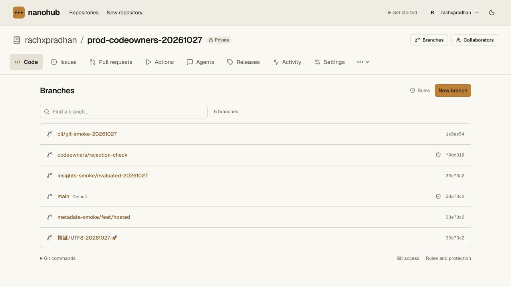

# Operator recovery request hold — 2026-10-27

The request fence is deployed on main-site version
`1450c429-a969-483e-8383-c05d9ed8467c`, with normal traffic enabled. The
[receipt](recovery-hold-receipt.json) separates local acceptance, isolated hosted
hold checks, a rolled-back asset regression and the corrected main rollout.
No production hold or disaster restore was performed.

## Local result

Three unit cases test the exact API and web entrypoints plus the shared control.
Only omitted configuration or the exact string `"0"` opens requests. Configured
empty, malformed and unexpected values hold traffic. Headers, queries, cookies
and authorization do not exempt a request. The API test uses binding getters
that throw: held requests return before auth, throttle or storage access.
The web test proves Next/API/legacy/assets delegates are not called while held.
Normal asset delivery, CLI cache headers, API/Git isolation, dynamic and legacy
fallback, and propagation of asset-service errors are also checked. Held
responses are private/no-store HTTP 503 with retry metadata; HEAD is bodyless.

The actual web entrypoint runs through Miniflare's asset router with synthetic
Next/API delegates and real static fixture files. Canonical normal and artifacts
configurations both require Worker-first asset routing. Normal HTML, CSS, JS
and CLI files must match expected bytes and MIME types. The Next stub returns
HTML and never serves assets: an accidental HTML fallback with HTTP 200 fails.
A negative control using the originally deployed Worker is rejected by these
strengthened assertions. Held, empty and malformed control values block those
paths, while explicit local release restores delivery.

The cold DO/D1/R2 drill keeps operator configuration outside its snapshots.
Restoring an older checkpoint does not clear the request hold. Restored member,
Git, CLI, MCP, runner and workload credentials, the owner, sign-in and public
help requests receive 503. Restart keeps the hold. Only the isolated loopback
fixture is released to demonstrate restored stale authority and apply the known
removals/revocations through owner APIs; denial survives another restart. The
hold does not itself revoke those restored records.

## Live Cloudflare probes and cleanup

The first disposable Worker uses the real built application entrypoint and
static assets with `NANOHUB_RECOVERY_HOLD: "1"` and `run_worker_first: true`.
Its only bindings are static assets and the control variable. It has no
repository, DO, D1, R2, legacy or vault binding, and no production credential.
Version `c68d5754-24a3-4002-98d6-39874ec4e16f` passes 17 held HTTP checks.

After correcting normal asset delegation, a second disposable Worker uses the
corrected entrypoint and actual built files. With the hold off, version
`a1cddac7-6df5-4ec4-b277-ec37ab956b23` verifies 15 selected assets: the CLI
manifest, current and previous CLI releases, every built CSS file, one JavaScript
chunk and one font. Bytes, hashes, MIME types and bodyless HEAD responses match.
CLI cache/nosniff headers are checked too. These checks exercise the real asset
binding rather than a synthetic renderer.

The same Worker is then deployed with the hold on as version
`6090578d-7805-467c-95e8-3b358ca9acf8`. All 27 checks return the expected private
503, including the same 15 previously served assets, root/dashboard, help,
live/MCP/CLI routes, CI claim, secret redemption, Git advertisement/receive-pack,
HEAD and OPTIONS. No cookie is issued. A previously served file cannot bypass
the aware Worker through asset-first routing.

Both disposable Workers are deleted. Separate Cloudflare deployment lookups
confirm `10007: Worker does not exist` for each. No probe runtime or application
storage binding remains. The main site's hold stays off, and the separate vault
service is unchanged.

## Main rollout and correction

The first main rollout, `fadeca05-a98e-446a-9400-d434c867af7f`, preserved all
repository-state reads but exposed an asset-routing regression. Worker-first
routing sent static files through Next/legacy handling. The visual check caught
an unstyled page; the CLI check received HTML in place of its JSON manifest.
The rollout was rolled back to `7b1af261-899b-4870-94f1-c25cf25fc6e7`, and styled
UI delivery was verified again. The production hold was off during this rollback.
An active hold must not be rolled back to an unaware build.

The corrected Worker explicitly asks `ASSETS.fetch` for matching GET/HEAD files
after the hold check and before Next/legacy routing. API/Git requests retain their
authenticated handlers. Missing assets fall through; other asset responses
retain their status, with the existing CLI cache headers applied where needed.
The original synthetic Next delegate had served assets itself and concealed this
normal-delivery gap. Exact byte/MIME assertions and a renderer that returns HTML
now reproduce and reject that behavior before rollout.

Corrected version `1450c429-a969-483e-8383-c05d9ed8467c` is deployed. Public
version reads match. All 15 selected build assets match their local bytes and
MIME types on the main domain, and the styled branches page renders correctly.
CLI 0.4.9 remains 49,938 bytes with SHA-256
`4cc9da686a99dc6d89d7c9dedb1afc9dbe2e633b9718ff33156caa6ed321db9a`;
downloaded version/help run outside the checkout, and 0.4.8 retains its earlier
hash. Cloudflare version metadata confirms Worker-first routing, all 27 binding
metadata objects identical to the original release, and no operator hold binding.

Eight signed-in read sets match the original pre-rollout baseline exactly:
branches (including runs, reviews, environments and sources), protections,
rulesets, defaults, archive, collaborators, vault metadata and runners. All six
branch entries, three policies at revision 3, three rulesets at revision 6,
main/default settings revision 1 and archive revision 0 remain identical. No
production credential, grant, policy, ref or review was created or edited.

## Regression gate and limits

All 270 API unit tests, 213 curated repository unit tests and the complete real
Worker/Git repository chain pass on the corrected sources using the normal
command. Access/vault tests (three unit cases plus real integration) and the
hosting/pool tests (28 cases plus real namespace/Git/dispatcher integration)
pass too. Pinned tsrs and the production Next/OpenNext build pass.

Earlier aggregate runs failed at different loopback Git connections. A passive
diagnostic run later passes with no connection failure triggering its probes;
subsequent uninstrumented complete runs pass before and after the asset fix.
No policy assertion was relaxed, and no failed Git mutation was automatically
retried within a fixture. The underlying cause of the earlier local transport failures
remains unestablished; their logs and scope are retained separately from the
successful acceptance.

This is a new-request fence, not a drain of in-flight work, existing WebSockets,
DO alarms, imports or direct RPC. It does not establish a cross-service backup
barrier, credential-epoch reset, current-authority reconciliation, hosted
disaster restoration or production traffic capacity. The remaining
[hosted recovery gate](../recovery.md#hosted-recovery-release-gate) stays open.
