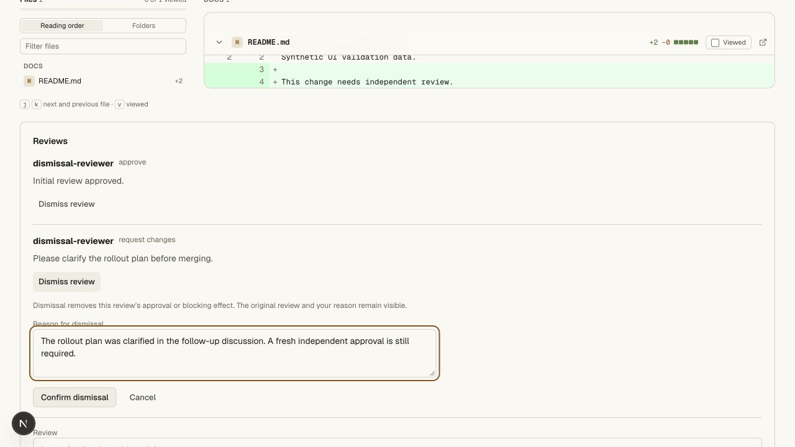
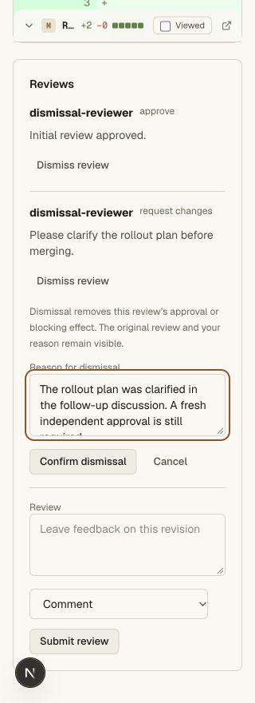
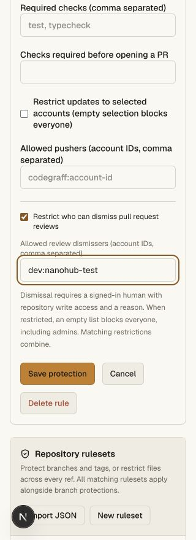
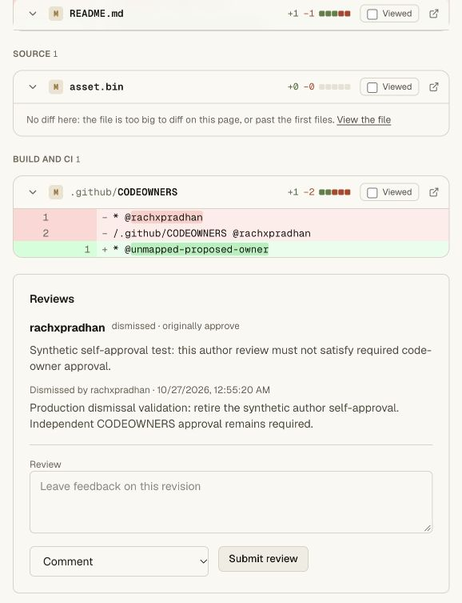
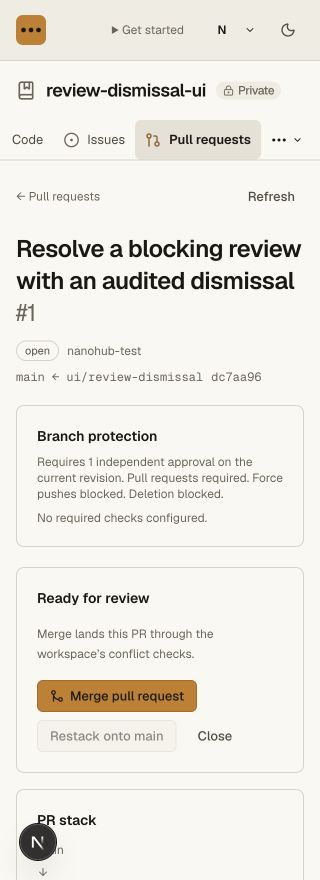

# Review dismissal validation

The change adds reasoned review dismissal, optional branch-level account
restrictions, visible retained feedback and an atomic audit. It also makes the
merge button reflect the sequencer's current approval/change-request/conversation
gate. Final merge enforcement remains in the serialized writer.

## Automated acceptance

Five new SQLite-backed cases verify removal of blocking change requests,
invalidated ordinary/code-owner approvals, no resurrection of older verdicts,
overlapping and empty dismissal restrictions, final policy re-read, human/reason/
open-PR/target validation, immutable original feedback and one audit per
idempotent dismissal. Dismissals do not alter last-push attribution.

A real Git/HTTP fixture verifies current reader/writer membership, demotion,
owner restriction enforcement, CSRF, agent plus cookie, Git-only and CI credential
denial, unknown-field injection rejection, nested-route isolation, concurrent
retries, private audit access, closed-PR rejection and successful merge after a
fresh legitimate approval. Native dismissal works during a Codegraff room outage.

The full repository gate passes **55 unit cases** and four real Git/HTTP suites:
repository migration/protections, ordinary Git clients, CODEOWNERS and review
dismissals. All three tsrs checks and the production OpenNext bundle pass.

Commands: `bun run --filter @swarm/api test:repository`, `bun run check`, and
`bun x opennextjs-cloudflare build --config wrangler.deploy.jsonc` from `apps/web`.

## Browser acceptance

The separate local `review-dismissal-ui` fixture starts with an independent
approval superseded by a change request. The browser dismissed the change
request with a reason; the old approval stayed invalid and Merge remained
disabled. It also dismissed the old approval, retained the original feedback,
and moved keyboard focus to that review after the form was removed. A new
legitimate independent approval then enabled Merge in the browser; that reviewer
remained excluded from the dismissal allowlist. The PR is left open for inspection.

An API development hot reload invalidated its development-only session during
one attempt. The form retained the entered reason and rendered the returned
access error. A normal Dev login restored the session and the dismissal passed.

The form and settings were inspected at actual 320 and 1280 CSS pixels.
At 320px, document width remained 320px. The settings save retained the explicit
account restriction. The activity browser filtered exactly the two dismissals
with their reasons and original-review links. Temporary viewport overrides were
reset. The local setup Git token was revoked and its temporary checkout removed.

## Hosted acceptance

Main Worker version `7b4d4b52-d25a-4adf-aff4-fd726fcae8e7` is deployed at 100%.
`/api/agent-help` reports this exact version; legacy `/install.sh` and `/download`
remain HTTP 200. The private vault service and provider bindings are unchanged.

On the existing private canary `rachxpradhan/prod-codeowners-20261027`, the
browser saved and re-opened an owner-only dismissal restriction while preserving
the code-owner protection. The actual signed-in owner dismissed the synthetic
author approval with a reason. Original feedback, actor, reason and timestamp
remain visible, focus stays on the review, both CODEOWNERS groups still require
independent approval and Merge remains disabled. No new Git token was issued.

The hosted **Review dismissals** filter returned exactly one event (#5), with the
actual signed-in actor, branch `main`, original verdict `APPROVE`, review/PR IDs
and the recorded reason. Its link returned to the retained review. No ref write
was emitted by this dismissal.

