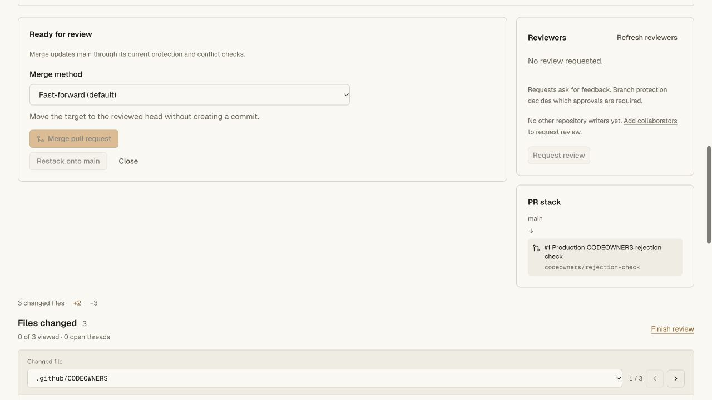
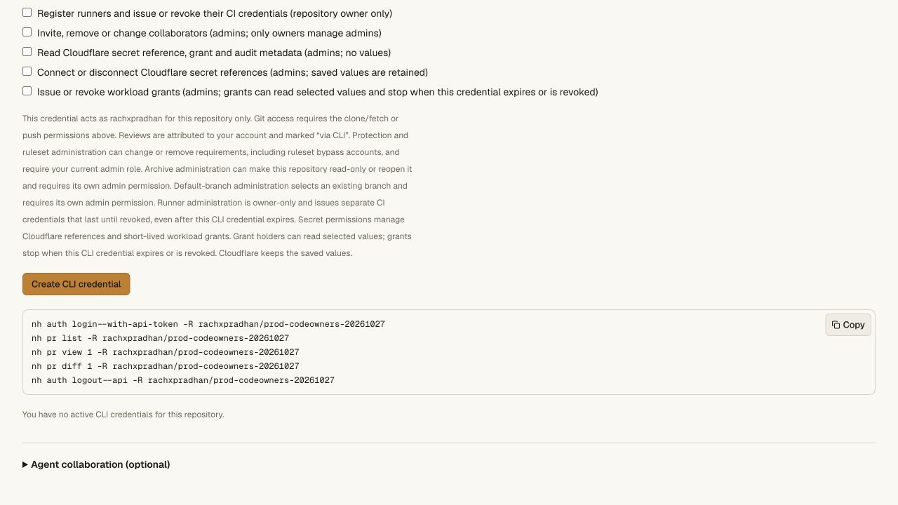

# Requested reviewers and secret administration — release 0.4.19

Main Worker **`3f71f23f-a748-4799-b813-b57392714f49`** serves 100% of traffic,
replacing `a37ab061-a029-4480-9fb9-2b7cefeb19e3`. Private Vault
**`0dbd5e74-5c41-428f-bc6a-2e8d3ecaef48`** replaces
`02dcb88b-5c99-49d9-a4b6-cb95451e6bb5`. CLI **0.4.19** is published:
97,845 bytes, SHA-256
`e86b40b33b6b2a4483073083054bd7d4605e835672c0e8bc32c90ddba2f0195e`.
The [receipt](review-requests-release-receipt.json) records source, deployment,
delivery and preservation evidence. This release does not establish production
traffic readiness or full GitHub parity.

The release combines [individual reviewer requests](../review-requests.md),
[durable legacy-write answer tracking](review-request-storage-validation.md)
and [CLI secret administration](../cli-secrets.md). The current writer-only
review policy and independent merge protections remain enforced. Requests are
advisory; Cloudflare retains saved secret values when grants end or runtime idles.

## Frozen cloud acceptance

Exact commit `233bd3f9847f2c2e07871625d9efb0ea4346620c` passes all nine gates
in a fresh Codegraff VM: frozen offline Bun install, API unit, complete repository
integration, CLI, access/Vault, hosting/capacity, both hosted-fixture regression
commands, build/exact-distribution integrations and pinned tsrs/operator checks.
There are **424 passing API tests** and **79 CLI tests**; all three workspace
check tasks run without cache hits. The repository command includes the legacy
SQLite write, restart, audit rollback and physical DO/D1/R2 recovery checks.
The exact distribution exercises reviewer, secret and deployment commands in
real local Workers inside Linux, using synthetic identities and providers.

The retained toolchain digest is
`sha256:76f35e83a77df1d8eace6e8fc49b7f77d6dcd6d90bbaf40722c5c5f9f8bd6694`.
Candidate execution has no network, control credentials, npm/npx or Docker
socket. Its VM is destroyed and a separate provider read confirms destruction.
This uses the existing trusted CI account; it neither replaces the configured
Nanohub Actions key nor activates its hosted dispatcher.

All **1,100 frozen source files** and **1,476 built files** match through staging
and promotion. Known control credentials are absent from source and compiled
output. The existing Cloudflare login is renewed with the same 23 saved scopes.
The earlier failed cloud attempts remain failed in their historical record.

## Disposable delivery and Vault-first rollout

A uniquely named disposable Worker uses the actual entrypoint/assets with only
ASSETS and version-metadata bindings. It has no production resources or custom
domain. Exact-name provider absence is checked before creation. **20 normal
asset comparisons** pass, including current and earlier CLI modules, checksum,
installer and representative CSS/JS/fonts. Its held version passes **26 GET
checks**, private/no-store 503 responses, `Retry-After: 60` and bodyless HEAD.
Deletion is confirmed, then independently rechecked before staging.

The Vault version is staged and its **three existing bindings compare exactly**,
including the existing Cloudflare Secrets Store reference. It is promoted first
with immediate Durable Object code updates. The current main API and CLI 0.4.17
stay unchanged during this step. Nine authenticated canary resources preserve
every previous field. Expected Vault additions are checked individually:
`revision`, `conditionalWrites`, `revisionTracking`, `clientGrants` and `cliAudit`.
Legacy audit attribution, when present, is added as null. No saved value is read,
uploaded, rotated or deleted. The unused canary Vault still has no alarm.

Main normal and held versions are then staged. **All 27 normal bindings remain
unchanged**; the held version adds only the recovery flag. Both retain Worker-first
assets and the 50,000-subrequest budget. One promotion requests the normal version
at 100% with immediate Durable Object code updates. Fresh provider records and
the public version endpoint agree. Held version
`fcd06c4d-04bd-490a-b78c-b347f8505ad0` remains inactive. The request hold is an
operator fence; it does not drain already dispatched work or complete a recovery drill.

## Public delivery and preservation

**28 public asset comparisons** match built bytes and MIME types, including every
built stylesheet, representative JavaScript/fonts, the CLI/installer/checksum and
checked earlier modules. The previous 0.4.17 module and installer retain their
independently captured public hashes. The public installer verifies the current
module and installs into a temporary path containing spaces and an apostrophe.
Both `nh` and `nanohub` run outside the checkout and expose reviewer and secret
commands alongside earlier capabilities. The temporary installation is removed;
the global installation is unchanged.

After main promotion, all nine authenticated canary resources match the
post-Vault snapshot exactly: branches with PR/review/CI data, protections,
rulesets, default branch, archive, environments, collaborators, secret metadata
and runners. Authentication remains in the browser. Live request metadata
advertises protocol 1, `revisionTracking: "storage"` and
`answerTracking: "storage-v2"`. Its first read initializes tracking storage; no
reviewer-request edit, Git/ref change or new review is submitted in this release.

The canary's sole member is also its PR author. The live reviewer panel correctly
shows no eligible other writer and disables requesting review, while protected
merge remains disabled. No policy or membership is changed to bypass that state.
Multi-account mutations are exercised in the source/bundle/distribution Linux
fixtures, not claimed as production mutations here.

CLI permission discovery offers 19 scopes, including the three new admin secret
permissions. The required read control is checked; all 18 optional controls are
enabled and unchecked for the owner. The UI explains parent-bound grants and
Cloudflare value retention. There are no active CLI credentials in this canary,
and none is issued. Six anonymous reviewer/secret CLI reads and mutation attempts
return 401 with `invalid_token` before mutation. These verify publication and
authorization boundaries, not a hosted delegated-grant lifecycle.

## Remaining gates

Hosted multi-account request mutations, delegated secret-grant mutations and
historical-version rolling upgrade/rollback acceptance remain open. Reader
feedback with separate required-approval authority, teams, automatic CODEOWNERS
requests, notifications/inboxes and broader GitHub/Actions compatibility are not
added by this release.

A fresh check of the intended Nanohub Actions key still returns **403 /
`sandbox_scope_required`**, with zero claims or allocations. Actual application
staging/cutover, unattended dispatch, complete production DR/authority recovery,
capacity/load, security and operations requirements remain open. The readiness
recommendation stays a controlled private beta with backup mirrors.
