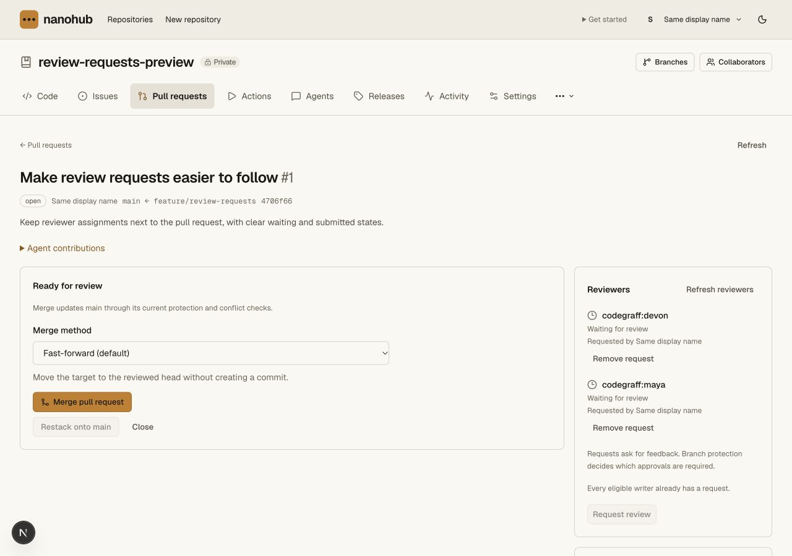

# Requested reviewers — local candidate 0.4.19

This validates the native PR request feature described in
[the contract](../review-requests.md). Production API/CLI deployment, cloud
acceptance and full GitHub parity remain unproved. The existing Cloudflare
deployment login is expired and cannot refresh; browser renewal needs the
Mac unlocked. No production mutation or new cloud sandbox is requested for
this feature's local checks.

Local acceptance passes:

- **413 API unit cases**, including six request-store tests for revision/ABA
  rejection, limits, stale/closed/archive fences, independent answers,
  preserved change requests, attribution and late-failure transaction rollback.
- **79 CLI cases**, including native request/remove/list, explicit revisions
  and diff identity, malformed intent, token-free output and no automatic replay
  after an uncertain write.
- The complete repository gate: **306 unit cases** and the actual local
  Worker/Git/review/protection/CLI/archive/recovery integration chain.
- Source and bundled request integration, followed by the exact distribution
  module with its manifest version, byte count and hash checked first.
- Strengthened cold DO/D1/R2 loss/restore acceptance: an answered request is
  renewed before checkpointing; request history, revision and current
  ineligible-reviewer status compare exactly after restoration alongside Git,
  permissions, policy, reviews, hunk conversations and Cloudflare references.
- Pinned tsrs, the existing operator checks and the complete OpenNext build.

The real Worker integrations verify browser same-origin/session boundaries,
reader/self-request denial, explicit CLI PR-write permission, concurrent edits,
stale revisions, reviewer demotion, submitted-review answers, re-request without
review deletion, direct final-writer credential/role checks, revoked credentials,
archive/closed state, restart persistence, connected-team removal/provider outage,
attributed audit and unchanged native Git clone/fsck. The test-only direct RPC
hook is not a production entrypoint.

Candidate 0.4.19 is 97,845 bytes, SHA-256
`e86b40b33b6b2a4483073083054bd7d4605e835672c0e8bc32c90ddba2f0195e`.
The local 0.4.17 and 0.4.18 modules retain their original hashes. The candidate
includes the preceding secret-administration commands. Its publication is still
pending, and source publication does not establish a passing hosted workflow.

Browser checks use the actual Next PR page and an isolated Miniflare backend
with synthetic sessions/people. The synthetic seed Git token is revoked after
setup. Both local preview listeners are confirmed absent after teardown. The
reviewer selector is exercised through its associated label and the actual Send
request control; two waiting people then disable another request with an
explanation. Document width equals viewport width at 1280×900 and 390×844.

Independent Impeccable review returns **ship** at the panel's visual scope,
with no material fixes. [The design validation](review-requests-design-validation.md)
identifies rendered and source-inspected states and preserves the existing
Harness palette/components. The context launcher fails with permission denied;
the documented fallback uses incumbent code. These checks do not certify all
accessibility states, security or production traffic readiness.

The first integration fixture incorrectly reuses one repository's Git seed key
for the connected-team repository. Git rejects it. The corrected fixture issues
a separately scoped synthetic key for that repository and revokes it afterward;
both source and bundle reruns pass. The initial failure remains in private logs.
An initial archive unit fixture targets the wrong test table; it is corrected to
use the application's real archive mirror. Browser testing also finds and fixes
a select label that included option text, and a layout inspection bounds long
request lists and prevents the merge card stretching to the sidebar's height.

Reader reviews, teams, automatic CODEOWNERS requests, notifications/inboxes,
old-version answer reconciliation and broader GitHub compatibility remain open.
The pending secret-service rollout, original staging/cutover, hosted dispatcher
activation and production recovery/load/operations requirements remain separate
launch gates in [production readiness](../production-readiness.md).

