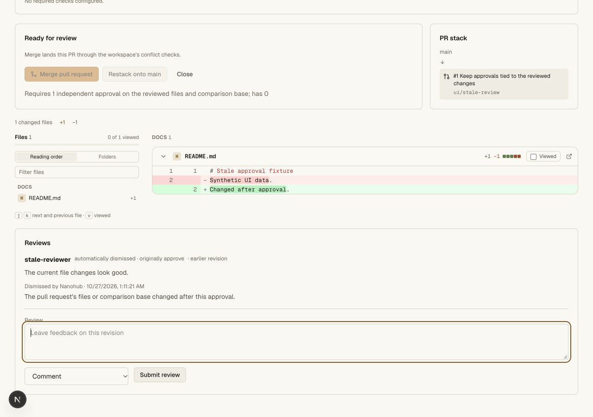
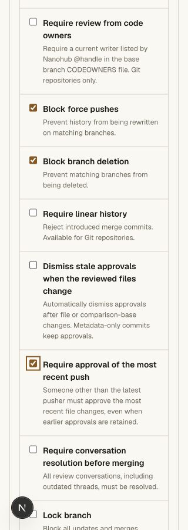
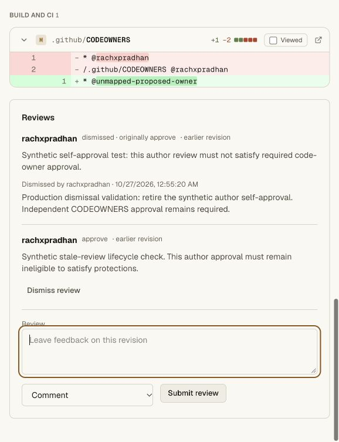
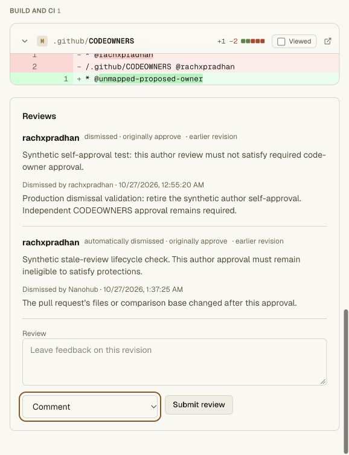

# Stale approval and latest-push validation

This change adds the configurable stale-approval dismissal and retained-review
modes described by [GitHub protected-branch guidance](https://docs.github.com/en/repositories/configuring-branches-and-merges-in-your-repository/managing-protected-branches/about-protected-branches).
Existing Nanohub policies keep strict behavior by default. Strict policies still
exclude the latest pusher from the general independent approval count; retention
mode permits their earlier approval while enforcing a separate fresh other-person
approval when the latest-push requirement is enabled.

## Automated acceptance

Eight new SQLite-backed cases cover strict compatibility defaults, irreversible
automatic dismissal and one audit, metadata-only commits, latest reviewable-push
attribution, retained approvals with fresh other-person review, code-owner
eligibility, overlapping restrictions, invalid values, comparison changes without
head movement, final comparison CAS, same-tree base metadata, change requests,
manual dismissal and conservative legacy records without tree evidence.

The real Git/HTTP test uses three native human accounts and ordinary scoped Git
credentials. It verifies:

- Metadata-only pushes keep both ordinary and owner approvals.
- File changes dismiss approvals, including after the original files are restored.
- A rejected multi-ref push rolls back ref changes, dismissals and their audits.
- Retention preserves the approval count and owner coverage while the separate
  latest-push gate requires a fresh reviewer other than the pusher.
- Requested changes survive later commits; manually dismissing them does not
  revive an older approval.
- Merging a separate ancestor PR advances the comparison base without moving
  the original PR's head. Its approvals are dismissed and already-landed changes
  disappear from its displayed diff.
- Old-anchor submissions fail with 409; injected tree evidence is ignored and
  the internal comparison command has no public mutation endpoint.
- Fresh legitimate reviews then permit merge; a fresh clone has the exact merged
  head and passes `git fsck --strict`.

The repository gate passes **63 unit tests and five Git/HTTP suites**. API, web
and vault tsrs checks and the full production OpenNext bundle pass. The earlier
latest-pusher test was adjusted for singular/plural error text, and the old
same-tree-return test now requires a fresh review after irreversible dismissal.

Commands: `bun run --filter @swarm/api test:repository`, `bun run check`, and
`bun x opennextjs-cloudflare build --config wrangler.deploy.jsonc` in `apps/web`.

## Browser acceptance

Separate local `stale-review-ui` uses a genuine local writer distinct from the PR
author. A metadata-only commit preserves its approval and Merge stays enabled.
A file-changing Git push then displays an automatic dismissal, retained original
feedback and system reason, and disables Merge. With explicit retention enabled,
the next change carries the approval forward but the latest-push gate remains
blocked. A fresh independent review enables Merge again.

The new settings and review history were visually inspected at actual 1280 and
320 CSS pixels. At 320px, document width remained 320px. Saving the existing
retention/latest-push configuration retained both values. Temporary viewport
overrides were reset; all fixture Git tokens were revoked and the local Git
checkout was removed. The PR remains open for inspection.

## Hosted release

Main Worker `84c8696b-861d-4558-a393-1991c3f64180` is deployed at 100%.
The previous release is `7b4d4b52-d25a-4adf-aff4-fd726fcae8e7`.
The private Cloudflare vault and retained provider secrets are unchanged.

On 2026-10-27, the human-approved temporary Git token was scoped only to
`rachxpradhan/prod-codeowners-20261027`. The strict policy was verified and saved
without weakening CODEOWNERS or dismissal restrictions. Synthetic author review
#2 was used to test storage lifecycle; author approval remained ineligible for
independent review throughout.

- Metadata-only commit `4d67a12ec9099d6462d69d3f3b64eab4d46d11e0` kept tree
  `e5ceb162690d2989a57b08942ee5ca3bec898257` and preserved review #2.
- File-changing commit `77b0f70bce16baef96a2fa045439541670e1b33e` produced tree
  `356c86556c6d6aff8d5b67f2eb868dd0a3af3ff4` and automatically dismissed review #2.
  The original review, system actor and reason remained visible.
- Main remained `33e73c27c6d261a16c384cdad6d1514b40305a2f`. Both CODEOWNERS
  groups still required independent approval and Merge remained disabled.
- The token was revoked through the UI, Git returned an authentication rejection,
  and the private plaintext token file was deleted.

Only the canary's `codeowners/rejection-check` branch received the two approved
synthetic commits. No new real repository or staging write occurred. Positive
independent approval in production still requires a second actual account; the
three-account local Git/HTTP fixture verifies that path.

The production audit contains event #9 for automatic dismissal of review #2,
with system actor, branch, reason and original verdict. It has `automatic:true`
and no ref field. Ref events #7 and #8 separately record the two accepted pushes.
