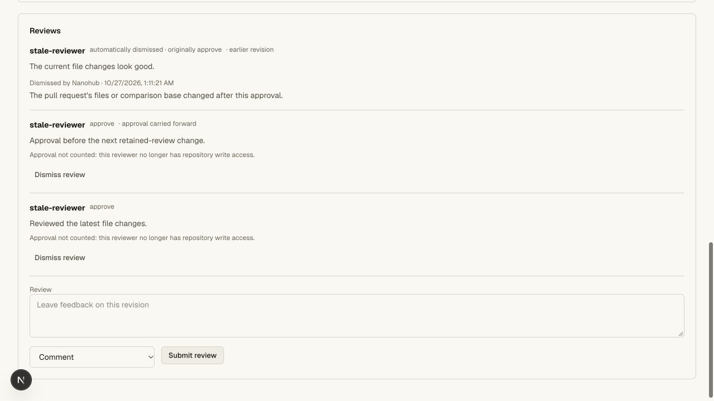
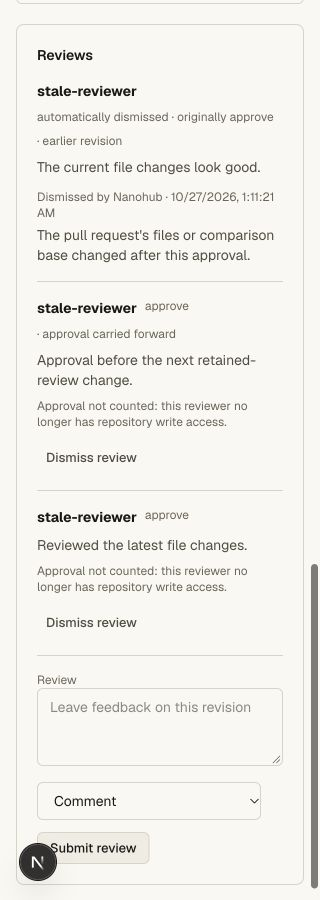
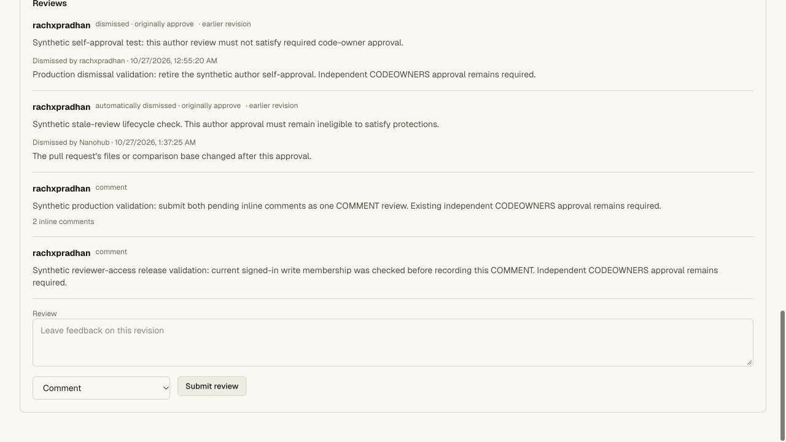

# Current reviewer write-access validation

## Change

Required approvals now use current repository write membership at gate preview
and again before the sequencer's final merge transaction. Native role lookups use
one Hub snapshot, including its check timestamp. External team lookups verify the
reviewer's linked account and current provider membership. Missing/reader roles
and unavailable proofs never supply an approval.

This applies to general and retained approvals, latest-reviewable-push approval,
and code-owner review. Original verdicts and feedback remain intact. Outstanding
requested changes are deliberately still blocking until replaced or explicitly
dismissed. A role restoration can make a still-valid undismissed review eligible
again; stale/manual dismissals remain irreversible.

Human independent review creation also rechecks current write access. Client
JSON cannot supply membership or independent status. Final merge requires a
trusted membership result no older than 30 seconds, then reads current reviews,
policy and refs in its serialized transaction. A new unverified reviewer cannot
count merely because their review arrived during the asynchronous lookup.

## Automated checks

Six new SQLite tests cover missing proof at final merge, demoted/removed/unknown
and unavailable reviewers, retained approvals, immutable historical feedback,
latest-push composition, author and agent exclusions, expired/invalid/future
proof, preserved requested changes, and reviews arriving after membership lookup.

The real Worker/Git/HTTP test covers two repositories:

- Native: a valid independent approval, reader demotion, complete removal,
  unchanged main after rejected merge, ignored injected membership JSON, denial
  of a new review after demotion, preserved requested changes and explicit
  dismissal, latest-push exclusion, fresh approval and protected merge. The
  provider is unavailable throughout, with no external membership requests.
- External team: a valid linked reviewer; a simulated outage for that reviewer's
  subject only while the author's access still works; approval exclusion and
  merge rejection; provider membership removal; a fresh verified approval after
  membership restoration; protected merge and a fresh exact clone/fsck.

All fixture Git credentials are revoked in cleanup. The prior hunk-comment smoke
now explicitly checks that demotion invalidates an existing approval before
restoring its synthetic writer and submitting a fresh review for its positive
merge. Other graph/protection behavior remains covered by the full repository
gate. API, web and vault tsrs checks and the OpenNext hosted build pass.

The final repository gate passes **87 unit tests and nine Git/HTTP suites**.
The focused membership suite has six cases; the production bundle includes the
native snapshot timestamp used for proof-age enforcement.

Commands: `bun run test:repository`, `bun run check`, and
`bun x opennextjs-cloudflare build --config wrangler.deploy.jsonc` in `apps/web`.

## Browser checks

The existing private local `stale-review-ui` has retained-approval and latest-push
requirements. Its synthetic reviewer was demoted from writer to reader through
the API. GET confirmed zero eligible approvals and a blocked gate. The browser
showed the original approval/body alongside **Approval not counted: this reviewer
no longer has repository write access**, with Merge disabled.

The review section was visually inspected at normal desktop width and 320 CSS
pixels, with document width 320. The exclusion explanation wrapped within the
page. The original writer role was restored, a fresh independent approval was
submitted and the API gate became ready again. No Git token was created for this
browser fixture; no ref moved. Temporary viewport overrides were reset.

## Hosted validation

Main Worker `2fccd22e-4aba-44d8-8e37-3af358f093c9` was deployed at 100% for this check.
Public `/api/agent-help` identified that exact version. Legacy `/install.sh` and
`/download` return HTTP 200. Previous main Worker:
`ed63fda6-1453-40aa-a95d-a5abac4d24ea`. Vault bindings/version are unchanged.

The existing signed-in owner opened private production canary
`rachxpradhan/prod-codeowners-20261027` PR #1. A new synthetic COMMENT review #4
exercised the fresh human-writer check before review storage. It persisted after
reload, alongside the prior three reviews and two-comment batch. There were zero
open inline threads and no pending draft. Head remained `77b0f70`; two CODEOWNERS
groups still awaited independent approval and Merge remained disabled.

No production role, policy, ref, credential or vault value was changed. The only
hosted test mutation was that synthetic COMMENT review. No production Git token
was issued or reused.

Native role transitions and the external-team outage/removal cases above use
multiple local fixture identities. A positive independent-approval or role-changing
production test would require a second real human account; no fake production
identity or new production credential was created for this validation.

## Scope limits

Membership and repository data live in separate services. The implementation
rechecks immediately before the serialized ref-write transaction and bounds
proof age; it does not claim a distributed atomic transaction with a simultaneous
external role change. Native lookups support up to 2000 candidate accounts;
external checks allow 128 in batches of eight. Provider errors exclude the
affected account; other independently verified approvals can still satisfy a
gate. Full GitHub parity remains open work.
