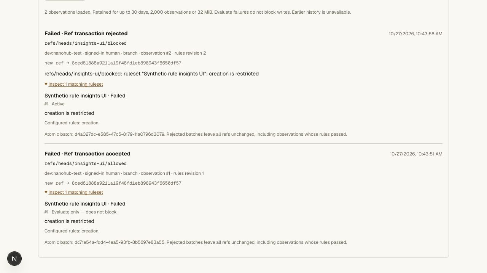
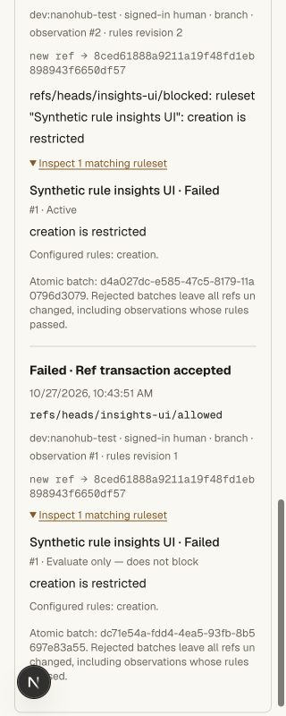
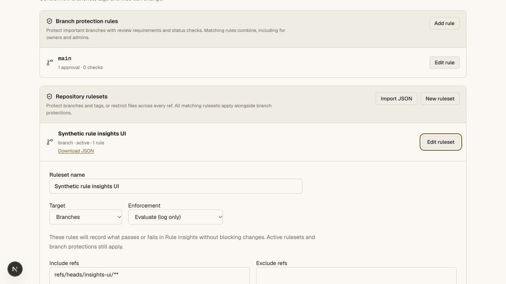
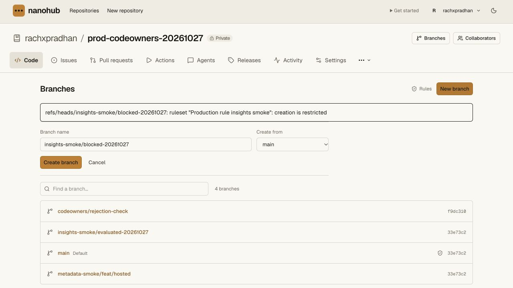
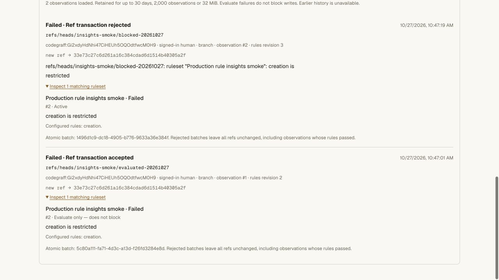

# Evaluate mode and rule insights validation

## Behavior

Branch, tag and push rulesets accept active, evaluate and disabled enforcement.
Evaluate rules record their outcome without rejecting a write. They have
separate graph budgets and separate signature evidence, so their failure cannot
satisfy or weaken active protection. Observation errors are visible rather than
silently reported as passes. Active restrictions and classic protections still
apply at the final serialized writer. Import/export and restoration retain mode.

Rule insights record matching rulesets and their configuration mode, first
graph-violation reasons, old/new IDs, ref, current actor, human/credential source,
rules revision, operation and atomic batch ID. The rules result and final write
acceptance are separate: an evaluate failure can accompany an accepted write,
and a successful ruleset evaluation can accompany a rejected atomic transaction.

Successful observations share the ref/review transaction. Rejection observations
are persisted only after rollback and do not produce accepted ref audit entries.
Collectors are request-local; no module-global state mixes concurrent requests.
The same path covers native Git, HTTP branch mutations, PR merges, restacks and
suggestion applications. Retention is bounded by 30 days, 2,000 observations and
32 MiB per repository, and read routes exclude expired observations.

List and detail APIs require a signed-in current admin and return private,
no-store responses. Filters compose by exact ref, actor, ruleset, result and
inclusive timestamp range, with stable ID cursors. Unknown/invalid filters and
non-GET requests reject. Git, runner and agent credentials cannot read insights.

## Automated evidence

Eight new SQLite/Git-graph cases cover:

- Evaluate acceptance followed by active rejection with durable failed evidence.
- Atomic rollback of refs and accepted audit, retaining attempted-ref observations
  with one batch ID.
- Separate active/evaluate metadata, path and signature results; observation
  evidence cannot satisfy an active signature rule.
- Observation resource failure recorded as an error without blocking a valid
  write, human-only bypass, exclusions and classic-lock intersection.
- Stable pagination under new arrivals, exact filters, SQL-shaped and unbounded
  input rejection, expired/count/byte retention and portable evaluate JSON.

A new real local Worker/Git/HTTP suite verifies owner/admin access and
reader/writer/Git denial, private detail responses, malformed-filter rejection,
real intermediate file/message/signature failures that remain observation-only,
active rejection, `git push --atomic` negative rollback and positive multi-ref
acceptance, signed-human branch-copy observations, tag lifecycle observation,
rejected PR-merge evidence with unchanged PR/main, positive independently
reviewed merge under evaluate mode, exact filtering/pagination and fresh clone
with `git fsck --strict`. The fixture Git token is revoked in cleanup.

The repository gate passed **122 unit tests and thirteen real Git/HTTP suites**.
All **163 API unit tests**, all three tsrs checks and the OpenNext hosted build
passed. A focused rerun of the eight new cases also passed after avoiding
unnecessary retention scans on operations with no matching rule attempts.
The existing RPC disposal warning still appears without a failed test.

Commands: `bun run test:repository`, `bun run --filter @swarm/api test:unit`,
`bun run check`, and `bun x opennextjs-cloudflare build --config
wrangler.deploy.jsonc` from `apps/web`.

## Browser evidence

In private local `hunk-review-ui`, a new creation rule scoped only to
`refs/heads/insights-ui/**` recorded an accepted creation in evaluate mode.
Activating the same rule rejected a second creation. Existing main protection
was unchanged. The UI showed both observations, their historic modes and
creation reasons, with independent accepted/rejected transaction labels.

The exact-ref filter reduced the list to the accepted observation. The mode
editor listed Evaluate (log only) and explained active-rule intersection; this
temporary editor change was cancelled. Desktop and 320 CSS-pixel views were
visually inspected; document width stayed 320 on mobile, including date controls,
full commit IDs, failure reasons and expanded details. Viewport overrides were
reset. Keyboard activation provided a working browser-control path after
pointer automation failed on existing controls.

## Hosted validation — 2026-10-27

Worker `8c2c6301-b314-40f4-bbd9-c30dd2d48ccd` replaced
`f8dd378e-b5d2-4a44-b6a7-fa53198ad60c` at 100%. The private vault version and
bindings were unchanged. The production check used the existing signed-in human
session in private `rachxpradhan/prod-codeowners-20261027` only.

- Imported **Production rule insights smoke**, ruleset #2, in evaluate mode,
  scoped only to `refs/heads/insights-smoke/**`, with one creation restriction.
  The preview correctly described immediate observation without enforcement.
- Created `insights-smoke/evaluated-20261027` from main. Observation #1 recorded
  the creation failure under rules revision 2 while accepting the transaction.
  The new ref points to existing main `33e73c27c6d261a16c384cdad6d1514b40305a2f`.
- Activated that same scoped rule. Creating `insights-smoke/blocked-20261027`
  returned `creation is restricted`. Observation #2 recorded active failure
  and rejected transaction under rules revision 3. The branch does not exist.
- Both observations, modes, actor, exact IDs and batch identities survived a
  full page reload. Expanded details matched the attempted operations.
- Existing main and `codeowners/rejection-check` remained `33e73c2` and
  `f9dc310`. The accepted synthetic ref and active creation restriction remain
  as clearly named canary evidence. No Git credential, signing key, member or
  vault value was created or changed by this rule test.

The same release also completed the prior production unsigned suggestion
rejection check; its additional source-only protection and resolved synthetic
thread are documented in [signature evidence](signature-validation.md). Main's
CODEOWNERS/conversation protections were retained and merge remained disabled.
The hunk composer opened and cancelled through keyboard activation, resolving
the prior browser-automation verification gap.

## Scope limits

These are native rule-suite semantics, not a claim of complete GitHub REST
response-schema compatibility or an aggregate dashboard. No historical backfill
is performed. Only attempted refs reaching final rule evaluation are recorded;
authentication, malformed uploads, object/preflight graph failures and remaining
unattempted refs after the first batch failure are not invented as evaluations.
Graph restrictions retain the first discovered violation per ruleset, rather
than a complete per-rule/per-commit trace. Classic-only failures have no rule
suite when no ruleset matched.

The native Git host now advertises the atomic capability because its final
writer already commits or rolls back the whole batch. Batches are bounded at
100 ref commands. Legacy snapshot mode does not advertise atomic support.
The private Cloudflare vault and its retained-value/on-demand behavior are
unchanged. Other parity work, including deployment environments and merge
queues, remains open.
