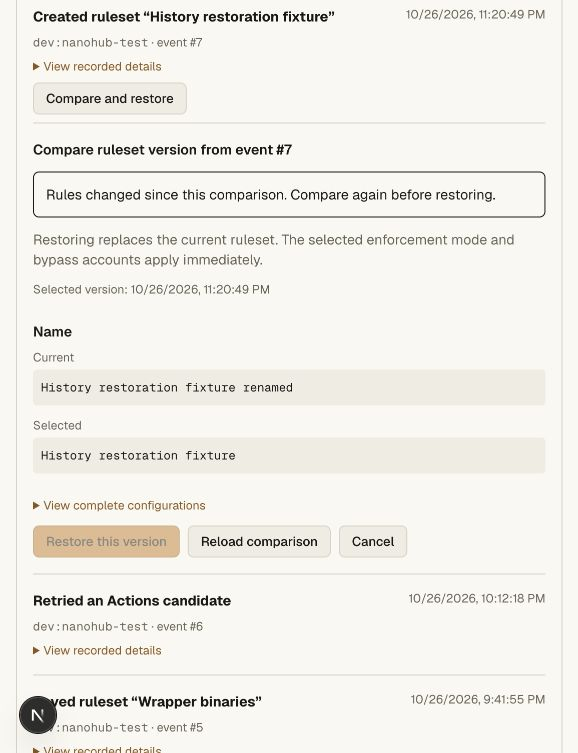
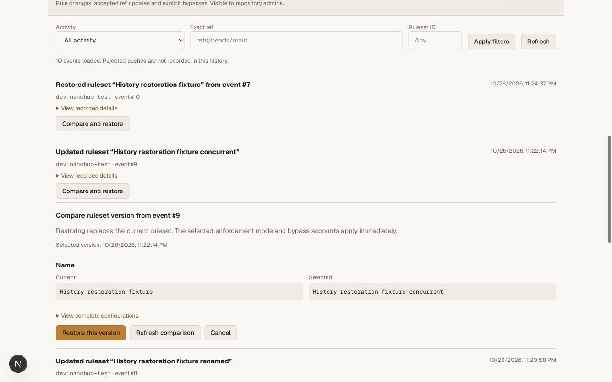
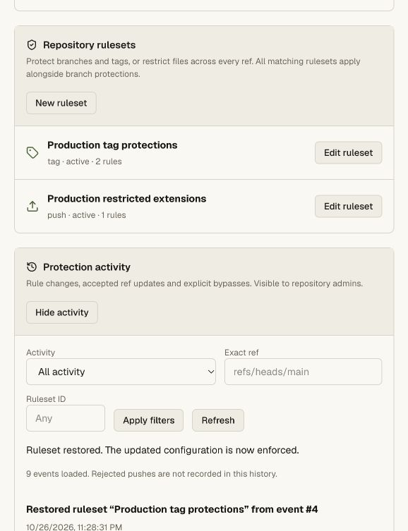

# Ruleset compare and restore validation

The history UI compares changed configuration fields before restoring a recorded
ruleset. Full configurations remain available in a disclosure. The server selects
the saved audit snapshot and checks the preview's repository rules revision in
the same transaction as the update and audit entry.

## Automated checks

- Four ruleset-history unit cases cover restored enforcement and provenance,
  stale comparisons without mutation, deleted-rule recreation/new IDs, preserved
  bypass lists, unrelated/missing/unsupported snapshots, malformed revisions and
  the 100-ruleset limit.
- The repository gate runs 40 unit cases plus the real Git/HTTP integration and
  ordinary Git-client smoke tests. HTTP checks deny writers/owner agents and
  cross-origin restoration, reject client configuration injection, verify private
  preview caching, exercise existing and deleted rulesets, reject repeat/stale
  restores with 409, and observe restored restrictions blocking branch creation.
- API, web and vault checks use the pinned tsrs compiler.
- The Cloudflare OpenNext bundle is built with the private production config.

Commands: `bun run --filter @swarm/api test:repository`, `bun run check`, and
`bun x opennextjs-cloudflare build --config wrangler.deploy.jsonc` in `apps/web`.
The repository integration still emits its pre-existing RPC disposal warning;
assertions and process exit pass. This change does not claim to fix that warning.

## Local browser checks

The synthetic `git-ui-fixture` has an isolated ruleset matching only
`refs/heads/ui-history-smoke`, with deletion and force-push protections and no
bypasses. The UI test changed only its name. A second editor changed the name
after the comparison loaded; restoration returned 409, showed the conflict and
disabled restore until comparison refresh. A refreshed comparison restored the
original name, updated the rules list and recorded the source event in history.
An unchanged comparison disables restoration.

Checks used actual 320, 578 and 1280 CSS-pixel viewports, including complete
configuration disclosures. No horizontal document overflow was observed.
Temporary viewport overrides were reset. The Settings rules page now has the
same explicit 1120-pixel width bound as Branches, avoiding an inherited workspace
style stretching the comparison.

## Hosted validation

Deployed `nanohub-swarm` version `b3077477-abeb-4701-bbfe-236abf404fd0` at 100%.
The public deployment metadata reports that version; legacy `/install.sh` and
`/download` endpoints still return HTTP 200.

In the private production canary `rachxpradhan/prod-smoke-20261026`, changed only
the tag ruleset's name to `Production tag protections (history check)`. Compared
its recorded event #4 with the current configuration: the UI showed only a Name
change. Restoring through the production UI succeeded, retained the ruleset ID,
returned the original name and recorded restoration event #9 linked to #4.
The success notice received keyboard focus. Existing main lock, tag restrictions
and file-extension rule remain configured. No new credential was created.

This does not establish full GitHub parity, version export/import, evaluate mode
or rejected-push insights. The hosted test restored a name-only change; actual
restored enforcement and conflict rejection are additionally covered by the local
real Git/HTTP gate and the two-editor browser test described above.
