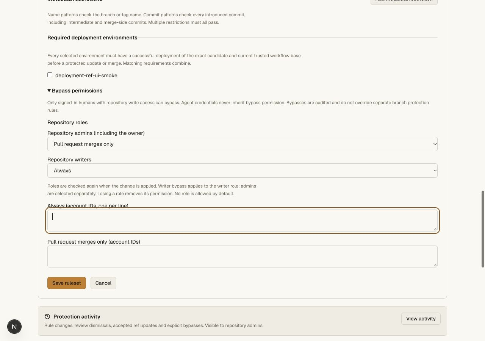
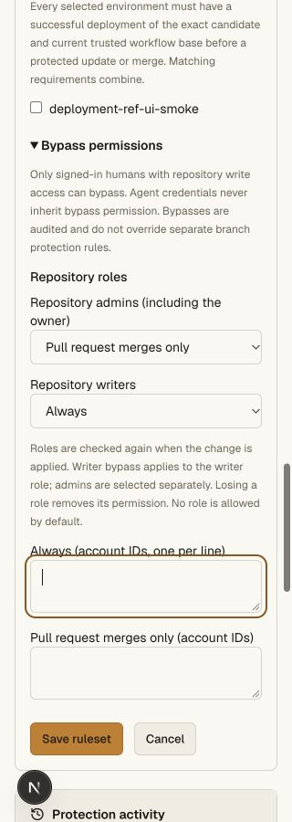
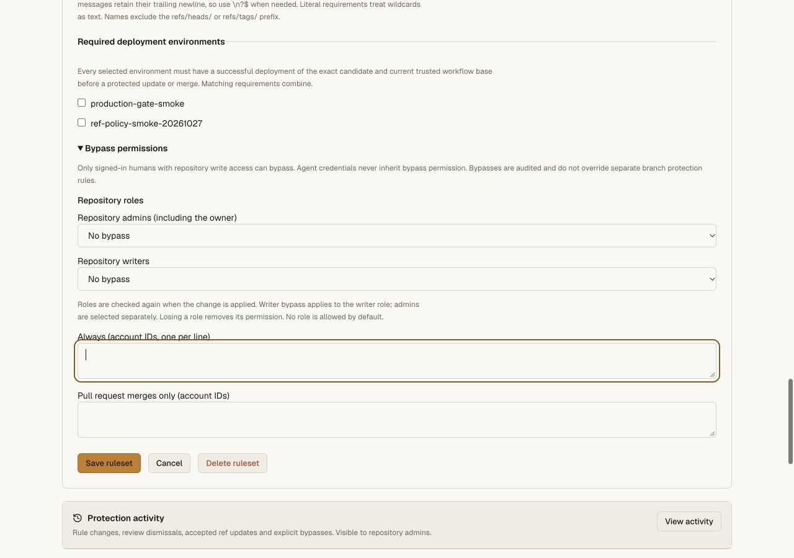
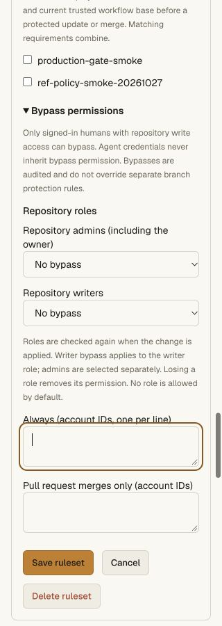

# Current repository-role ruleset bypass — 2026-10-27

Rulesets now accept explicit admin/owner and writer role actors alongside named
accounts. [The contract](../github-parity.md#ruleset-bypass-by-repository-role)
explains exact role selection, signed-human boundaries and bounded membership
freshness; this is not full GitHub identity, team or credential equivalence.

## Local acceptance

- **251 API unit tests** pass. Six new cases cover supported numeric role IDs,
  malformed actors, duplicate role modes, exact roles, no implicit admin grant,
  PR-only modes, human/credential separation, fresh account-bound evidence,
  changed native roles, missing/expired/future/incorrect proofs, deployment gate
  parity, rule insights, preserved audit, portable transfer refusal and
  mixed-version CLI editing without downgrade.
- Full repository regression gate and all smoke checks pass. The new real
  Worker/Git case grants creation/deletion bypass to explicit admins or writers,
  rejects other roles and immediately observes the next lookup after demotion.
  Writer bypass does not implicitly include admins; owners must be selected
  through the admin role. Other matching rulesets and classic locks still block.
- A PR-only admin rule bypasses its own update/signature/deployment restrictions
  at merge, with consistent signature/deployment previews. Classic required
  environments and locks still block. A previous preview carries no bypass
  authority into the final writer.
- A real suggestion application uses fresh writer-role authority at its final
  branch update. Accepted ref audit records the actor/observed role/time, while
  insights record the precise actor type, ID and mode that matched.
- Native and already published bundled CLI **0.4.8** export numeric role actors
  without conversion to user IDs; an actual source CLI conditional update
  preserves them. Old credential scopes gain no authority. Git, CLI merge and
  agent credentials cannot inherit the browser-only bypass.
- External member/owner changes are read from fresh provider evidence; an
  unavailable provider cannot turn into a cached-owner or display-name grant.
  Restart preserves configuration. A real fresh clone and `git fsck --strict`
  pass after the protected merge. Fixture credentials are revoked.
- Pinned tsrs across workspaces and Worker types plus the production OpenNext
  build pass. CLI module stays byte-for-byte **46,789 bytes**, version 0.4.8,
  SHA256 `db5a3b089b91c03161f85c9d86c512f6bead424cb9afa131ad6449b53babcf11`.

The local editor starts both roles at No bypass. An unapplied draft selects
PR-only admin and always writer, then verifies that changing to Tags resets the
role choices and offers only No bypass/Always. The draft is cancelled without
saving. Desktop is 1280 px; mobile viewport/document widths both measure 320 px.
Controls use the existing 14 px foreground token and keyboard focus treatment.

Production rollout and preserved configuration are recorded below. Positive
mutations described above are local Worker/Git acceptance, not a production role
grant or production bypass execution. No new cloud VM execution is established.

## Production acceptance

Worker **9a672bf3-e90b-4a27-ae65-568def2ca65e** is deployed. A fresh signed-in
ruleset read reports `roleBypass: true`, which preflights the updated Hub role
receiver. The exact same three ruleset objects remain at rules revision 5;
no repository role bypass has been configured in this canary.

Before/after comparison preserves six refs, main/default settings revision 0,
active archive revision 0 with no transition, environments and CI history. All
three classic policy objects remain identical at protection revision 3.
The existing production editor displays No bypass for both roles. Desktop and
320 px mobile layouts were inspected. The form was cancelled using keyboard
activation after a pointer activation left it open; no selection was changed or
saved. No production bypass, policy write or credential creation was performed.

Public verification passes for the deployed Worker version, unchanged published
0.4.8 module bytes/checksum, and refusal of anonymous private ruleset/API reads
(404 and 401). The actual 0.4.8 installer/both aliases were verified in the
preceding CLI archive rollout; this unchanged artifact did not need republishing.
Private machine receipts:

- `~/.config/nanohub/prod-validation-2026-10-27/ruleset-roles-public.json`
- `~/.config/nanohub/prod-validation-2026-10-27/ruleset-roles-stateful.json`

The vault service was not redeployed. Production observations establish rollout,
readiness, UI and configuration preservation; positive role-bypass writes remain
local acceptance evidence.

