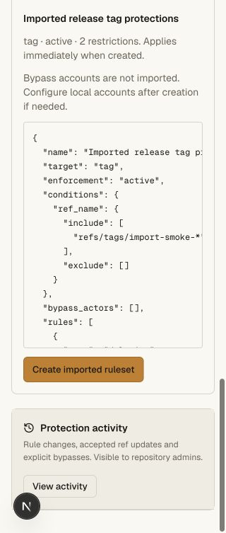
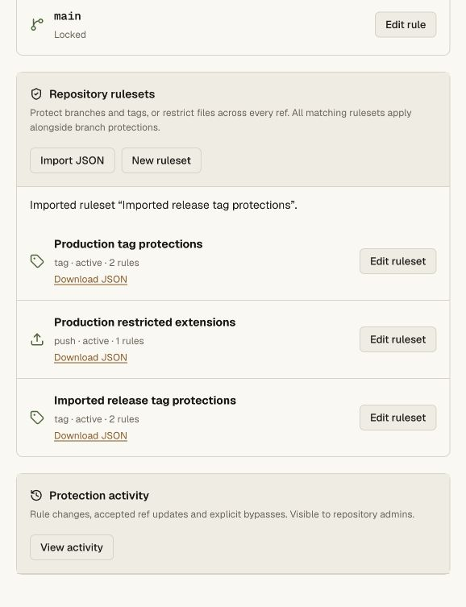

# Ruleset JSON transfer validation

Current and historical ruleset downloads preserve supported configuration and
omit source IDs, audit metadata and bypass accounts. Imports preview before
creation, identify supported metadata/scope translations and reject unsupported
policy rather than discarding it. The source behavior follows GitHub's
[history/export guidance](https://docs.github.com/en/enterprise-cloud@latest/repositories/configuring-branches-and-merges-in-your-repository/managing-rulesets/managing-rulesets-for-a-repository)
and the shape of its official
[tag-protection recipe](https://github.com/github/ruleset-recipes/blob/a1f8e53ec12857637e8762e689a3abc255ff2c2f/tag-rulesets/prevent-tag-delete.json).

## Automated checks

The repository gate contains 43 unit cases plus real Git/HTTP and ordinary Git
client integration. New transfer cases cover:

- Branch, tag and push roundtrips, including native path/size exceptions.
- No exported IDs or bypass identities; imported bypass lists start empty.
- Explicit universal repository-selector mapping and metadata notes, without
  mutating the source object.
- Rejection of unsupported rules, evaluate mode, selective repository conditions,
  unknown policy fields and nonempty imported bypass lists.
- Preview leaves the plan and revision unchanged.
- Writer/agent import denial, same-origin enforcement and validation on both
  preview and final create.
- New IDs, export attachment/cache/nosniff headers, and current exports available
  to members without revealing bypasses.
- Historical export after deletion; historical access denied to writers/agents.
- A real Git branch push rejected by the imported active restriction.

Commands: `bun run --filter @swarm/api test:repository`, `bun run check`, and the
Cloudflare OpenNext build with `wrangler.deploy.jsonc` in `apps/web`.

## Browser checks

The local `git-ui-fixture` imported the synthetic file
`packages/api/scripts/fixtures/rulesets/import-tags.json`, scoped only to tags
matching `import-smoke-*`, with deletion and force-push blocks and no bypasses.
File selection, invalid JSON, an oversized file, unsupported signatures, source
edits invalidating the preview, successful creation and success-notice focus were
exercised. Re-selecting the source after editing its text works.

The current configuration downloaded through the browser as `ruleset-5.json`.
It contains no ID or bypass list. That downloaded file was loaded back into the
preview without creating a duplicate. Historical event #11 downloaded as
`ruleset-5-event-11.json` and matched the current configuration exactly.

Rendered at 320, 578 and 1280 CSS pixels. The 320-pixel document had no horizontal
overflow; the desktop page remains bounded to 1120 pixels. Temporary viewport
overrides were reset and the extra responsive tab was closed.

## Hosted validation

Deployed main Worker version `d791c92a-0e7c-4ec2-b0f9-e5ed29c6c75a` at 100% and
verified it through public deployment metadata. The production browser imported
the synthetic file into `rachxpradhan/prod-smoke-20261026` after reviewing the
scope/metadata notes. It received local ID #3 instead of source ID 424242 and
targets only `refs/tags/import-smoke-*`. Existing main lock and tag/file rules
remain configured. No new credential was created.

Current `ruleset-3.json` and historical `ruleset-3-event-10.json` downloaded through
the browser. Both matched the reviewed supported configuration and omitted IDs
and bypass accounts. Creation event #10 appears in production activity.
Anonymous current/historical export requests were denied; the legacy install and
download endpoints still return HTTP 200.

The live test covers file preview/create and current/historical download. The
actual rejection of Git writes by an imported rule is established by the local
real Git/HTTP gate above. Full GitHub ruleset, organization-policy and Actions
compatibility remain incomplete.
