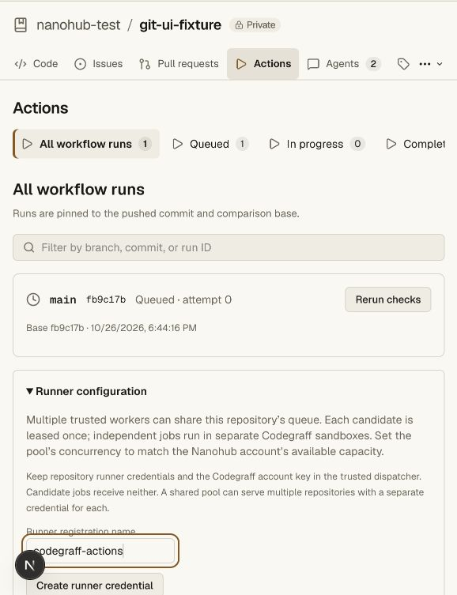

# Runner pool validation — 2026-10-26

Local verification passed:

| Command | Evidence |
| --- | --- |
| `npm run check` | API, web and vault pass pinned tsrs |
| `npm run test:unit -w @swarm/api` | 70 unit tests pass |
| `npm run test:repository` | 29 unit cases plus real private Git/HTTP/DO roundtrip pass |
| `npm run test:access -w @swarm/api` | 3 unit cases plus real vault/ACL integration pass |
| `npm run test:hosting -w @swarm/api` | 16 dispatcher/pool cases plus namespace/HTTP integration pass |
| `npm run build -w @swarm/web` | Next production build succeeds |
| `git diff --check` | No whitespace errors |

Concurrency coverage:

- 260 candidates are claimed beyond the 200-run display window, without duplicates.
- 32 simultaneous HTTP claims across eight registrations receive distinct leases.
- Revoking a registration reassigns its four running candidates at the next attempt;
  old read tokens and completions are rejected.
- A shared limiter caps jobs across candidates; failed jobs release permits.
- Independent workflow jobs overlap; dependencies wait and cancel on failure.
- Multi-repository pools use separate repository tokens under one Codegraff key.
- Shutdown drains work; explicit capacity responses honor Retry-After; uncertain
  allocation timeouts are not retried automatically.

The Actions runner configuration was inspected in the local synthetic repository;
an empty registration name disables credential creation. No credential was created
through the browser for the screenshot.

Live Codegraff allocation and test execution remain pending the account key,
repository runner credential, and published digest-pinned toolchain image. The
user is preparing the key. Sandbox API fixtures are not live execution receipts.

Later real cloud evidence is available in [Codegraff live acceptance](codegraff-live-validation.md).
It verifies one real disposable VM through the dispatcher and local Nanohub
API, using the existing CI configuration. It does not prove simultaneous
multi-VM cloud capacity or activate the production runner service. The separately
configured Nanohub key still needs sandbox scope.
