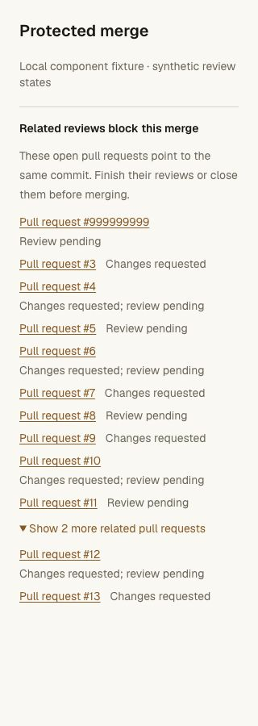
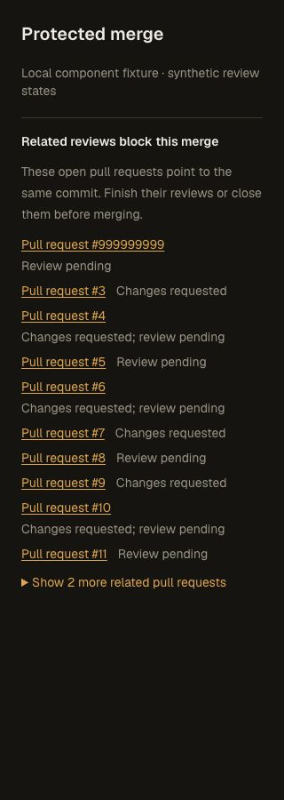

# Reviews at a shared head commit — 2026-10-28 JST

A regression reproducer on the preceding implementation shows a protected PR
can merge while a second open PR at the exact same head has requested changes.
The new final-writer guard rejects that merge. It also observes pending browser
and CLI reviews on peer PRs, matching the
[documented GitHub restriction](https://docs.github.com/en/repositories/configuring-branches-and-merges-in-your-repository/managing-protected-branches/about-protected-branches#require-pull-request-reviews-before-merging).
This is local acceptance, not a production rollout.

## Enforcement and privacy

The source CLI and packaged CLI run against actual local Workers, SQLite DOs,
D1 and ordinary Git. PR #1 targets protected `main`; PR #2 targets a separate
`release` branch while both live heads point to the same commit. An approval on
PR #1 cannot overcome requested changes or a private pending review on PR #2.
Denied HTTP/CLI requests leave `main` unchanged. Forged empty blocker evidence
in HTTP JSON has no authority. A direct call to the existing final merge RPC
also rejects the blocked candidate.

Tests cover latest verdicts, comment-only feedback, explicit dismissal without
resurrecting an older decision, retained change requests after demotion,
concurrent browser/CLI drafts, and a draft arriving after a clean preview.
Private draft bodies, authors, IDs, excerpts and issuing credentials never enter
the public blocker records. Only peer PR numbers and generic status flags do.
Unit cases additionally cover empty/earlier-diff pending reviews and prove that
peer approvals cannot satisfy the current PR's approval requirements.

A different live SHA clears the peer relationship even with an identical tree;
moving it back restores the block. Publishing/discarding all pending reviews or
closing the related PR clears its pending blocker. A revoked CLI credential
cannot access its draft; that draft remains private, and closing its peer PR
clears the blocker. A new open PR without feedback is not blocked by the closed
PR's history. Archive and current branch locks remain authoritative. Pending
blockers persist across Worker restart.

The upgraded merge route uses `mergeReviewedPull`. A fixture injects Cloudflare's
exact missing-method error into that receiver after every review condition is
otherwise satisfied. HTTP returns 503 with Retry-After 5, the CLI reports the
update, and `main` stays unchanged. No fallback to the older writer occurs.
After restoring the receiver, the real protected CLI merge succeeds. An
independent clone passes `git fsck --strict` and matches the expected commit.

## Checks

- Seven focused SQLite regression cases pass.
- Source and actual standalone distribution pass the real CLI/Worker/Git flow,
  including direct final-RPC enforcement and the older-receiver failure case.
- All 323 API unit cases and 254 repository unit cases pass. The full real
  Worker/Git/protection/CLI/recovery chain also passes.
- Pinned tsrs passes for API, frontend and web Worker configurations.
- The production Next build passes. It builds the local CLI candidate too;
  no public release or deployment is performed.

The [receipt](shared-head-reviews-receipt.json) pins runtime-source and evidence
hashes. Fixture credentials are revoked and local Worker resources disposed.
The visual preview server is stopped, its temporary browser tab closed and the
browser viewport override reset.

## Rendered notice

The committed notice component is rendered in isolation with the actual
Tailwind stylesheet, Harness palette and local Geist font. Browser checks cover
desktop and 320-pixel layouts, light/dark themes, a nine-digit PR number,
keyboard focus/link activation and a twelve-peer disclosure. At 320 pixels,
document scroll width equals viewport width. These are component fixtures;
full-page production UI, physical-device behavior and 200% zoom were not tested
for this candidate.

## Remaining scope

The candidate has not been deployed or pushed to GitHub. It does not implement
loose required-check mode: current Git merges still require a fast-forward
candidate containing the latest target branch, and check evidence remains tied
to the current trusted workflow base. Merge strategies, hosted release
acceptance and the broader production gates remain outstanding.
