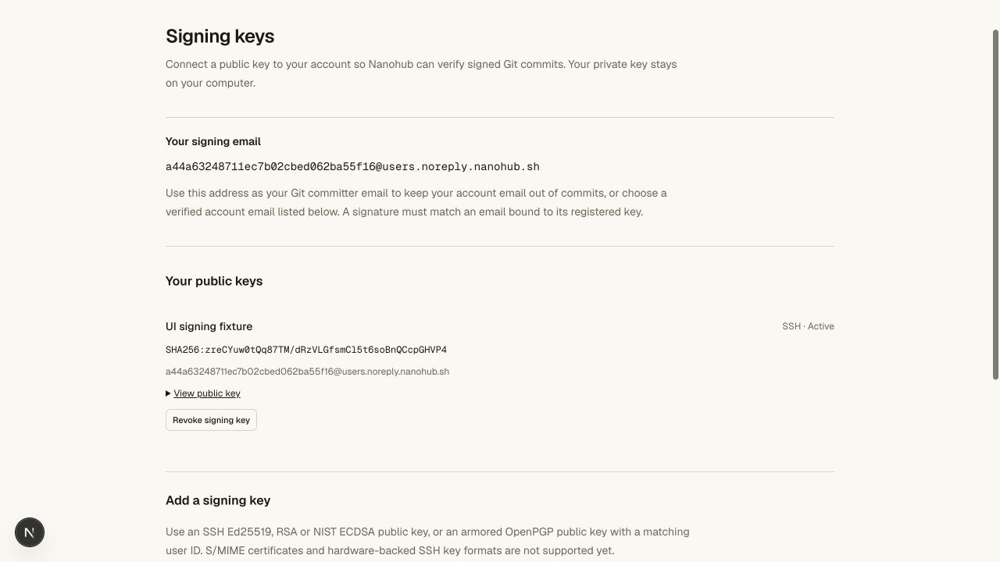
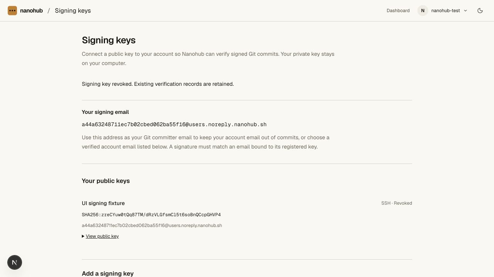
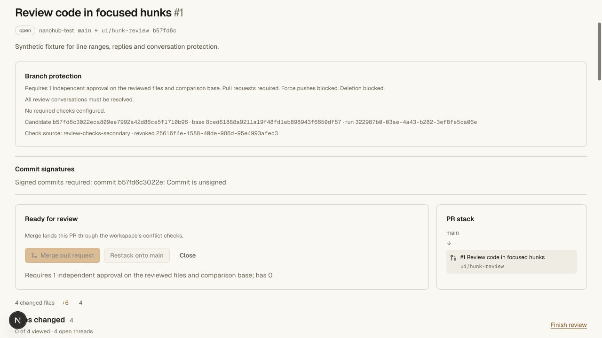
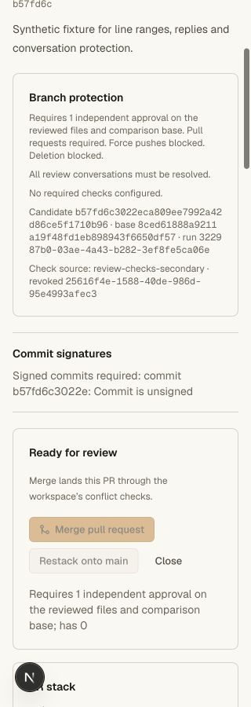
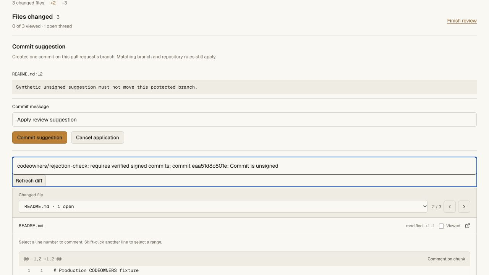

# Signed commit validation

## Implemented behavior

Account settings accept public SSH or OpenPGP signing keys from the signed-in
human account, with same-origin writes and current verified-email checks. Agent,
Git and CI credentials cannot enroll keys. A canonical account-derived Nanohub
noreply address is always available. Private key material is rejected. Stable
fingerprints and key aliases cannot be reassigned to another account, including
after revocation.

Verification reconstructs Git's exact unsigned commit payload and verifies the
detached signature. Supported SSH keys are Ed25519, RSA 2048–8192 with SHA-2, and
NIST ECDSA P-256/P-384/P-521; the SSHSIG namespace must be `git`. OpenPGP keys
must currently certify the committer email and have a valid signing key. An
expired/revoked key cannot use a backdated signature to regain eligibility.

New verifications check current email ownership before and after crypto and
recheck active key ownership when recording the receipt. Successful receipts
are immutable and repository-scoped. They bind both Git's object ID and the
SHA-256 digest of the raw object. Revoking a key or later removing an email does
not invalidate the same previously verified object, but blocks new verification
using that revoked key or removed email.

Classic branch protections and native `required_signatures` rules reject
unsigned or invalid introduced commits. Checking only the tip is insufficient:
intermediate commits and merge parents are included. Classic protection checks
updates; ruleset branch creation exempts history already reachable from the
pre-push branches. Creation proofs bind that branch snapshot. The serialized
writer rechecks current rules and refs; atomic multi-ref rejection moves no ref.
Git push, PR merges, branch creation, restacking and suggestion application all
use these checks. Web-generated commits are unsigned and cannot bypass them.

Current email reads in D1 and repository transactions are separate operations,
not a distributed transaction with simultaneous account-email changes.

## Automated evidence

- Ten signature unit cases exercise real Git/OpenSSH signatures for all five
  supported key families, native `git verify-commit`, Git/GnuPG signatures,
  payload preservation, tampering, malformed and duplicate headers, wrong keys,
  namespace/version boundaries, identity ownership, current email, expired and
  revoked OpenPGP keys, final-record revocation races, persistent receipts and
  strong-digest mismatch rejection.
- Five graph/rule cases cover creation ancestry, entire introduced ranges,
  branch/ref/revision proof binding, classic creation semantics, tags,
  non-commits and explicit human ruleset bypass without a classic-policy bypass.
- A real local Worker/Git/HTTP suite verifies enrollment/auth/origin boundaries,
  all five SSH algorithms inside workerd, uppercase OpenPGP committer email,
  unsigned and hidden-intermediate rejection, tampering, atomic push rollback,
  concurrent valid creations using one pre-push snapshot, branch-copy behavior,
  suggestion/restack rejection, current verified-email removal and restoration,
  persistence after revocation, fresh independent review, protected merge, exact
  clone and `git fsck --strict`. Fixture credentials and private key files are
  cleaned up.

The final full gate passed **114 repository unit tests and twelve real
Worker/Git/HTTP suites**. All **155 API unit tests**, the API/web/vault tsrs
checks and the OpenNext hosted build passed. The test runtime reported an RPC
disposal warning but no failed test; this is not evidence of live Codegraff
provider execution.

Commands: `bun run test:repository`, `bun run --filter @swarm/api test:unit`,
`bun run check`, and `bun x opennextjs-cloudflare build --config
wrangler.deploy.jsonc` from `apps/web`.

## Local browser evidence

The existing synthetic `hunk-review-ui` fixture showed public key metadata,
private-key input rejection and a successful revoke action. A required-signature
policy showed the unsigned candidate and disabled merge. Desktop and actual
320 CSS-pixel views were inspected, with document width 320 on mobile. The
original local main policy was restored and no fixture branch moved. The test
public key remains recorded as revoked; its temporary private key was removed.

## Hosted release and limits

Worker `f8dd378e-b5d2-4a44-b6a7-fa53198ad60c` initially replaced
`44998612-4744-46da-bd55-56b2a7e409cc` at 100%. A final public
`/api/agent-help` read returned that exact version, and `/install.sh` and
`/download` both returned HTTP 200. Private vault version
`02dcb88b-5c99-49d9-a4b6-cb95451e6bb5` and its bindings were unchanged.

The authenticated production signing-key page loaded the account's own key
listing and form. No production signing key or Git credential was created.
Dummy invalid form text was cleared. No production policy or ref changed during
this release validation. The existing synthetic PR still showed head `f9dc310`,
two outstanding CODEOWNERS groups, four historical reviews and a disabled merge.

At the initial release, fresh hosted unsigned-write rejection was not completed: automated button
activation had no visible effect on the Rules editor or hunk composer. An
unchanged local Dev login button showed the same symptom, while text editing
and file selection worked. The cause was unconfirmed at that point. The follow-up below completes the
negative rejection path. Production key enrollment and positive crypto
verification remain covered only by the real local Worker suite.

Remaining work includes S/MIME, hardware-backed SSH formats, automatic
verification/badges for every unprotected push, vigilant-mode semantics,
fork-network receipt sharing and server-side private-key signing. This does not
claim full GitHub signature or API compatibility.

### Hosted rejection follow-up

The subsequent `8c2c6301-b314-40f4-bbd9-c30dd2d48ccd` release completed the
bounded unsigned-write test using the existing signed-in canary session.
Keyboard activation provided a working interaction path; the user also
confirmed ordinary Rules-form clicks work.

A new classic protection applies only to `codeowners/rejection-check`, with
required signed commits, zero approvals/checks, direct writes otherwise allowed,
and force/deletion blocks. Main's existing policy was not edited. A synthetic
RIGHT line-2 suggestion was published as thread
`32ca00a8-39d3-42fb-ae44-f60e4eb8a9d6`. Applying it returned:

`codeowners/rejection-check: requires verified signed commits; commit eaa51d8c801e: Commit is unsigned`

The application was cancelled, selection cleared, and only that synthetic thread
manually resolved. No application receipt or applied indicator was produced.
After reload, the source remained `f9dc310`, main remained `33e73c2`, there were
zero unresolved threads and both CODEOWNERS groups still blocked merge. The
source-only signature rule remains enabled. No production signing key or Git
credential was created. Positive production crypto verification remains
unverified; the real local Worker suite covers it.

