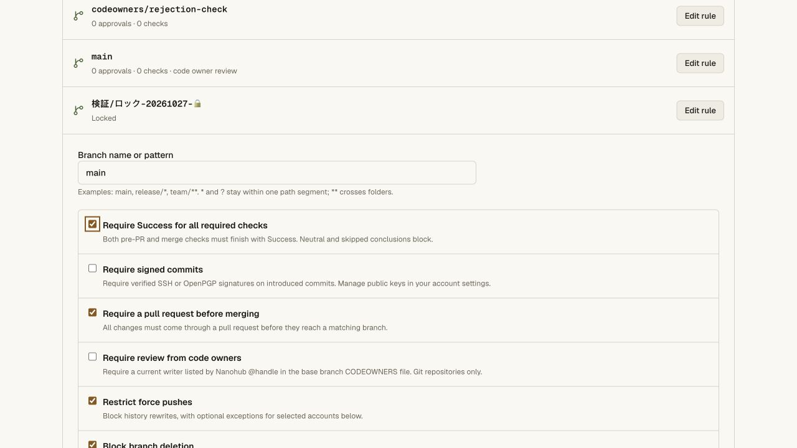

# Success-only required checks — 2026-10-27

The stricter [Meld acceptance](https://github.com/justrach/nanohubbies/issues/2)
requires skipped results to block landing. Branch protection now supports an
explicit `successOnlyChecks` option alongside the ordinary GitHub-compatible
default. See [the contract](../check-conclusions.md#success-only-migration-policy)
and [sanitized production receipt](success-only-checks-receipt.json).

## Verified behavior

- Only Success satisfies a named required check when strict mode applies.
  Neutral/skipped reports remain unchanged and block both pre-PR and merge
  gates. Ordinary policies retain their existing accepted conclusions.
- Matching protections combine with strict mode winning. A permissive exact
  rule cannot weaken another matching rule. Current settings are re-read at
  the final serialized writer; a prior preview supplies no permission.
- A new queued/running/non-successful attempt cannot inherit an earlier
  Success for the same SHA. Source pins and revocation still apply. Unknown or
  malformed reports cannot complete a run; stale callbacks are rejected.
- Omitting the field when replacing an existing strict policy is rejected by
  the gateway and final store. Explicit false remains an admin policy change.
  Conditional CLI deletion remains available through the existing flow.
- Both browser and CLI refuse new fields on an older receiver with retryable
  503; they never let an unaware writer silently discard the requirement.
  Once enabled, rollback must retain an aware enforcement build.

## Local gates

All **267 API unit tests**, **210 repository unit tests** and the complete real
Worker/Git acceptance chain pass. Five new unit cases cover all conclusions,
latest-attempt authority, boolean/overlap/omission behavior, current policy at
PR open and merge, and mixed-version reads/writes without downgrade.

The new isolated real Worker/Git test verifies strict pre-PR rejection, an
ordinary-mode opt-out, final merge after policy strengthening, queued/running
and failed reruns after same-SHA Success, rejected forged/stale/unknown reports,
current sources, direct and alternate-ref push refusal, standalone CLI full
export/edit with revision races, policy audit, restart, revocation and a final
successful merge followed by clone/fsck. No hosted credential is used.

The **39 CLI tests**, **28 hosting/pool tests**, namespace and access/vault
integration, pinned tsrs, production Next.js and Cloudflare OpenNext builds,
and `git diff --check` also pass. The portable 0.4.9 CLI already passes complete
policy JSON through unchanged, so its published bytes do not change.

## Production observations

Worker **7b1af261-899b-4870-94f1-c25cf25fc6e7** is deployed and reported by the
public version endpoint. The actual canary protection receiver advertises
`successOnlyCheckConclusions: true`. Before/after signed-in reads confirm all
three policies and protection revision 3, all six branch entries, main/default
settings revision 1, and all three rulesets at graph revision 6 remain identical.

The deployed editor renders the new option unchecked by default. Keyboard
interaction toggles it in an unsaved draft. The draft was cancelled, then the
protection API was re-read to confirm no policy was saved. No production
credential was issued and no production strict rule was enabled during this
validation. Positive enforcement tests use isolated real Workers. The vault
service, GitHub remotes and primary-repository selection remain unchanged.

Public CLI 0.4.9 still verifies as 49,938 bytes with SHA-256
`4cc9da686a99dc6d89d7c9dedb1afc9dbe2e633b9718ff33156caa6ed321db9a`.
Its downloaded version/help run outside the checkout; 0.4.8 retains its earlier
hash. This feature does not establish unattended hosted Actions, full staging
acceptance or production traffic capacity.
