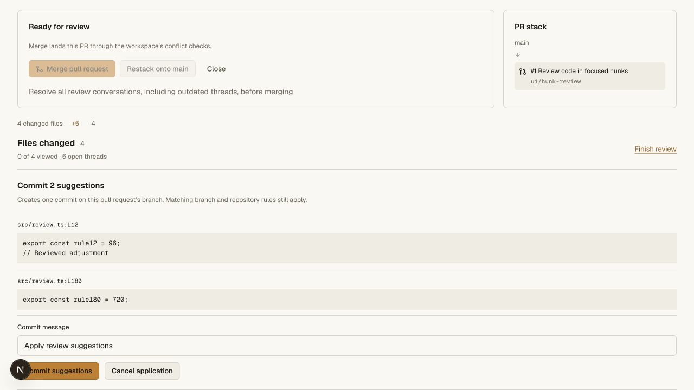
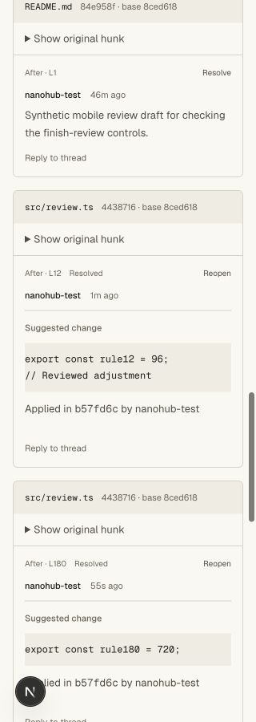
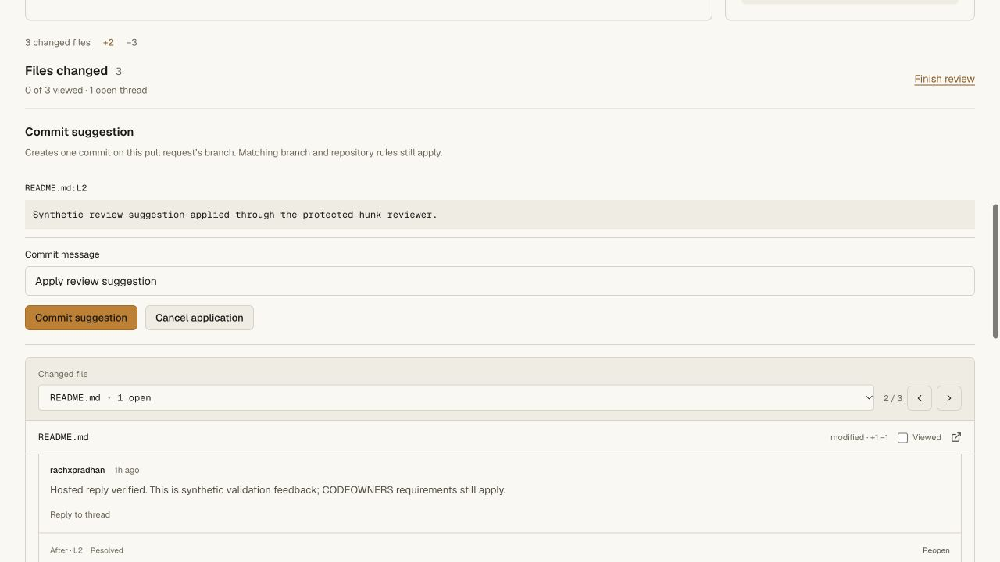
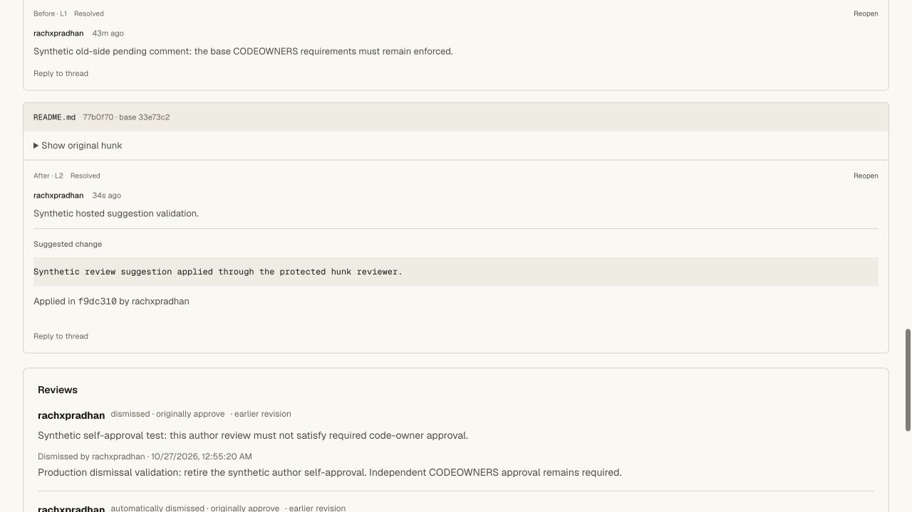
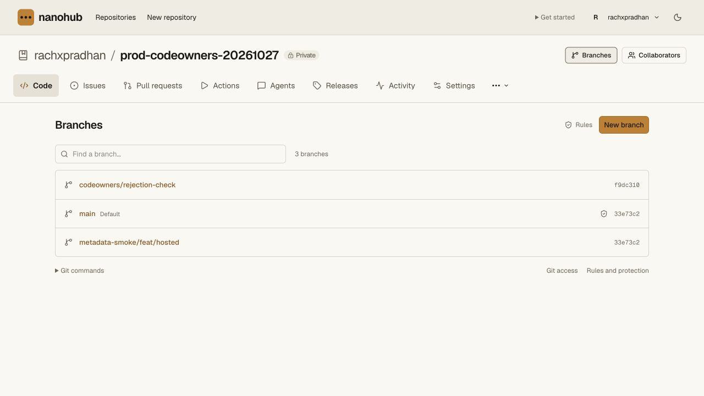

# Protected code suggestion validation

The native PR hunk reviewer supports suggested changes on selected after-side
lines. A reviewer can publish immediately or collect suggestions in a private
pending review. A writer can preview and commit one suggestion or a batch of up
to 50 non-overlapping roots across files.

## Enforcement

The server derives replacements from stored comments and constructs one commit
with the current PR source head as its parent. It validates exact current head,
comparison, visible hunk, side, range, regular UTF-8 file and fence syntax. It
preserves untouched Git object IDs and file modes, binary files, symlinks, Unicode
paths, line endings and final-newline style. Generated commits use pseudonymous
Nanohub account identities; other authors receive co-author trailers. They are
unsigned and claim no verified email.

The normal protected branch write path enforces locks, allowed pushers,
PR/check requirements, metadata and push rules. It also queues CI and dismisses
stale approvals when configured. The branch write, selected-root resolutions,
applied metadata and idempotency receipt share one serialized SQL transaction.
A late failure rolls everything back. Published but unreachable Git objects may
remain after rejected races; rejected refs never advance.

Only current signed-in human writers can apply, with same-origin enforcement
and a membership recheck before the transaction. Reader, agent, Git-only, CI and
mixed credentials cannot act as a human suggestion reviewer. Input cannot assert
the next tree, proof, replacement, author or independent-review status.

## Automated checks

Seven new unit cases cover fence parsing, deletion versus blank lines, nested
fences, line replacement, LF/CRLF and EOF behavior, UTF-8, graph reconstruction,
reverse-coordinate batch application, preservation of untouched objects and
modes, invalid/overlapping/stale selections, idempotency, final state checks and
late-failure atomic rollback.

The real Worker/Git/HTTP suite applies three disjoint suggestions, including an
insertion and a CRLF executable-file edit. It checks role/origin boundaries,
cross-PR and unknown-field rejection, duplicate IDs, replies, left-side ranges,
no-ops, overlap, locks, commit-message and restricted-path rules, exact retry,
changed-request rejection, already-applied roots, stale approval dismissal and
private-draft retention, queued CI, fresh independent review, protected merge
and clone/fsck. Binary, symlink, executable and Unicode objects remain intact.
Its synthetic Git credential is revoked during cleanup.

The full gate passes **94 unit tests and ten real Git/HTTP suites**. API, web and
vault tsrs checks and the OpenNext hosted build also pass. Commands:
`bun run test:repository`, `bun run check`, and
`bun x opennextjs-cloudflare build --config wrangler.deploy.jsonc` in `apps/web`.

## Browser checks

The existing local `hunk-review-ui` fixture received two suggestions in separate
`src/review.ts` hunks. **Suggest change** copied the selected current code into a
safe fence. Both published roots were added to a batch and previewed together.
One commit `b57fd6c3022eca809ee7992a42d86ce5f1710b96` changed the intended values
and inserted an explanatory line. Main stayed unchanged; both roots became
resolved with applied-commit metadata. Its previous independent approval was
automatically dismissed and four unrelated unresolved roots remained open.

Desktop and 320 CSS-pixel checks exposed and fixed a horizontal author-layout
rule leaking into suggestion previews. The corrected preview and applied
receipt fit the mobile page; viewport and document widths were both 320.
Temporary viewport overrides were reset and local test tabs closed.

## Hosted validation

Main Worker `1b3900d1-838e-4e25-8a59-9ff06bc2e3da` was deployed at 100% for this check.
Previous main version: `2fccd22e-4aba-44d8-8e37-3af358f093c9`. The private vault
version/bindings remain unchanged. Public `/api/agent-help` identifies the exact
new version; legacy `/install.sh` and `/download` return HTTP 200.

The signed-in owner used existing private canary
`rachxpradhan/prod-codeowners-20261027` PR #1. A synthetic README line-2 suggestion
was published as root `419618f8-7510-44ee-b96d-c4af57ba438d`, previewed, and applied
with subject **Apply synthetic production review suggestion**. The source head
advanced from `77b0f70` to `f9dc310`; the rendered diff contains the exact proposed
text. The root is resolved and records that applied commit and human actor.
The three previous resolved roots and four review records remain present.
Main remains `33e73c2`, as does the unrelated metadata smoke branch. Two base
CODEOWNERS groups still await independent approval and Merge remains disabled.

No production Git credential was created or reused. The production writes were
one clearly synthetic public-on-private-repo comment and one source-branch
commit; no policy, member, vault value or protected main ref was changed.

## Limits

No automatic reanchoring, reply application, left-side application, offset fence
syntax or binary editing. One plain complete suggestion fence per root, at most
201 selected lines, 1 MiB source/result files, up to 50 roots and a 200-character
one-line subject. The same source-branch requirements can intentionally prevent
application. Positive independent-review/multi-account policy tests run in the
local real Worker/Git suite; the hosted check uses the existing owner's account
and does not claim a second real reviewer. Full GitHub parity remains open work.
